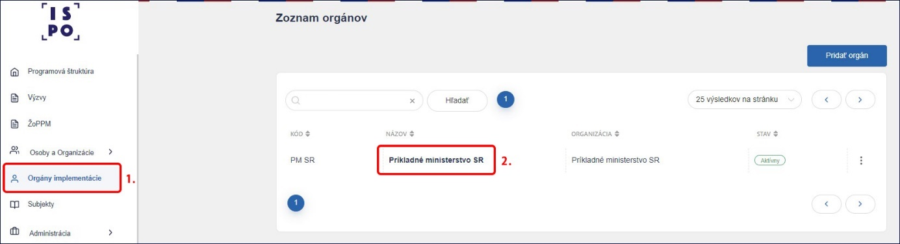
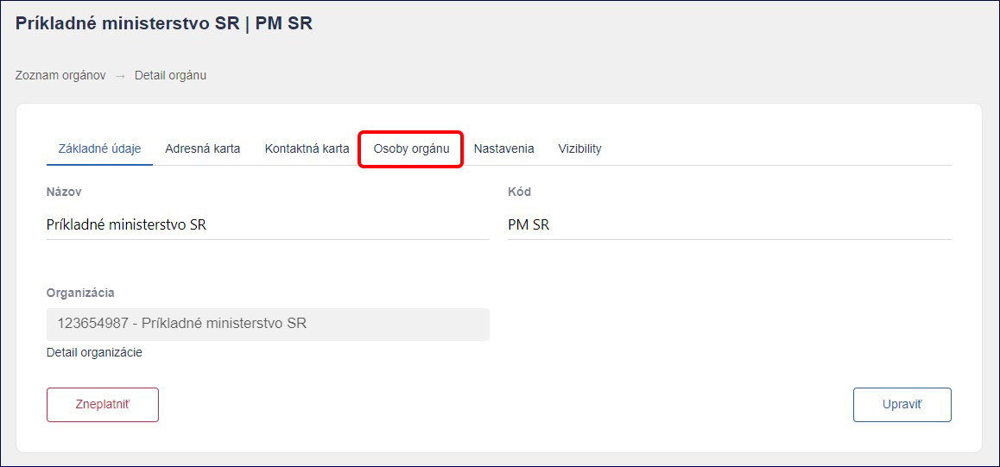
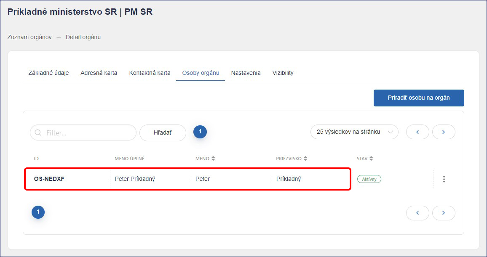
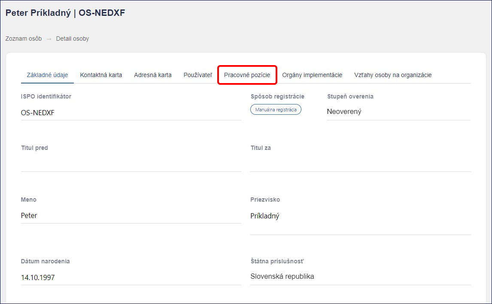
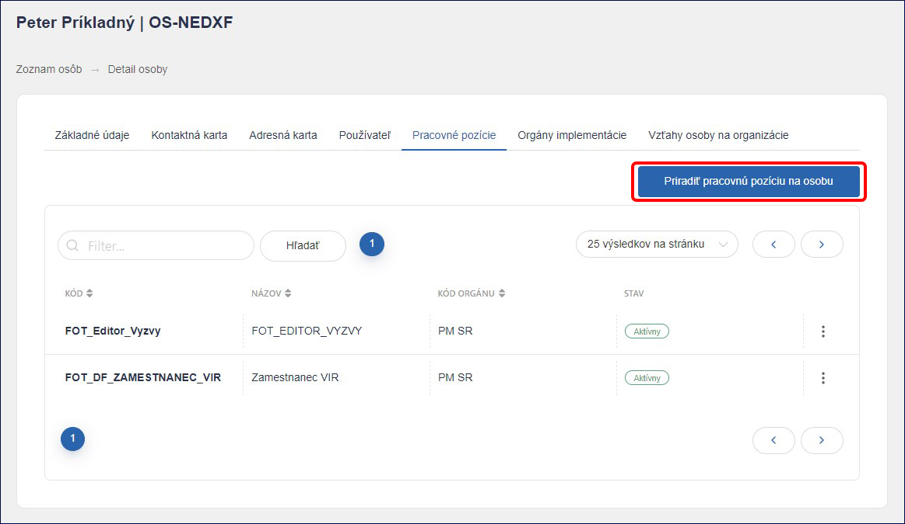
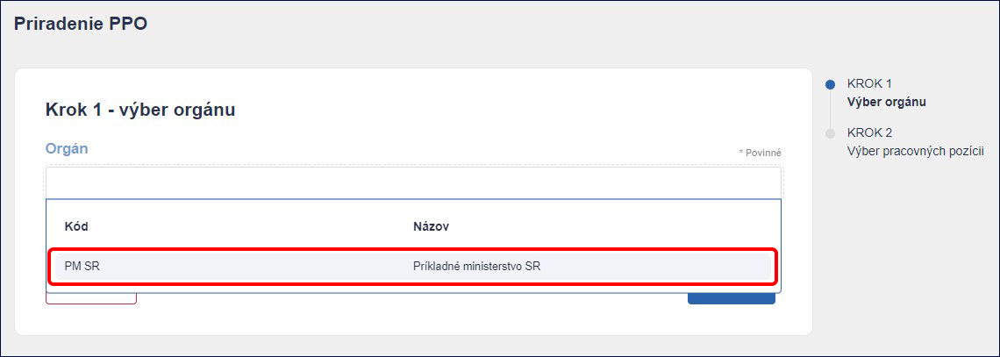
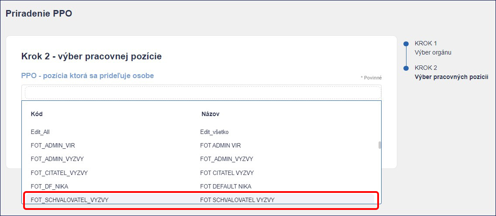
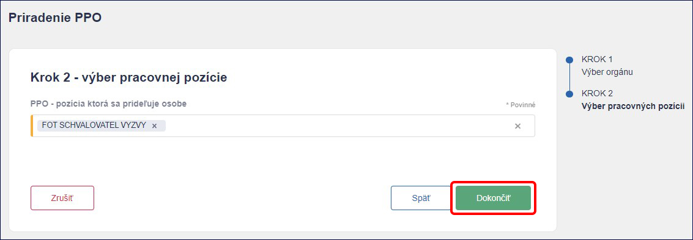
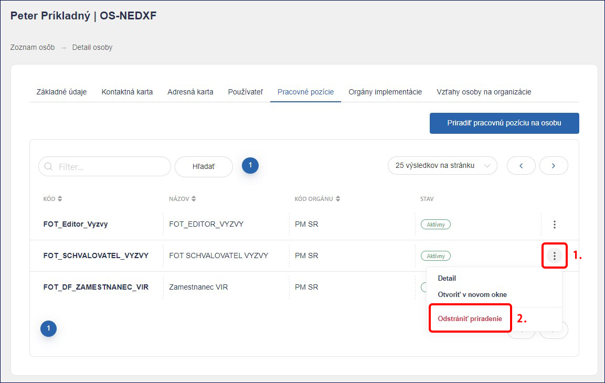

# 2. Pracovné pozície   

Administrácia výziev a žiadostí v ISPO si vyžaduje priradenie viacerých
pracovných pozícií. Pracovné pozície prideľuje administrátor
vykonávateľa **Admin VIR** ostatným zamestnancom registrovaným na
neverejnú časť ISPO na základe interných potrieb vykonávateľa. 

Aktuálne dostupné pracovné pozície v ISPO sú nasledovné:   

1)  **Čitateľ výzvy -** pracovná pozícia umožňuje nahliadnutie do výzvy,
    bez možnosti editácie.

2)  **Editor výzvy -** pracovná pozícia umožňuje vytvoriť a editovať
    výzvu. Danú pracovnú pozíciu odporúčame priradiť zamestnancovi,
    ktorý sa podieľa na príprave, vytvorení a editácii výzvy.

*Pozn. Pracovnú pozíciu „Editor výzvy“ odporúčame
<u>nepriraďovať</u> osobe spolu s pracovnou*  \
*pozíciou* „*Schvaľovateľ výzvy“ z dôvodu zachovania princípu kontroly
štyroch očí.*  

3)  **Schvaľovateľ výzvy -** pracovná pozícia umožňuje odoslanie výzvy
    na posúdenie NIKA (bez možnosti editácie výzvy). Danú pracovnú
    pozíciu odporúčame priradiť zamestnancovi, ktorý bude kontrolovať
    výzvu a následne ju odošle na posúdenie NIKA. Zároveň, ak NIKA vydá
    stanovisko “Na doplnenie”, Schvaľovateľ výzvy musí toto stanovisko
    najprv pomocou modrého tlačidla „Prevziať“, až následne môže Editor
    výzvy pokračovať v úprave.   

*Pozn. Pracovnú pozíciu *„*Schvaľovateľ výzvy“ odporúčame
<u>nepriraďovať</u> osobe spolu s pracovnou pozíciou „Editor výzvy“ z
dôvodu zachovania princípu kontroly štyroch očí.*  

4)  **Administrátor výzvy -** pracovná pozícia umožňuje zverejnenie,
    pozastavenie, uzatvorenie a zrušenie výzvy (bez možnosti editácie
    výzvy). Danú pracovnú pozíciu odporúčame priradiť zamestnancovi,
    ktorý bude výzvu zverejňovať po stanovisku
    NIKA.

5)  **Čitateľ ŽoPPM** - pracovná pozícia umožňuje prácu so žiadosťami o
    poskytnutie prostriedkov mechanizmu. Vďaka nej môžeme vidieť zoznam
    prijatých ŽoPPM, stiahnuť zjednodušený sumár žiadosti, stiahnuť
    kompletnú žiadosť aj s prílohami.

6)  **Editor registratúrneho záznamu** - pracovná pozícia umožňuje
    evidenciu prijatých sumárov ŽoPPM v ISPO, tzn. doplnenie čísla
    registratúrneho záznamu z registratúrneho systému VIR, čísla spisu,
    dátumu prijatia žiadosti v registratúre a dodatočnej referencie (v
    prípade potreby).

7)  **Spracovateľ dát** – pracovná pozícia, ktorá pomocou funkcie
    Datamart umožňuje prácu s údajmi o výzvach a žiadostiach
    vykonávateľa. Na základe tohto oprávnenia je užívateľ neverejnej
    časti oprávnený zobraziť si údaje v štruktúrovanej forme a
    zrealizovať export údajov z ISPO (vo formátoch html, csv, excel,
    obázok, pdf).

8)  **Monitorovací manažér VIR** – pracovná pozícia umožňuje funkciu
    Vkladania údajov, v ktorej dokážeme pridávať monitorovacie údaje do
    systému ISPO a zároveň ich editovať. Pomocou funkcie Reporting
    dokážeme monitorovacie údaje exportovať.

*Pozn. Pracovná pozícia „Spracovateľ dát“ a „Monitorovací manažér“
umožňuje <u>zobrazenie rodného čísla žiadateľa</u>. Z tohto dôvodu
odporúčame priradiť danú pozíciu zamestnancovi, ktorý je oprávnený
pracovať so žiadosťami, resp. osobnými údajmi žiadateľov.*

9)  **Priraďovateľ ŽOP** - pracovná pozícia umožňuje aktiváciu
    prijímania ŽoP cez Portál ISPO, nastavenie administrácie ŽoP
    a pridelenie používateľov k posudzovaniu ŽoP.

10) **Editor registratúrneho záznamu ŽOP** - pracovná pozícia umožňuje
    evidenciu prijatých žiadostí o platbu v ISPO, tzn. doplnenie čísla
    registratúrneho záznamu z registratúrneho systému VIR, čísla spisu,
    dátumu prijatia žiadosti v registratúre a dodatočnej referencie (v
    prípade potreby).

11) **Kontrolór úplnosti ŽOP** - pracovná pozícia umožňuje skontrolovať
    žiadosť o platbu, na ktorú bol používateľ priradený ako kontrolór
    úplnosti. Zároveň umožňuje vykonať priame doplnenie ŽoP alebo
    vyžiadať doplnenie žiadosti o platbu od žiadateľa.

12) **Administratívny finančný kontrolór ŽOP** - pracovná pozícia
    umožňuje skontrolovať žiadosť o platbu, na ktorú bol používateľ
    priradený ako finančný kontrolór na mieste a administratívny
    finančný kontrolór. Zároveň umožňuje vykonať priame doplnenie ŽoP
    alebo vyžiadať doplnenie od žiadateľa. Následne umožňuje žiadosť
    zamietnuť, schváliť, schváliť čiastočne alebo schváliť so zníženou
    sumou.

13) **Schvaľovateľ doplnenia ŽOP** – pracovná pozícia umožňuje schváliť
    odoslanie výzvy na doplnenie ŽoP a následne schváliť zapracovanie
    doplnenia ŽoP.

14) **Editor Projektu** **a** **ŽOP** - pracovná pozícia umožňuje
    vytvárať a editovať evidenčný projekt, internú žiadosť o platbu
    a internú monitorovaciu správu. Zároveň umožňuje editáciu projektov
    z priameho vyzvania.

15) **Priraďovateľ ŽoPPM** - pracovná pozícia umožňuje priraďovať
    používateľov s pracovnou pozíciou posudzovateľ, hodnotiteľ, arbiter
    a zazmluvniteľ na konkrétnu ŽoPPM.

16) **Posudzovateľ ŽoPPM** - pracovná pozícia umožňuje náhľad detailu
    celej ŽoPPM vrátane príloh. Zároveň umožňuje zaevidovať úvodnú
    kontrolu ŽoPPM, nahrať kontrolný zoznam, vyhodnotiť referenčné
    registre, pozrieť si stanovisko hodnotiteľov a zaevidovať výsledky
    posudzovania. Umožňuje tiež priame doplnenie ŽoPPM alebo vyžiadať
    doplnenie od žiadateľa.

17) **Hodnotiteľ ŽoPPM** - pracovná pozícia umožňuje náhľad detailu
    celej ŽoPPM vrátane príloh. Umožňuje tiež nahrať kontrolný zoznam,
    vyhodnotiť referenčné registre a zaevidovať výsledky hodnotenia
    ŽoPPM.

18) **Arbiter** - pracovná pozícia umožňuje náhľad detailu celej ŽoPPM
    vrátane príloh. Umožňuje tiež skontrolovať stanovisko všetkých
    hodnotiteľov a posudzovateľov, skontrolovať kontrolné zoznamy,
    referenčné registre. Zároveň umožňuje ŽoPPM schváliť, zamietnuť
    alebo vrátiť do posudzovania.

19) **Zazmluvniteľ** - pracovná pozícia umožňuje náhľad detailu celej
    ŽoPPM vrátane príloh. Zároveň umožňuje skontrolovať stanovisko
    všetkých hodnotiteľov, posudzovateľov a arbitra, skontrolovať
    kontrolné zoznamy, referenčné registre. Umožňuje tiež nahrať údaje
    zo zmluvy a projekt zazmluvniť.

20) **Editor doplnenia ŽoPPM/Projektu** - pracovná pozícia umožňuje
    priame doplnenie ŽoPPM/projektu alebo vyžiadať doplnenie od
    žiadateľa/prijímateľa a zapracovať ho.

21) **Čitateľ doplnenia ŽoPPM/Projektu** - pracovná pozícia umožňuje
    náhľad doplnenia ŽoPPM/projektu.

22) **Čitateľ SPIS** - pracovná pozícia umožňuje prezerať spisovú zložku
    konkrétneho orgánu.

23) **Editor SPIS** - pracovná pozícia umožňuje prezerať a nahrávať
    dokumenty do spisovej zložky konkrétneho orgánu.

**Upozornenie!** *Pracovné pozície je možné vzájomne kombinovať. Za
správne pridelenie pracovných pozícií na úrovni vykonávateľa zodpovedá
Admin VIR.*

## 2.1) Priradenie pracovnej pozície (návod pre Admina VIR)

Pre priraďovanie a odoberanie pracovných pozícií v ISPO potrebujeme
pracovnú pozíciou **Admin VIR** (prideľuje Centrum podpory ISPO na
základe žiadosti o registráciu, ktorá je podpísaná štatutárom daného
vykonávateľa).

2.1.1) Po prihlásení do systému v ľavom paneli vyberieme sekciu **Orgány
implementácie** a klikneme na orgán, pod ktorým sme prihlásení (vzorovo:
Príkladné ministerstvo SR).  

2.1.2) Zobrazí sa detail orgánu, v ktorom klikneme na záložku **Osoby
orgánu**.

2.1.3) V zozname sa zobrazia všetky osoby priradené k danému orgánu.
Vyberieme si **osobu**, ktorej chceme prideliť pracovnú pozíciu
(vzorovo: Peter Príkladný).

2.1.4) Zobrazí sa profil danej osoby. Následne klikneme na záložku
**Pracovné pozície**.

2.1.5) V zozname sa zobrazia aktuálne pracovné pozície priradené danej
osobe. Klikneme na tlačidlo **Priradiť pracovnú pozíciu na osobu**.

2.1.6) Priraďovanie pracovnej pozície zahŕňa dva kroky. V prvom kroku
vyberieme zo zoznamu príslušný **orgán**,\
pod ktorým zamestnanec pracuje. Po výbere orgánu klikneme na tlačidlo
**Ďalej**.

2.1.7) V druhom kroku vyberieme zo zoznamu relevantnú pracovnú pozíciu,
ktorá prislúcha danému zamestnancovi (vzorovo: pracovná pozícia s názvom
„Schvaľovateľ výzvy“). Zamestnanec môže mať priradených viac pracovných
pozícií.

2.1.8) Proces priraďovania pracovnej pozície dokončíme kliknutím na
tlačidlo **Dokončiť**. V prípade, že sme omylom zvolili nesprávnu
pracovnú pozíciu, môžeme ju pred dokončením vymazať pomocou krížika
nachádzajúceho sa vedľa názvu pozície a zo zoznamu si vybrať požadovanú
pracovnú pozíciu. Zo zoznamu môžeme vybrať viac pracovných pozícií
naraz.

2.1.9) Po úspešnom priradení pracovnej pozície sa opäť zobrazí profil
danej osoby a zároveň sa v pravom dolnom rohu zobrazí informácia „**PPO
úspešne priradená k osobe**“. Úspešné priradenie pracovnej pozície
môžeme overiť opätovným kliknutím na záložku **Pracovné pozície**, kde
by sa mala relevantná pozícia zobraziť v stave **Aktívny**. Ak chceme
osobe pracovnú odobrať, klikneme na tlačidlo **Tri bodky** vedľa
pracovnej pozície a klikneme na možnosť **Odstrániť priradenie.**

