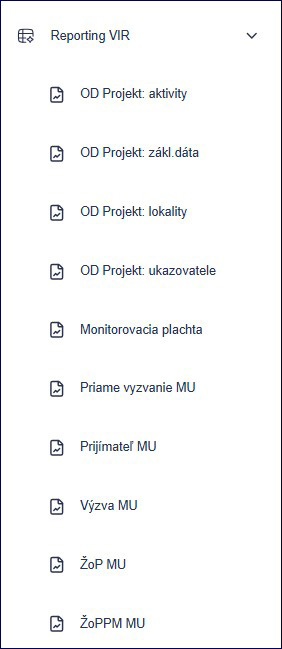
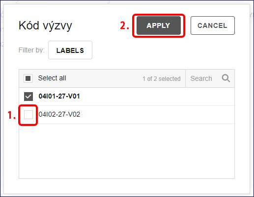
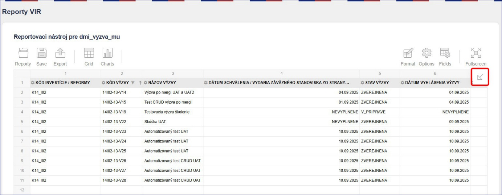
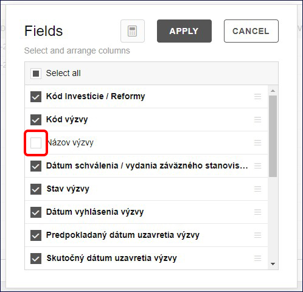
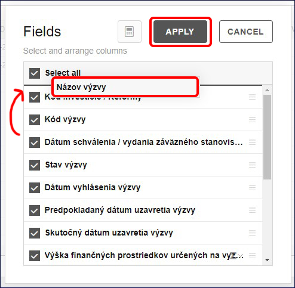
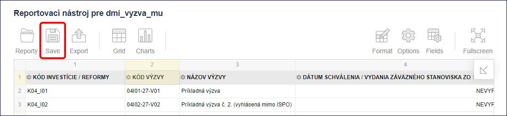
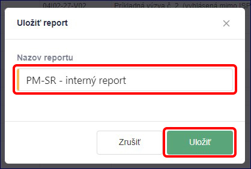
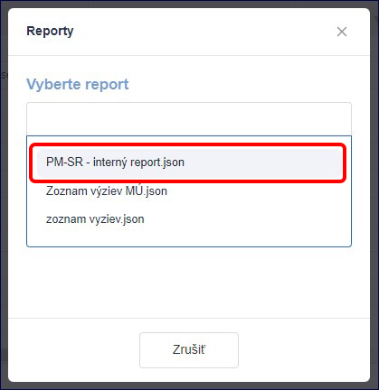
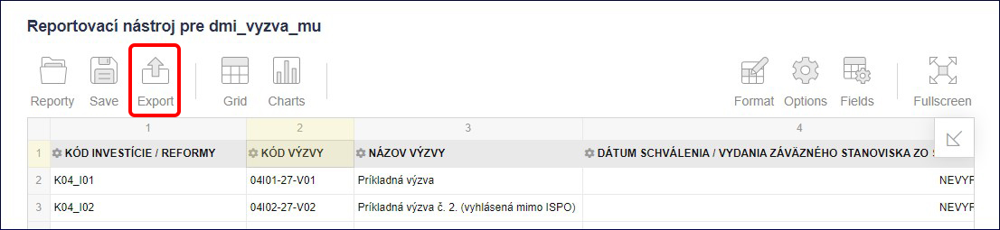

# 9. Reporting - Datamart

Pre používanie funkcie Datamart (reporting), ktorá umožňuje prácu s
údajmi v ISPO, potrebujeme mať priradenú pracovnú pozíciu **Spracovateľ
dát** alebo **Monitorovací manažér VIR**. Na základe týchto oprávnení
môžeme sledovať a exportovať monitorovacie údaje odvíjajúce sa od
programovej štruktúry. Reporitng generuje systémové dáta a kopíruje
zoznamy a zber údajov podľa ***Prílohy SIPOO č. 5.1 - 2 Vzor
monitorovacích údajov***.

Po pridaní pracovnej pozície **Spracovateľ dát** alebo **Monitorovací
manažér VIR** klikneme na záložku **Reporting VIR**. Následne sa
zobrazia nasledujúce záložky:

- ***Priame vyzvania MU*** -\> Zoznam priamych vyzvaní (monitorovacie
  údaje)

- ***Prijímateľ MU*** -\> Zoznam prijímateľov (monitorovacie údaje)

- ***Výzva MU*** -\> Zoznam výziev (monitorovacie údaje)

- ***ŽoP MU*** -\> Zoznam ŽoP (monitorovacie údaje)

- ***ŽoPPM MU*** -\> Zoznam ŽoPPM (monitorovacie údaje)

- ***OD Projekt: aktivity***

- ***OD Projekt: zákl. dáta***

- ***OD Projekt: lokality***

- ***OD Projekt: ukazovatele***

9.1) Zobrazenie dát\
--------------------

9.1.1) Klikneme na záložku **Výzva MU**. Zobrazí sa zoznam všetkých
výziev priradených na orgán, pod ktorým pracujeme.

9.1.2) Kliknutím na šípku v konkrétnom stĺpci, napríklad v stĺpci **Kód
výzvy**, môžeme zoradiť riadky podľa poradia.

Kliknutím na názov konkrétneho stĺpca, napríklad stĺpca **Kód výzvy**,
môžeme filtrovať, ktoré výzvy chceme v tabuľke zobraziť. Klikneme na
názov stĺpca a vo filtri odklikneme zaškrtávacie políčko pri údajoch,
ktoré nechceme zobraziť. Potvrdíme kliknutím na tlačidlo **Apply**.

9.1.3) V prípade, že chceme zobrazovať iné poradie stĺpcov alebo
niektoré stĺpce nezobrazovať, klikneme na znak **šípky** v pravom hornom
rohu tabuľky.

Odklikneme zaškrtávacie políčko údajov, ktoré nechceme zobraziť.
Podržaním ľavého tlačidla myši na názve dokážeme presunúť názov stĺpca
na poradie aké potrebujeme. Následne potvrdíme kliknutím na tlačidlo
**Apply**.

9.1.4) Kliknutím na tlačidlo **Fullscreen** môžeme report zobraziť na
celú obrazovku.

9.1.5) Takto nastavený report môžeme uložiť pomocou tlačidla **Save**,
aby sme ho do budúcna nemuseli nastavovať znova. Ako názov ukladaného
reportu odporúčame uviesť skratku vykonávateľa a názov toho, čo
reportujeme. Napríklad ***PM-SR Interný report***. Potvrdíme kliknutím
na tlačidlo **Uložiť**.

Takto uložený report nájdeme v zozname reportov.

9.1.6) Kliknutím na tlačidlo **Export** môžeme report exportovať do
rôznych súborov alebo vytlačiť.

9.1.7) Datamart obsahuje aj ďalšie funkcie ako tvorenie rôznych grafov,
či iné zobrazovanie dát. Takéto funkcionality môžeme pozrieť
v originálnom manuáli pre aplikáciu Flexmonster na stránke
<https://www.flexmonster.com/doc/admin-panel-guide/> alebo na youtube
kanáli <https://www.youtube.com/@FlexMonsterPivot> .