# 4. Žiadosť o poskytnutie prostriedkov mechanizmu

Žiadosti o poskytnutie prostriedkov mechanizmu (ďalej len ŽoPPM) podané
cez Portál ISPO môžeme na neverejnej časti ISPO vidieť s pridelenou
pracovnou pozíciou **Čitateľ ŽoPPM**, v ľavom paneli v záložke **ŽoPPM -
Všetky ŽoPPM**.

Po kliknutí na záložku ŽoPPM vidíme zoznam žiadostí podaných na výzvy.
Na vyhľadávanie žiadostí slúži filter, v ktorom môžeme hľadať na základe
*kódu výzvy*, *kódu žiadosti* či *názvu žiadateľa*. Filtrovať môžeme aj
pomocou evidencie stavov žiadostí.

Pri konkrétnej žiadosti môžeme vidieť *kód, názov žiadateľa, dátum
vytvorenia, dátum a čas zaevidovania v ISPO, stav* a *mód spracovania.*

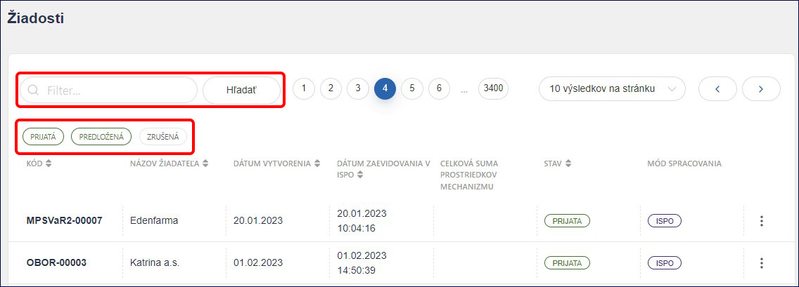

Mód spracovania žiadostí prijatých cez Portál ISPO je ***ISPO***.
V záložke ŽoPPM môžeme vidieť aj žiadosti, ktoré boli do systému vložené
cez funkcionalitu *Vkladanie údajov* (**kapitola 8**) alebo boli
importované podľa prílohy *SIPOO č. 5.1 - 2 Vzor monitorovacích údajov.*
Takéto žiadosti majú mód spracovania ***Import***.

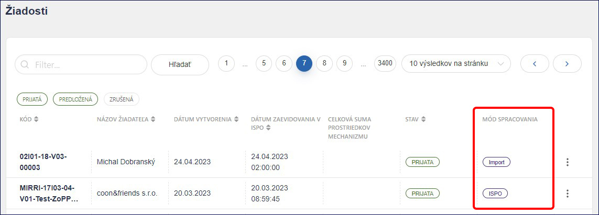

## 4.1) Stiahnutie ŽoPPM

Ak chceme konkrétnu žiadosť stiahnuť, pri danej žiadosti klikneme na
tlačidlo **Tri bodky**. Stiahnuť môžeme *Sumár žiadosti PDF* alebo
*Úplnú žiadosť aj s prílohami*. Úplná žiadosť aj s prílohami je súbor vo
formáte ZIP, ktorý obsahuje *Sumár žiadosti* *PDF, Úplnú žiadosť vo
formáte PDF*, *Úplnú žiadosť vo formáte JSON* a všetky prílohy, ktoré
žiadateľ do žiadosti nahral cez Portál ISPO.

## 4.2) Registratúrny záznam ŽoPPM

Ak žiadateľ zaeviduje žiadosť prostredníctvom Portálu ISPO, žiadosť je
automaticky v stave **Prijatá**. Ak ku žiadosti vytvoríme registratúrny
záznam, stav žiadosti sa automaticky zmení do stavu **Predložená**.

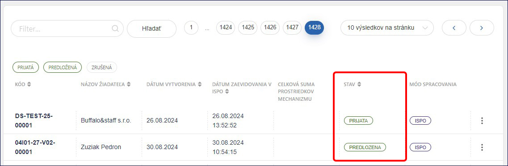

Registratúrny záznam vytvárame vtedy, ak sme prijali žiadateľom
podpísaný Sumár žiadosti PDF v elektronickej alebo listinnej podobe. Pre
vytvorenie registratúrneho záznamu potrebujeme mať priradenú pracovnú
pozíciu **Editor registratúrneho záznamu**. Na obrazovku registratúrneho
záznamu sa môžeme dostať dvoma spôsobmi:\
skratkou kliknutím na tlačidlo **Tri bodky** vpravo, kde vyberieme
možnosť **Registratúrny záznam**,

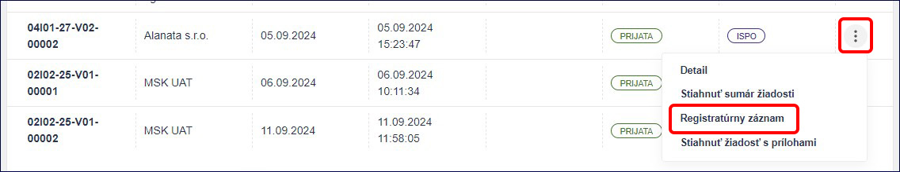

alebo kliknutím na konkrétnu žiadosť, v ktorej detaile klikneme na
záložku **Registratúrny záznam**.

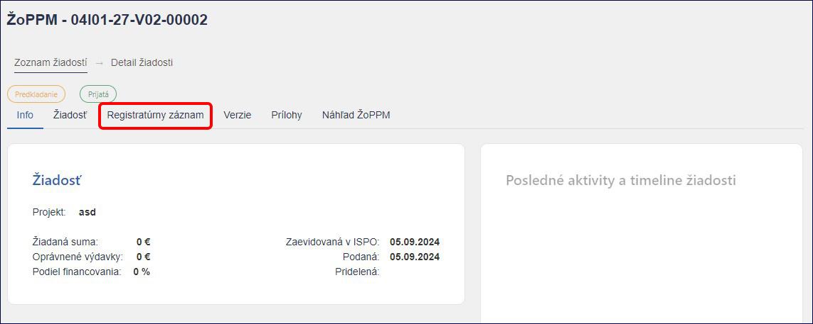

V záložke **Registratúrny záznam** klikneme na tlačidlo **Zaevidovať**.

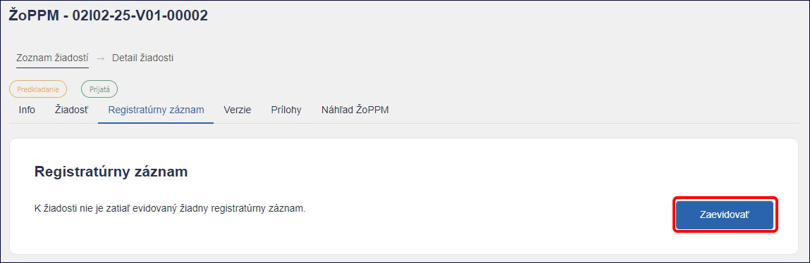

Vyplníme údaje ako ***Spisová značka,*** ***Dátum prijatia, Číslo
registratúrneho záznamu*** a ***Link na RZ v registratúre*** a klikneme
na tlačidlo **Uložiť**.

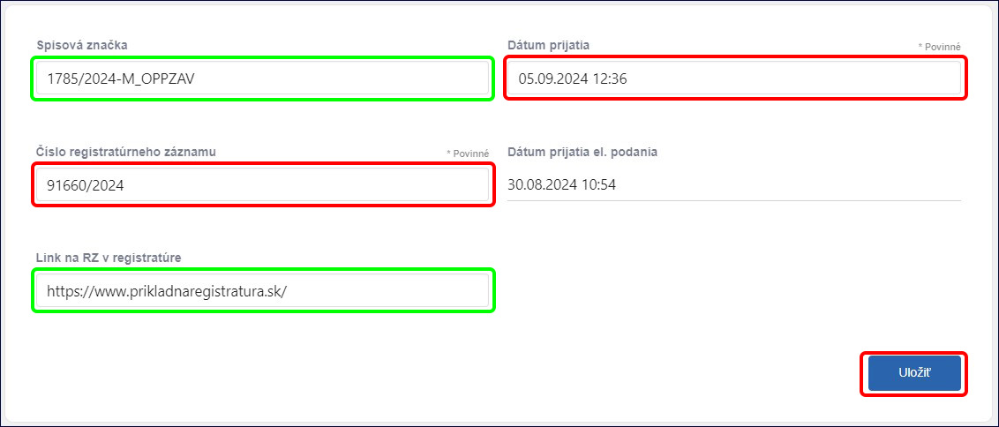

Po zaevidovaní registratúrneho záznamu sa zmení stav žiadosti z
**Prijatá** na **Predložená**.

## 4.3) Detail ŽoPPM

Keď v zozname ŽoPPM klikneme na konkrétnu žiadosť, otvorí sa detail
tejto žiadosti.

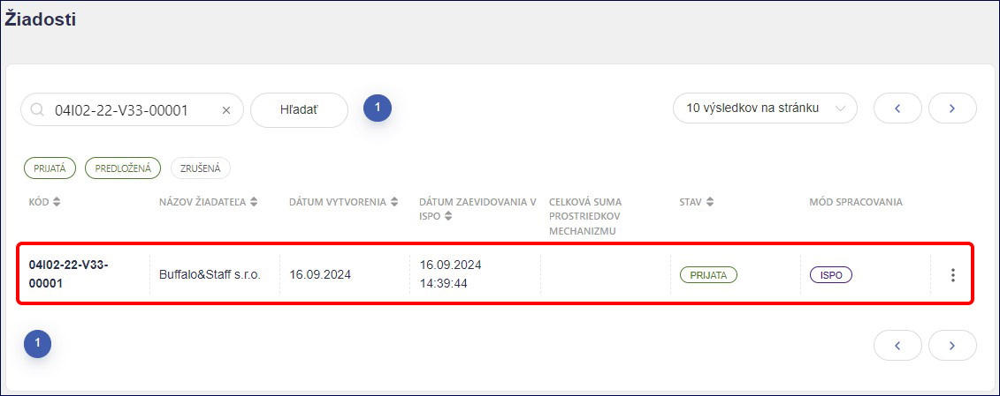

V detaile žiadosti môžeme vidieť *kód* a *stav žiadosti*. Detail
žiadosti je rozdelený do šiestich záložiek. V prvej záložke ***Info***
sa nachádzajú základné údaje o žiadateľovi a o žiadosti, ako *názov
projektu*, *požadovanú sumu*, *oprávnené výdavky* a *dátum zaevidovania
v ISPO*.

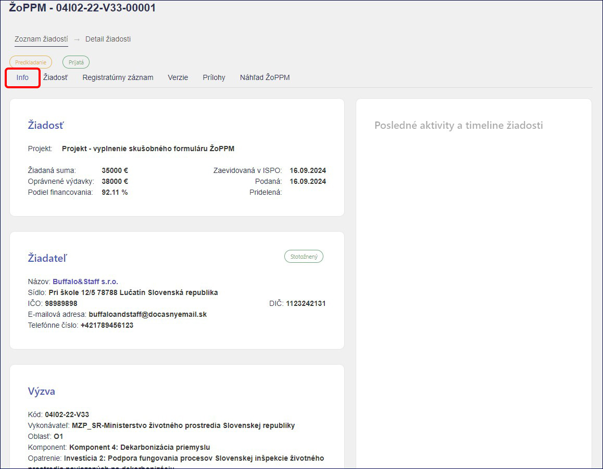

V záložke **Žiadosť** je ŽoPPM rozdelená do sekcií, v závislosti od
konfigurácie a formulára ŽoPPM, podľa podkapitoly **3.3)**.

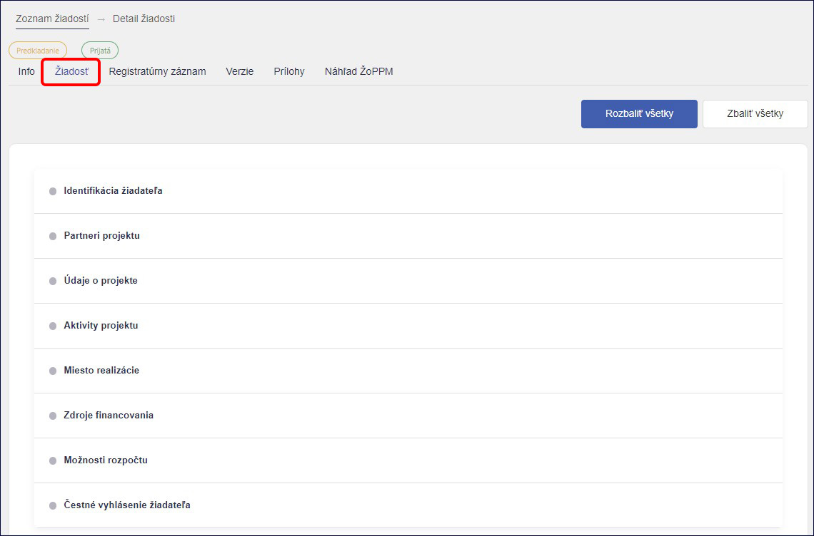

Kliknutím na konkrétnu sekciu, napr. ***Aktivity projektu***, sa
rozbalia údaje, ktoré v nej žiadateľ vyplnil.

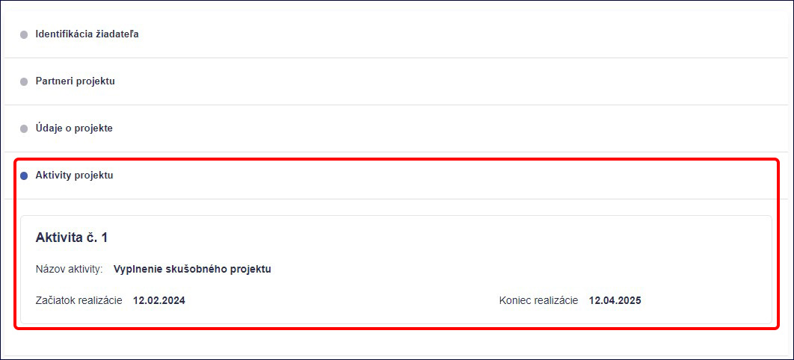

V záložke **Prílohy** sa prehľadne nachádzajú všetky súbory a dokumenty,
ktoré žiadateľ v jednotlivých krokoch formulára ŽoPPM priložil. Záložka
slúži pre lepší prehľad a sťahovanie dokumentov.

V záložke **Náhľad ŽoPPM** môžeme vidieť úplný prehľad žiadosti so
všetkými údajmi a prílohami tak, ako ich uviedol žiadateľ na Portáli
ISPO.

## 4.4) Posudzovanie ŽoPPM cez ISPO

Posudzovanie ŽoPPM začína **nastavením posudzovania ŽoPPM** a pridelením
spracovateľov ŽoPPM na výzve podľa podkapitoly **3.7)**.

4.4.1) Po prijatí ŽoPPM cez Portál ISPO a následnom prijatí podpísaného
sumára ŽoPPM, s pracovnou pozíciou **Editor registratúrneho záznamu**
vytvoríme registratúrny záznam podľa podkapitoly **4.2)**. Po uložení sa
zmení stav žiadosti z **Prijatá** na **Predložená**.

4.4.2) S pracovnou pozíciou **Priraďovateľ ŽoPPM** uvidíme túto ŽoPPM
v zozname **ŽoPPM** - **Čakajúce na priradenie** na poslednom mieste
v zozname. Klikneme na žiadosť.

**Upozornenie**! *Pracovnú pozíciu **Priraďovateľ ŽoPPM** odporúčame
prideliť vedúcemu pracovníkovi.*

V žiadosti sa preklikneme na záložku **Posudzovanie** a klikneme na
tlačidlo **Priradiť spracovateľov**.

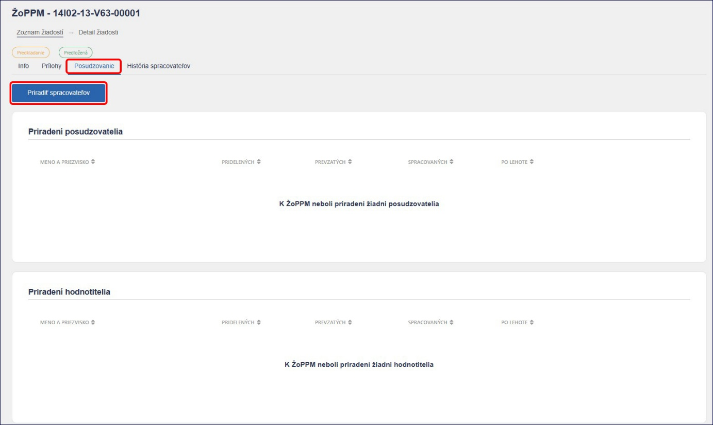

Zobrazí sa obrazovka pre priraďovanie osôb do jednotlivých pozícií
spracovateľov ŽoPPM, ako posudzovatelia, hodnotitelia, arbitri
a zazmluvnitelia. Zároveň sa zobrazí zoznam osôb, ktoré boli pre
jednotlivé pozície priradené na výzve podľa podkapitoly **3.7)**.

Ak v zozname vidíme osoby, pridelíme tie, ktoré chceme aby boli
posudzovateľmi pre danú ŽoPPM a to kliknutím na tlačidlo **Prideliť**
pri osobe.

*Príklad*: *Chceme, aby bol pre danú ŽoPPM posudzovateľom Peter
Príkladný. Pri jeho mene klikneme na tlačidlo **Prideliť**.*

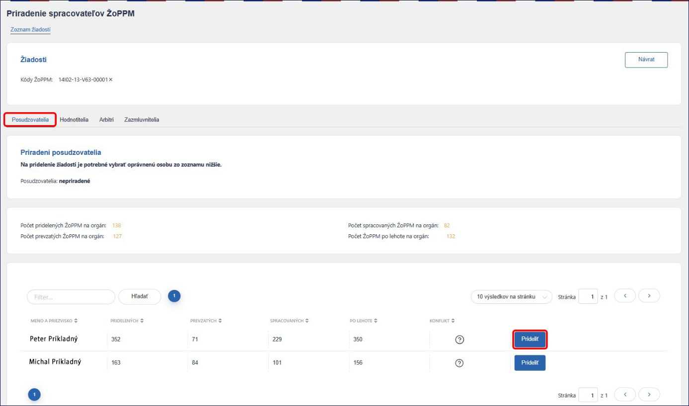

Ak chceme osobu odobrať, klikneme na tlačidlo **Odobrať**.

Ak chceme naraz prideliť všetky osoby v zozname, klikneme na tlačidlo
**Prideliť všetkých posudzovateľov**.

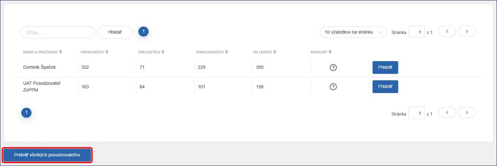

Následne sa preklikneme do záložky Hodnotitelia, Arbitri
a Zazmluvnitelia a opakujeme proces pridelenia osôb.

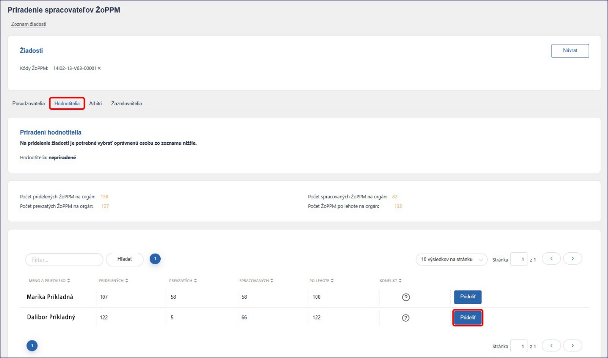

4.4.3) Počas prideľovania osôb na konkrétnu ŽoPPM nám pomáha aj model
konfliktu záujmov. V zozname osôb sa nachádza stĺpec **KONFLIKT**, ktorý
nám pomocou ikon napovedá, či je daná osoba v potenciálnom konflikte
záujmov so žiadateľom alebo nie.

Ikona **šedého otáznika** znamená, že systém ISPO nedokázal z dostupných
údajov o zamestnancovi a žiadateľovi vyhodnotiť konflikt záujmov
a odporúčame možný konflikt overiť mimo systému ISPO.

Ikona **zelenej fajky** znamená, že systém ISPO z dostupných údajov
o zamestnancovi a žiadateľovi nezistil konflikt záujmov a takúto osobu
môžeme bezpečne prideliť.

Ikona **červeného výkričníka** znamená, že na základe dostupných údajov
o zamestnancovi a žiadateľovi, systém vyhodnotil potenciálny konflikt
záujmov. Ak presunieme kurzor myši na ikonu výkričníka, ukáže sa text
s opisom potenciálneho konfliktu záujmov. Potenciálny konflikt záujmov
preveríme aj mimo ISPO. Takúto osobu môžeme prideliť na ŽoPPM, avšak
musíme uviesť dôvod, prečo sme osobu s potenciálnym konfliktom záujmov
priradili na danú ŽoPPM.

*Príklad: Ak chceme na ŽoPPM prideliť zamestnanca Petra Príkladného,
systém na základe informácií o ňom a žiadateľovi nedokázal vyhodnotiť
konflikt záujmov a možný konflikt overíme mimo ISPO. Ak chceme prideliť
zamestnanca Michala Príkladného, systém vyhodnotil, že nie je
v konflikte záujmov so žiadateľom a môžeme ho prideliť. Ak chceme
prideliť zamestnankyňu Mariku Príkladnú, systém vyhodnotil potenciálny
konflikt záujmov. Ak prejdeme kurzorom myši nad ikonu výkričníka, systém
nám vypíše, kde bol potenciálny konflikt záujmov zistený a je potrebné
zvážiť pridanie tejto osoby ako spracovateľa danej ŽoPPM.*

4.4.4) Ak sme boli na konkrétnu ŽoPPM priradení ako posudzovateľ,
nájdeme ju v zozname **ŽoPPM – Čakajúce na posúdenie.**

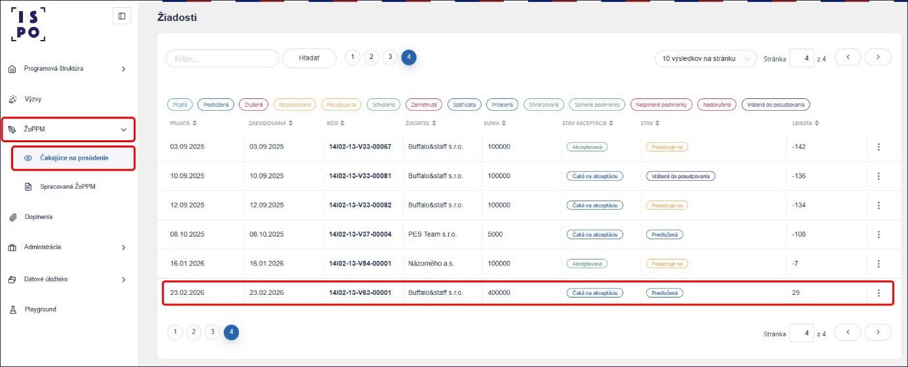

Po kliknutí na ŽoPPM v záložke **Posudzovanie** najskôr akceptujeme
alebo zamietneme naše pridelenie na danú ŽoPPM. Klikneme na tlačidlo
**Prebrať posudzovateľom.**

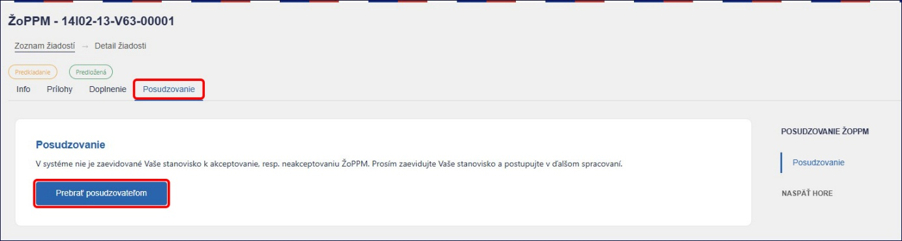

Zo zoznamu vyberieme možnosť **Akceptujem – preberám do posudzovania**
alebo **Neakceptujem – vrátiť na pridelenie inému posudzovateľovi**
a klikneme na tlačidlo **Potvrdiť**.

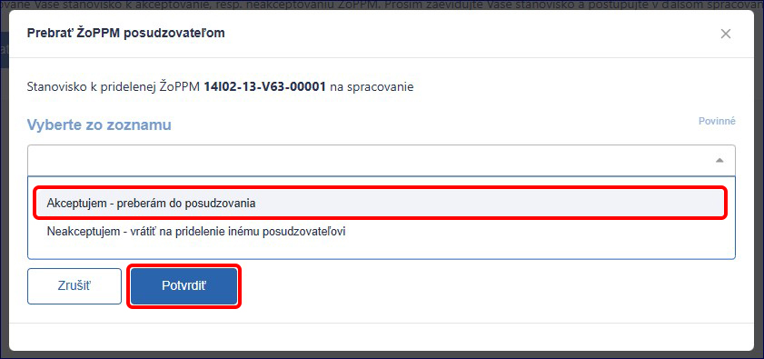

Ak sme pridelenie akceptovali, otvoria sa ďalšie záložky, ktoré nám
umožnia vidieť detailné údaje ŽoPPM, ktorú si môžeme stiahnuť podľa
podkapitoly **4.1)** alebo si pozrieť si jej detaily podľa podkapitoly
**4.3)**.

Ak sme prvým posudzovateľom na danej ŽoPPM, v záložke **Posudzovanie**
klikneme na tlačidlo **Zaevidovať úvodnú kontrolu**. V prípade ak toto
tlačidlo zaklikol iný posudzovateľ s rolou posudzovateľa na danej ŽoPPM,
nebude už k dispozícii.

V záložke Kontrolné zoznamy si stiahneme vzor kontrolného zoznamu pre
posudzovateľa, ktorý bol nahratý vo výzve v podkapitole **3.7)**.
Kontrolný zoznam vypĺňame mimo ISPO a nahráme ho v záverečnom stanovisku
posudzovateľa.

**Poznámka:** *V prípade, že v ktorejkoľvek fáze posudzovania
identifikujeme nedostatky alebo chýbajúce informácie v ŽoPPM, môžeme
využiť funkcionalitu **Doplnenie ŽoPPM**, ktoré opisujeme v podkapitole
**4.5)**.*

V záložke referenčné registre nájdeme zoznam registrov tak, ako sme ich
nastavili na výzve v podkapitole **3.7)**. Kliknutím na konkrétny
register napr. **Zoznam daňových subjektov registrovaných pre DPH** sa
dostaneme do jeho detailu.

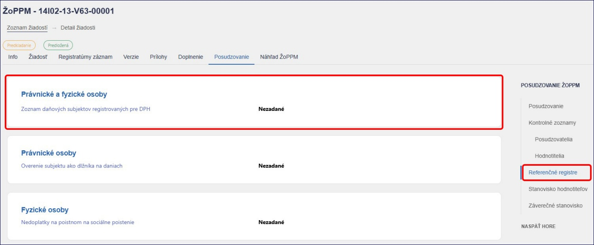

Následne klikneme na tlačidlo **Zaevidovať údaje.**

Vyplníme všetky povinné polia, ako **Stav vyhodnotenia údajov**, **Zdroj
údajov** a **Podklad, na základe ktorého boli údaje uložené.** Po
vyplnení polí klikneme na tlačidlo **Uložiť**.

Po uložení sa zobrazí možnosť pre nahratie prílohy. Ak nahráme prílohu,
nahratie potvrdíme opätovným kliknutím na tlačidlo **Uložiť**. Ak
prílohu nenahráme, klikneme na tlačidlo **Návrat**.

Po vyplnení a uložení údajov k referenčnému registru môžeme tieto údaje
upraviť, vymazať alebo kliknutím na tlačidlo **Návrat** sa dostaneme
späť na zoznam všetkých referenčných registrov.

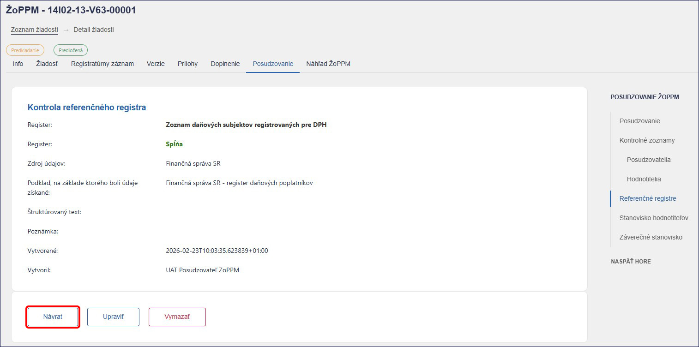

V časti **Stanovisko hodnotiteľov** môžeme pozrieť detail stanoviska
všetkých hodnotiteľov.

Kliknutím na tlačidlo **Detail** sa zobrazia údaje zadané daným
hodnotiteľom, ako aj príloha kontrolného zoznamu hodnotiteľa.

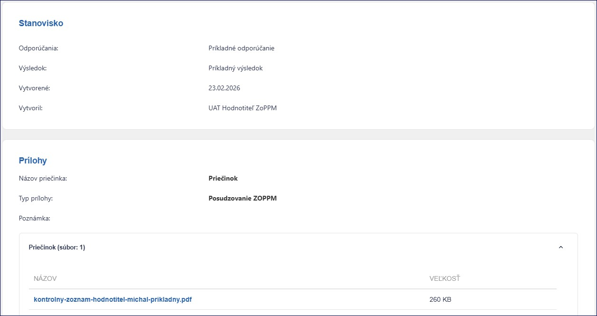

Záverečným krokom posudzovateľa je zaevidovanie **Záverečného
stanoviska**. Ak je na ŽoPPM priradených viac posudzovateľov, do systému
sa nahráva jedno finálne stanovisko za všetkých posudzovateľov. Klikneme
na tlačidlo **Zaevidovať záverečné stanovisko**.

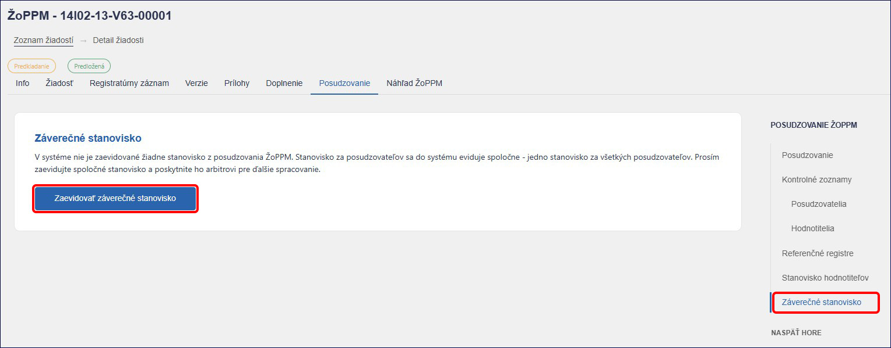

Vyplníme povinné polia ako **Proces hodnotenia**, **Odporúčania**
a **Výsledok.** Klikneme na tlačidlo **Uložiť**.

Po uložení sa sprístupní možnosť pre nahratie prílohy. Nahráme vyplnený
kontrolný zoznam posudzovateľa. V prípade, že bolo posudzovateľov viac,
nahráme všetky kontrolné zoznamy za každého posudzovateľa. Nahratie
potvrdíme opätovným kliknutím na tlačidlo **Uložiť**.

Po uložení a zaevidovaní záverečného stanoviska posudzovateľa ho môžeme
ešte upraviť, vymazať alebo pokračovať postúpením ŽoPPM na arbitra. Ak
chceme prácu posudzovateľa dokončiť, klikneme na tlačidlo **Postúpiť na
arbitra**.

**Upozornenie!** *Pokiaľ nebolo odkliknuté tlačidlo **Zaevidovať úvodnú
kontrolu,** nebude možné uložiť záverečné stanovisko.*

Takto posúdenú ŽoPPM v role posudzovateľa nájdeme v zozname **ŽoPPM -\>
Spracované ŽoPPM**.

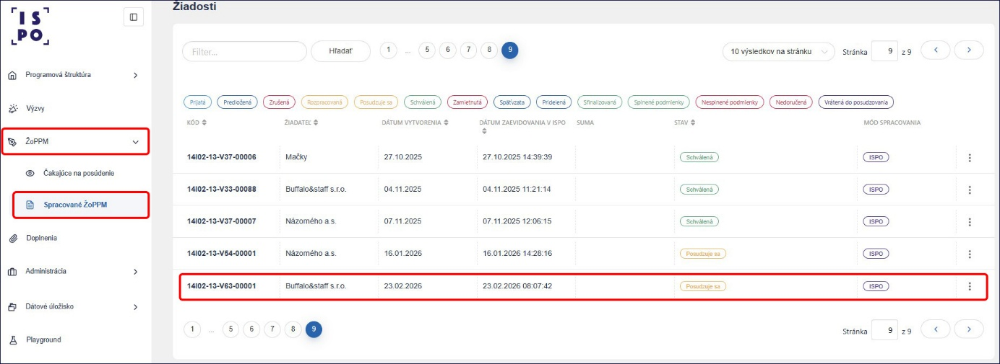

4.4.5) Ak sme boli na danú ŽoPPM priradení ako hodnotiteľ, nájdeme ju
v zozname **ŽoPPM – Čakajúce na hodnotenie.** Po kliknutí na ŽoPPM
v záložke **Posudzovanie** najskôr akceptujeme alebo zamietneme naše
pridelenie na danú ŽoPPM. Klikneme na tlačidlo **Prebrať hodnotiteľom.**

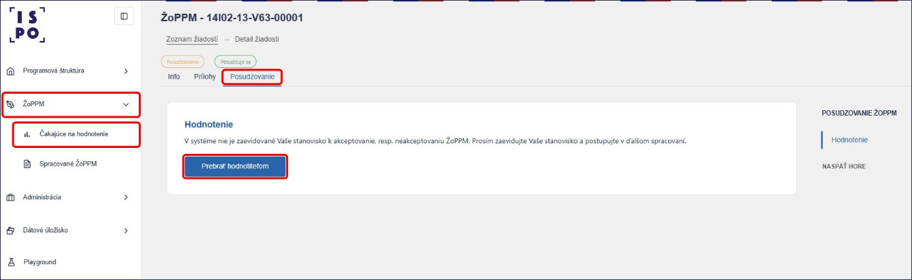

Zo zoznamu vyberieme možnosť **Akceptujem – preberám do posudzovania**
alebo **Neakceptujem – vrátiť na pridelenie inému posudzovateľovi** a
klikneme na tlačidlo **Potvrdiť**.

Ak sme pridelenie akceptovali, otvoria sa ďalšie záložky, ktoré nám
umožnia vidieť detailné údaje ŽoPPM, ktorú si môžeme stiahnuť podľa
podkapitoly **4.1)** a pozrieť si jej detaily podľa podkapitoly
**4.3)**.

V záložke Kontrolné zoznamy stiahneme vzor kontrolného zoznamu pre
hodnotiteľa, ktorý bol nahratý vo výzve v podkapitole **3.7)**.
Kontrolný zoznam vyplníme mimo ISPO a nahráme ho v záverečnom stanovisku
hodnotiteľa.

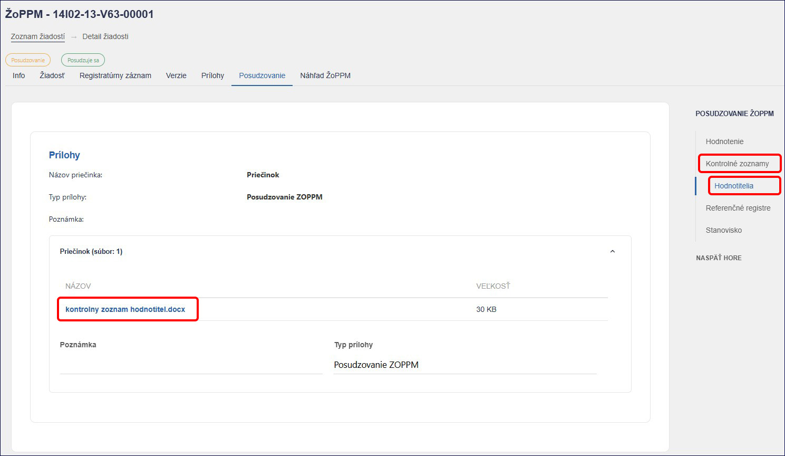

Vyhodnotenie referenčných registrov opisujeme v bode **4.4.4)**.

**Poznámka:** *V prípade, že v ktorejkoľvek fáze posudzovania
identifikujeme nedostatky alebo chýbajúce informácie v ŽoPPM, môžeme
využiť funkcionalitu **Doplnenie ŽoPPM**, ktorú opisujeme v podkapitole
**4.5)**.*

Záverečným krokom hodnotiteľa je zaevidovanie **Stanoviska**. Ak je na
ŽoPPM priradených viac hodnotiteľov, do systému nahráva každý hodnotiteľ
stanovisko sám za seba. Klikneme na tlačidlo **Zaevidovať stanovisko**.

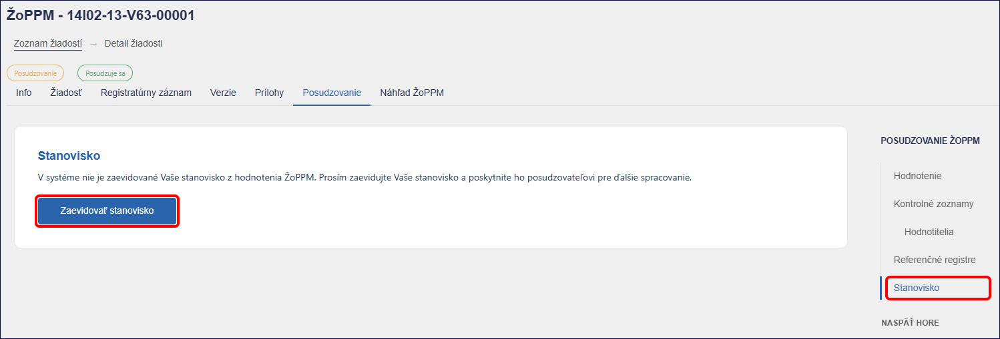

Vyplníme povinné polia ako **Odporúčania** a **Výsledok.** Klikneme na
tlačidlo **Uložiť**.

Po uložení sa sprístupní možnosť pre nahratie prílohy. Sem nahráme
vyplnený kontrolný zoznam hodnotiteľa. Nahratie potvrdíme opätovným
kliknutím na tlačidlo **Uložiť**.

Po uložení a zaevidovaní stanoviska hodnotiteľa ho môžeme ešte upraviť,
vymazať alebo ukončiť kliknutím na tlačidlo **Ukončiť hodnotenie**.
Takto zaevidované stanovisko sa sprístupní pre posudzovateľa a následne
aj arbitra.

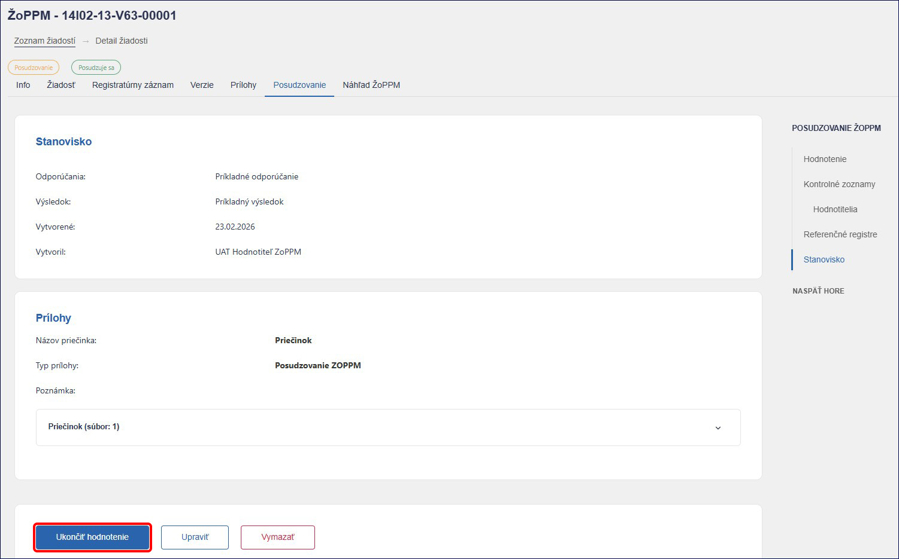

Takto ohodnotenú ŽoPPM v role hodnotiteľa nájdeme v zozname **ŽoPPM -\>
Spracované ŽoPPM**.

4.4.6) Ak sme boli na konkrétnu ŽoPPM priradení ako arbiter, nájdeme ju
v zozname **ŽoPPM – Čakajúce na arbitra.**

Po kliknutí na danú ŽoPPM v záložke **Posudzovanie** vidíme výsledky
posúdenia a hodnotenia tak, ako boli zadané v predchádzajúcich bodoch.
V záložke **Referenčné registre** môžeme kliknúť na konkrétny register
a nahliadnuť, ako boli údaje v ňom zapísané.

**Upozornenie!** *Arbiter údaje z výsledkov posudzovania neupravuje, iba
číta a kontroluje. Ak nájde nedostatky, uvedie ich v záverečnej správe
a vráti ŽoPPM späť do posudzovania.*

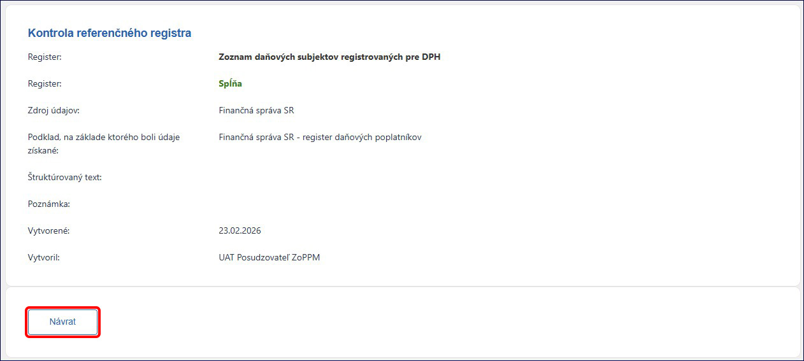

V záložke **Stanovisko hodnotiteľov** môžeme vidieť detail stanoviska
všetkých hodnotiteľov vrátane príloh kontrolných zoznamov hodnotiteľov.

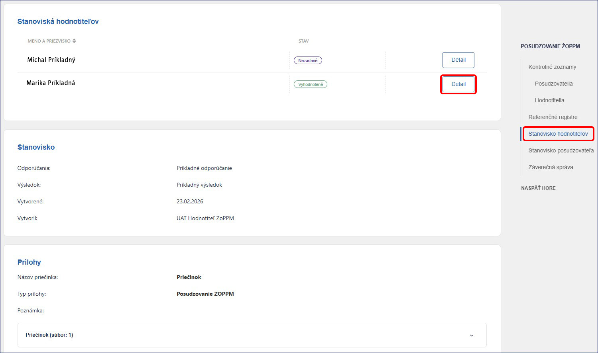

V záložke **Stanovisko posudzovateľa** môžeme vidieť detail stanoviska
všetkých posudzovateľov, vrátane príloh kontrolných zoznamov
posudzovateľov.

Po kontrole vyššie uvedených údajov môžeme pristúpiť k záverečnej správe
arbitra. Klikneme na tlačidlo **Zaevidovať záverečnú správu**.

Vyplníme povinné polia ako **Proces hodnotenia, Odporúčania**
a **Výsledok.** Klikneme na tlačidlo **Uložiť**.

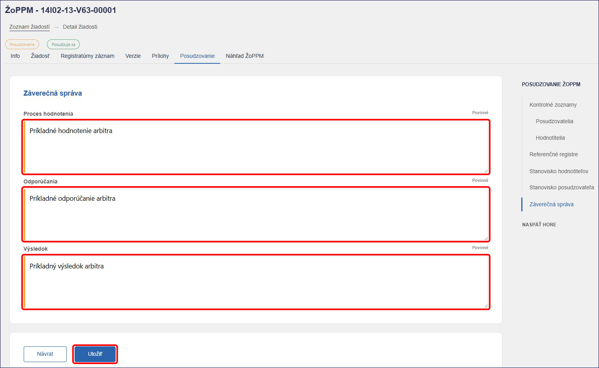

Po uložení sa sprístupní možnosť pre nahratie prílohy. Nahratie prílohy
potvrdíme opätovným kliknutím na tlačidlo **Uložiť**.

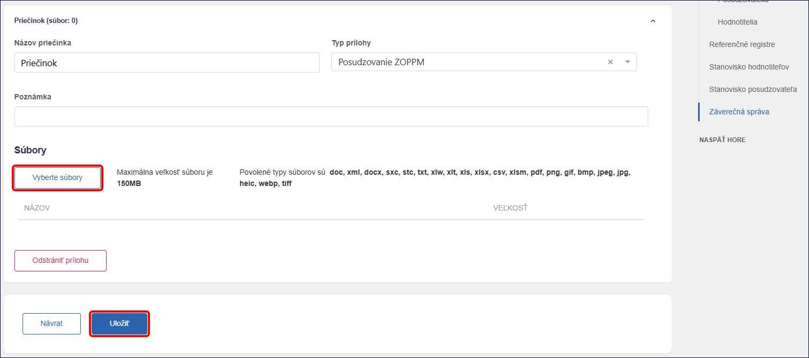

Následne sa sprístupnia nasledovné tlačidla:

- **Schváliť** – v prípade, že žiadosť spĺňa všetky podmienky a bola
  posudzovateľmi posúdená pozitívne, klikneme na tlačidlo **Schváliť**
  a ŽoPPM bude pripravená na zazmluvnenie v stave **Schválená**.

- **Zamietnuť –** v prípade, že žiadosť nespĺňa podmienky a bola
  posudzovateľmi posúdená negatívne, klikneme na tlačidlo **Zamietnuť**.
  ŽoPPM bude v stave **Zamietnutá** a nebude použiteľná pre ďalšie
  úkony.

- **Vrátiť na posúdenie –** v prípade, že Arbiter identifikoval
  nedostatky v posudzovaní a hodnotení, prípadne identifikoval
  nedostatky v samotnej ŽoPPM, môže žiadosť vrátiť na opätovné posúdenie
  a hodnotenie, pričom tieto nedostatky označí v záverečnej správe.
  ŽoPPM ostane v stave **Posudzuje sa** a zopakuje sa celý proces
  posudzovania.

Ak ŽoPPM z výsledkov posudzovania spĺňa všetky podmienky, klikneme na
tlačidlo **Schváliť**.

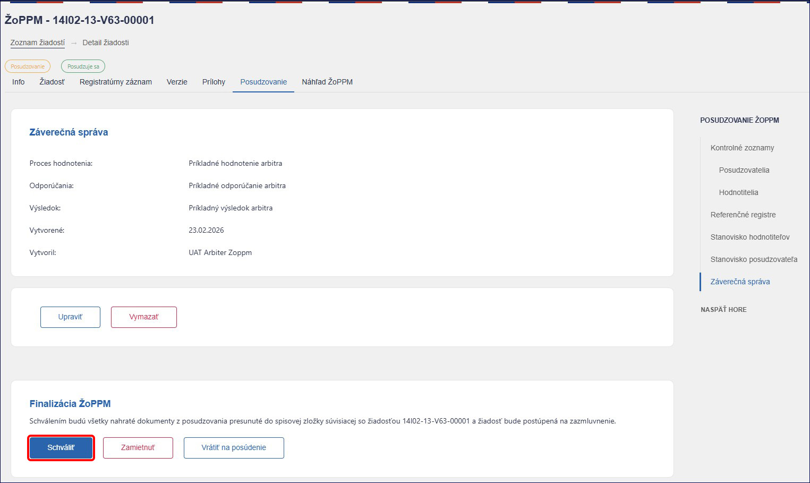

Následne do textového poľa môžeme uviesť poznámku a klikneme na tlačidlo
**Potvrdiť**.

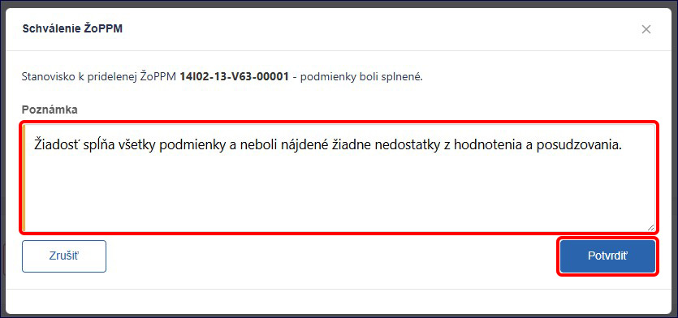

Takto schválenú ŽoPPM v role arbitra nájdeme v zozname **ŽoPPM -\>
Spracované ŽoPPM**.

4.4.7) Úlohou zazmluvniteľa v systéme je nahrať zmluvu, ktorá bola
uzatvorená medzi vykonávateľom a prijímateľom a zaevidovať stav projektu
**Zazmluvnený**.

Ak bola ŽoPPM schválená arbitrom a boli sme na ňu priradení ako
zazmluvniteľ, nájdeme ju v zozname **ŽoPPM - Čakajúce na zazmluvnenie**.

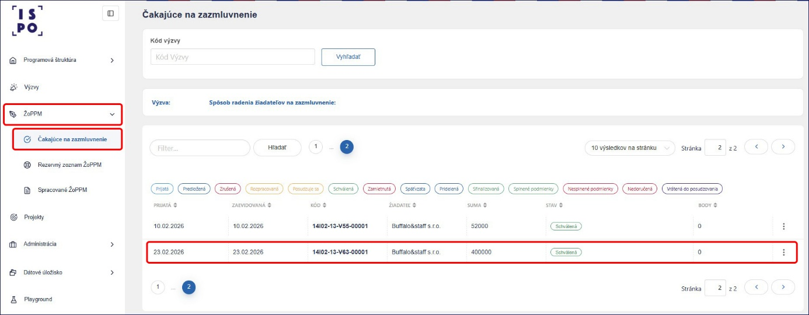

Po kliknutí na ŽoPPM v záložke **Posudzovanie** môžeme pozrieť ako boli
vyhodnotené referenčné registre posudzovateľmi a hodnotiteľmi, tiež si
môžeme pozrieť stanoviská hodnotiteľov a posudzovateľov, ako aj
záverečnú správu arbitra.

V záložke **Zazmluvnenie** môžeme vykonať niekoľko akcií. V prípade, že
ŽoPPM splnila podmienky, ale už boli napr. vyčerpané finančné
prostriedky na výzvu, môžeme danú ŽoPPM **Vložiť do rezervného
zoznamu**.

Takto označenú ŽoPPM nájdeme v záložke **ŽoPPM – Rezervný zoznam
ŽoPPM**. V prípade, že sa finančné prostriedky z akýkoľvek dôvodov znovu
uvoľnia, ŽoPPM z rezervného zoznamu odoberieme kliknutím na tlačidlo
**Odobrať z rezervného zoznamu** a následne ju môžeme zazmluvniť.

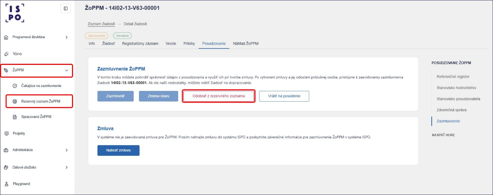

Ak došlo k uzavretiu zmluvy medzi vykonávateľom a prijímateľom, nahráme
zmluvu a údaje k nej do systému. Klikneme na tlačidlo **Nahrať zmluvu**.

Sprístupnia sa polia pre zadanie údajov zmluvy ako **Číslo zmluvy**,
**Dátum uzavretia zmluvy**, **Dátum zverejnenia zmluvy v CRZ**, **Dátum
platnosti zmluvy** a **Link CRZ**. Klikneme na tlačidlo **Uložiť**.

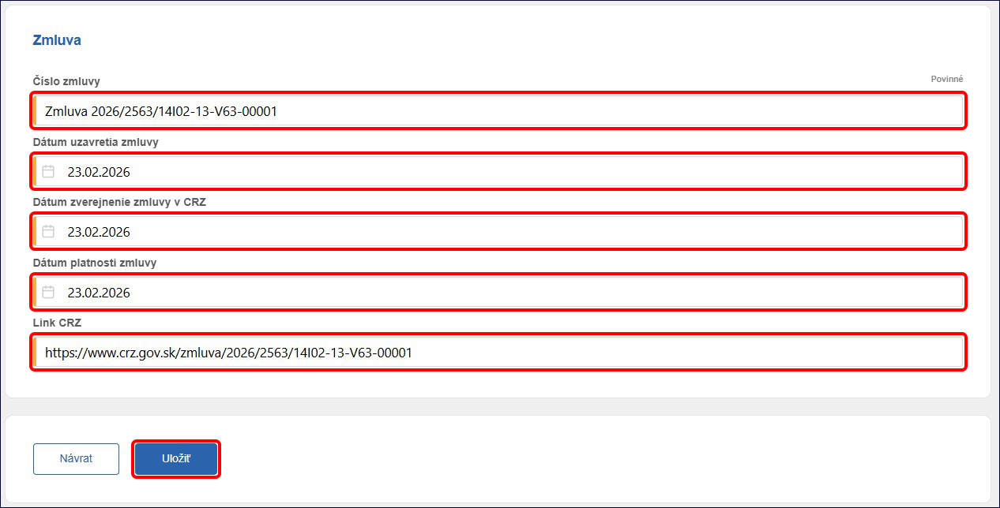

Po uložení sa sprístupní pole pre nahratie príloh k zmluve, kde môžeme
nahrať súbor s celým znením zmluvy. Po nahratí súboru opätovne klikneme
na tlačidlo **Uložiť.**

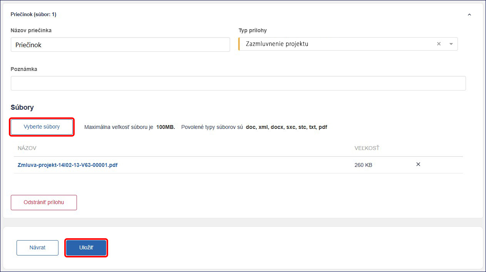

Po uložení a nahratí zmluvy ju môžeme ešte upraviť alebo vymazať.
Pokračovať môžeme kliknutím na tlačidlo **Návrat**.

Následne sa sprístupni tlačidlo **Zazmluvniť**, na ktoré klikneme.

Po kliknutí na tlačidlo **Zazmluvniť** a potvrdení tohto rozhodnutia
v systéme automaticky vznikne projekt v stave zazmluvnený, ktorý nájdeme
v zozname **Projekty**.

Údaje o projekte sa automaticky dotiahnu aj do reportu. Ak bolo na výzve
nastavené prijímanie žiadostí o platbu cez Portál ISPO podľa podkapitoly
**3.8)**, zazmluvnený projekt je zároveň pripravený pre prijímateľa,
ktorý naň môže podať ŽoP.

## 4.5) Doplnenie ŽoPPM

Ak vykonávame posudzovanie ŽoPPM cez ISPO podľa podkapitoly **4.4)**,
možnosť doplnenia ŽoPPM je naviazaná na pracovné pozície **Posudzovateľ
ŽoPPM** a **Hodnotiteľ ŽoPPM**. Ak nevykonávame posudzovanie ŽoPPM cez
ISPO, potrebujeme mať priradenú pracovnú pozíciu **Editor doplnenia
ŽoPPM/Projektu**.

Po kliknutí na konkrétnu ŽoPPM, prejdeme do časti **Doplnenie**. Ak ešte
nebolo vytvorené žiadne doplnenie na danú ŽoPPM, zoznam je prázdny.
V ISPO rozlišujeme dva typy doplnenia a to **Nové priame doplnenie**
a **Nové doplnenie**

4.5.2) **Nové priame doplnenie** je typ doplnenia, kedy sme chýbajúce
údaje od žiadateľa obdržali mimo ISPO, napríklad cez e-mail a do ŽoPPM
tieto údaje chceme zapracovať. Klikneme na tlačidlo **Nové priame
doplnenie.**

V poli **Výber doplnenia** zvolíme možnosť ŽoPPM, uvedieme **Názov
doplnenia** a klikneme na tlačidlo **Vytvoriť doplnenie**.

V nasledujúcej obrazovke môžeme kedykoľvek upraviť názov doplnenia.
Zároveň sa sprístupnili sekcie formulára ŽoPPM tak, ako boli nastavené
na výzve a ktoré žiadateľ vyplnil cez Portál ISPO.

Kliknutím na jednotlivé sekcie sa otvorí detail sekcie, kde uvidíme
**Aktuálnu hodnotu**, ktorá obsahuje údaje, ktoré vyplnil žiadateľ cez
Portál ISPO. Časť **Upravená hodnota** slúži pre nás a môžeme do nej
vpisovať doplnené údaje od žiadateľa.

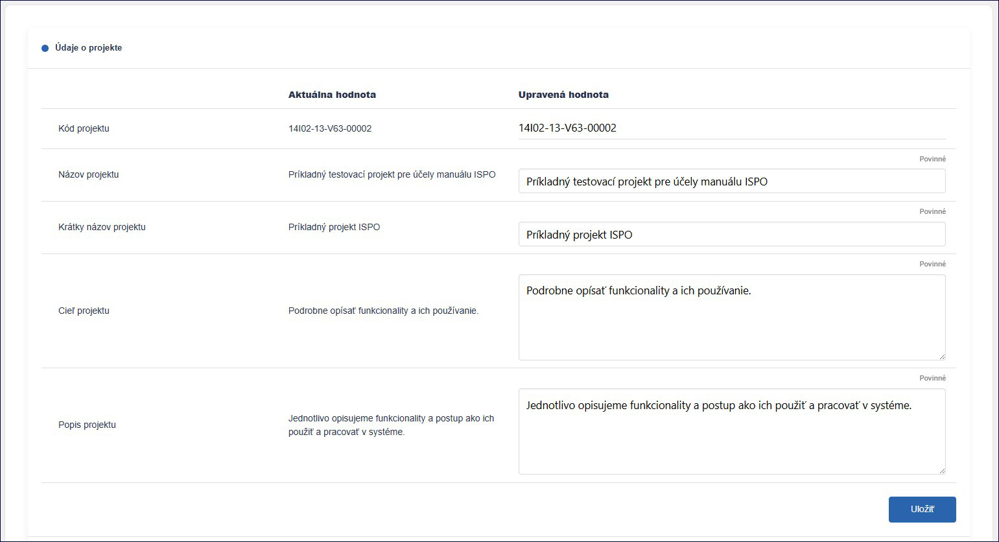

Vzorovo klikneme na prvú sekciu **Údaje o projekte**. Počas posudzovania
ŽoPPM sme zistili, že žiadateľ uviedol príliš stručný **Popis
projektu**. Výzvu na doplnenie sme odoslali mimo systému ISPO, napríklad
e-mailovou komunikáciou, ktorou sme obdržali aj odpoveď žiadateľa
s doplnenými údajmi k popisu projektu.

Odpoveď žiadateľa s údajmi k popisu projektu následne zapracujeme cez
priame doplnenie tak, že prepíšeme údaje v časti **Upravená hodnota**
a následne klikneme na tlačidlo **Uložiť**.

Takýmto spôsobom môžeme doplniť údaje do akejkoľvek sekcie. Ak sme
zapracovali všetky žiadateľom doplnené údaje, môžeme priame doplnenie
ukončiť tlačidlom **Uzavrieť doplnenie**.

V modálnom okne uvedieme **Názov verzie** a **Dôvod**, na základe
ktorého toto doplnenie uzatvárame.

Uzatvorením doplnenia, čiže jeho zapracovaním sa vytvorí nová verzia
ŽoPPM so zapracovanými zmenami po doplnení. Verzie ŽoPPM opisujeme
v bode **4.5.4)**.

4.5.3) **Nové doplnenie** je typ doplnenia, v ktorom najskôr
vyšpecifikujeme chýbajúce údaje ŽoPPM a vyzveme žiadateľa cez Portál
ISPO, aby ich doplnil. Žiadateľ ich doplní cez Portál ISPO a odošle späť
k nám. Následne jeho odpoveď zapracujeme do ŽoPPM. Klikneme na tlačidlo
**Nové doplnenie**.

Vyplníme **Názov doplnenia**, štandardne „*Výzva na doplnenie ŽoPPM -
14I02-13-V03-00005“*. V poli **Výber doplnenia** vyberieme možnosť
ŽoPPM. Pole **Dátum exspirácie** je automatický vyplnené dátumom 10 dní
od aktuálneho dňa. Ak nám 10 dní nevyhovuje, uvedieme iný dátum.

Následne sa sprístupní časť **Požiadavky**, v ktorej špecifikujeme
požiadavky na žiadateľa. Klikneme na pole **Nová požiadavka**.

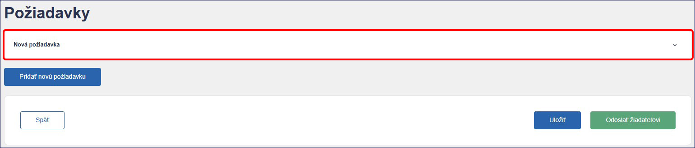

Otvoria sa ďalšie polia ako **Sekcia**, **Názov požiadavky**, **Detail
požiadavky** a možnosť pridať prílohu k požiadavke. V poli **Sekcie** sa
nachádzajú jednotlivé kroky formulára ŽoPPM. Vyberieme sekciu, v ktorej
sme identifikovali chýbajúce údaje. Vzorovo klikneme na prvú sekciu
**Údaje o projekte**. Počas posudzovania ŽoPPM sme zistili, že žiadateľ
uviedol príliš stručný **Popis projektu**, preto uvedieme do poľa
**Názov požiadavky** napr. „*Doplnenie popisu projektu“.* V poli
**Detail požiadavky** uvedieme detailnú požiadavku napr. „*V žiadosti je
uvedený stručný popis projektu, z ktorého nie je jasný rozsah a obsah
projektu. Prosíme o doplnenie popisu projektu v rozsahu opísanom vo
výzve. V prílohe posielame vzor popisu projektu.“* Následne môžeme
kliknúť na tlačidlo **Pridať novú prílohu** a nahrať vzorový súbor pre
žiadateľa.

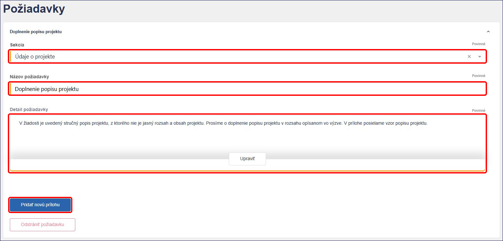

Kliknutím na tlačidlo **Pridať novú požiadavku** môžeme rovnakým
spôsobom špecifikovať požiadavku ku každej sekcii formulára ŽoPPM. Ak
sme požiadavky vyšpecifikovali, môžeme takto zadefinovanú výzvu na
doplnenie odoslať žiadateľovi na Portál ISPO kliknutím na tlačidlo
**Odoslať žiadateľovi**. Takéto doplnenie je v stave **Čaká na
odpoveď**.

Náhľad výzvy na doplnenie na Portáli ISPO.

- *Žiadateľ môže reagovať napísaním odpovede a nahratím prílohy*

- *Žiadateľ môže reagovať vybraním jednej z možností spĺňam, nespĺňam,
  netýka sa.*

Keď žiadateľ odpovie na naše požiadavky, doplnenie sa dostane do stavu
**Zodpovedaná**. V danej ŽoPPM klikneme na záložku **Doplnenie**
a v zozname klikneme na doplnenie v stave **Zodpovedaná**.

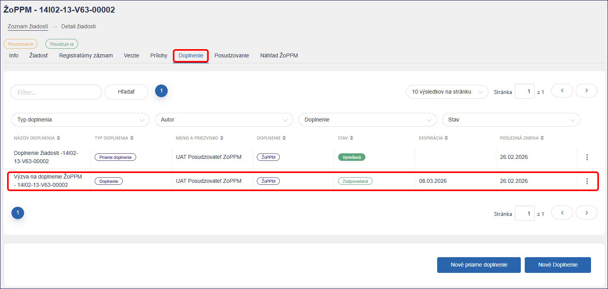

Po otvorení detailu doplnenia klikneme na konkrétnu požiadavku. V prvej
časti vidíme nami zadefinovanú požiadavku a v druhej časti odpoveď od
žiadateľa. Pre zapracovanie odpovede žiadateľa do ŽoPPM klikneme na
tlačidlo **Zapracovať doplnenie**.

Pri zapracovaní odpovede postupujeme rovnakým spôsobom ako pri priamom
doplnení, ktoré opisujeme v bode **4.5.2.)**, pričom ako zdroj údajov
využívame odpoveď žiadateľa. Po zapracovaní odpovedí žiadateľa klikneme
na tlačidlo **Uzatvoriť**, čím dokončíme doplnenie.

V prípade, že žiadateľ neodpovedal na výzvu na doplnenie do dátumu
určeného pre odpoveď, môžeme doplnenie označiť za exspirované.

V prípade, že žiadateľ odpovedal nedostatočným spôsobom, môžeme
doplnenie zamietnuť.

4.5.4) Každým zapracovaním a uzatvorením doplnenia vzniká nová verzia
ŽoPPM. Verzie nájdeme v danej ŽoPPM v záložke **Verzie**. Ak bolo
vykonané a zapracované akékoľvek doplnenie, v zozname uvidíme viac ako
jednu verziu. Verzie idú po poradí. Na prvom mieste s označením **0** sa
nachádza pôvodná verzia ŽoPPM.

Pre porovnávanie verzií medzi sebou označíme zaškrtávacie políčka dvoch
verzií a klikneme na tlačidlo **Porovnať**.

**Upozornenie!** *Systém ISPO dokáže v jednej chvíli porovnať len dve
verzie ŽoPPM. Ak daná ŽoPPM má viac ako dve verzie, nevieme porovnať
všetky naraz.*

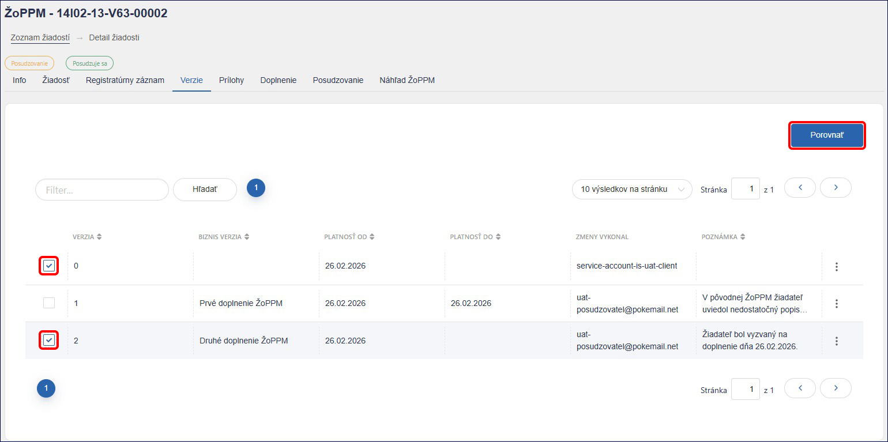

Zobrazia sa všetky sekcie formulára ŽoPPM. Kliknutím na sekcie sa otvorí
detail sekcie.

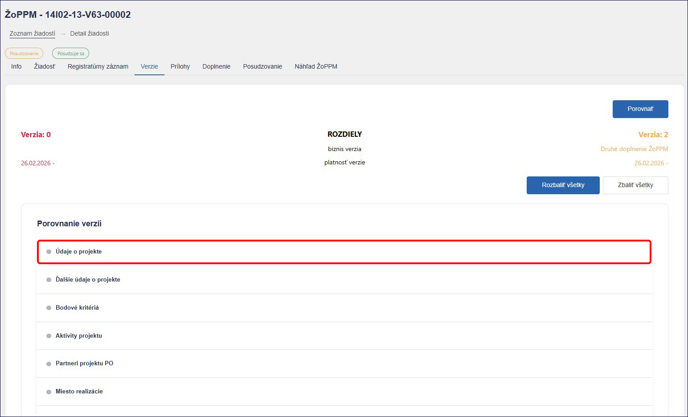

Klikneme na sekciu **Údaje o projekte**, na ktorej sme vykonali
doplnenie podľa bodov **4.5.2)** a **4.5.3)**. Po rozbalení sekcie na
ľavej strane vidíme pôvodnú verziu a na pravej strane novú verziu po
doplnení. Polia, v ktorých sa údaje doplnili sú označené farebne.

