# 5. Priame vyzvanie

Pre vytvorenie a editovanie priameho vyzvania v ISPO je potrebné, aby
sme mali priradenú pracovnú pozíciu **Editor výzvy**.

## 5.1) Vytvorenie priameho vyzvania cez ISPO

5.1.1) V ľavom paneli klikneme na záložku **Výzvy**. Zobrazí sa zoznam
výziev vytvorených pod našim orgánom (v prípade, že sme ešte nevytvorili
žiadnu výzvu, zoznam bude prázdny). Klikneme na modré tlačidlo **Pridať
výzvu**.

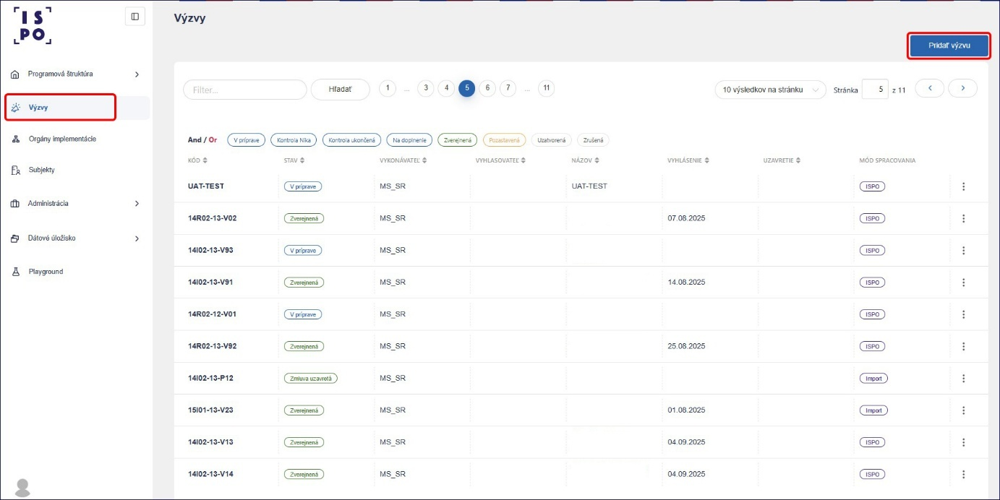

5.1.2) V prvom kroku zvolíme typ výzvy **Priame vyzvanie**. Následne
klikneme na tlačidlo **Ďalej**.

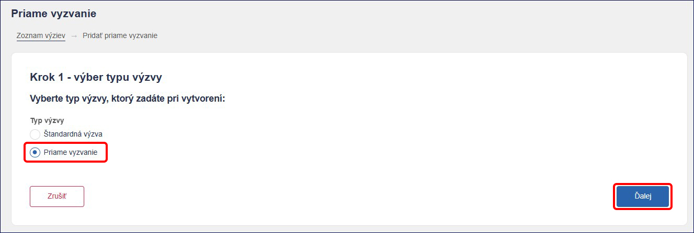

5.1.3) V druhom kroku vyberieme zo zoznamu **Komponent**, **Opatrenie**
a **Vykonávateľa**. Pokračujeme kliknutím na tlačidlo **Ďalej**.

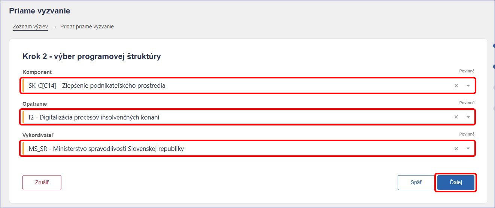

5.1.4) V treťom kroku systém automaticky vytvorí najbližší voľný **kód
priameho vyzvania** podľa Príručky k úložisku NIKA v zložení:

***Číslo komponentu -\> veľké I/R -\> číslo investície/reformy -\>
pomlčka -\> číslo vykonávateľa -\> pomlčka -\> veľké P a poradové číslo
priameho vyzvania***

*Príklad: 14I02-13-P59 (komponent 14, investícia 2, vykonávateľ
Príkladné ministerstvo SR, priame vyzvanie číslo 59)*

Tento kód v prípade potreby môžeme prepísať. Následne uvedieme **Názov
priameho vyzvania**.

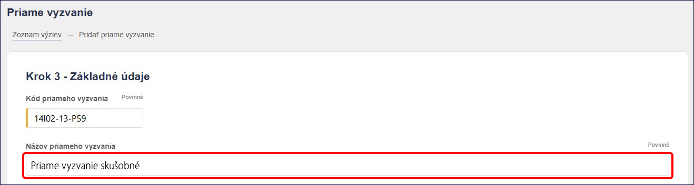

V časti prijímateľ klikneme na tlačidlo **Pridať**. Označíme organizáciu
a do poľa **Výber organizácie** uvedieme názov alebo IČO organizácie.
Systém ISPO spárovaný s RPO navrhne zoznam organizácií, z ktorých si
vyberieme požadovanú a potvrdíme tlačidlom **Pridať**.

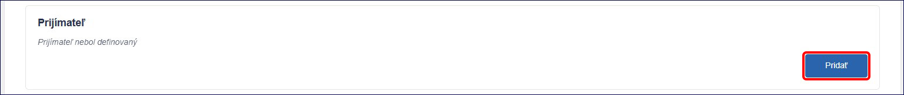

Následne môžeme vyplniť polia, ako **Výška finančných prostriedkov**,
**Schéma štátnej pomoci/pomoci de minimis**, **Zjednodušené vykazovanie
prostriedkov** a **Dátum schválenia / vydania záväzného stanoviska
NIKA**. Pokračujeme kliknutím na tlačidlo **Ďalej**.

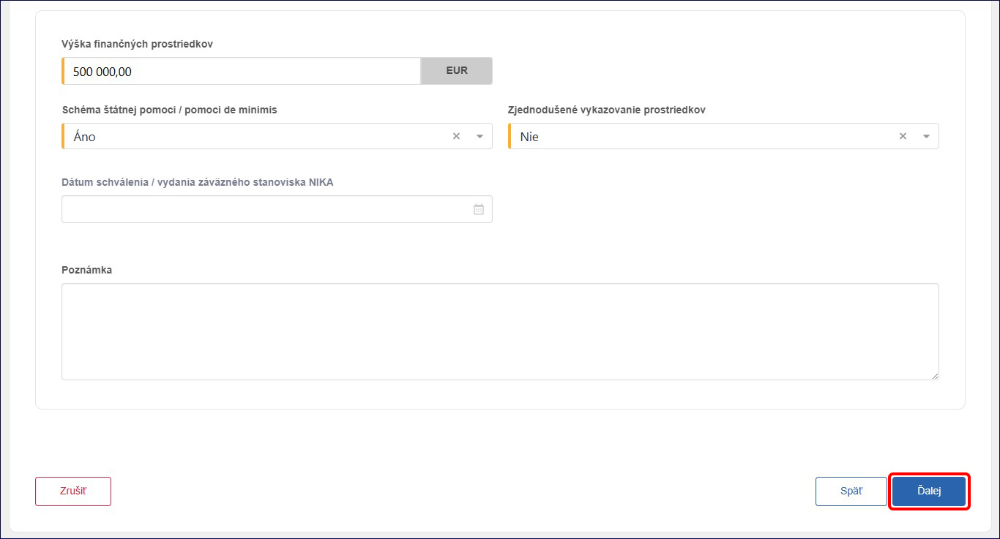

5.1.5) Štvrtý krok obsahuje zhrnutie, v ktorom môžeme skontrolovať
zadané údaje. V prípade potreby sa môžeme vrátiť pomocou tlačidla
**Späť** a údaje v predchádzajúcich krokoch upraviť. Následne
pokračujeme kliknutím na tlačidlo **Dokončiť**.

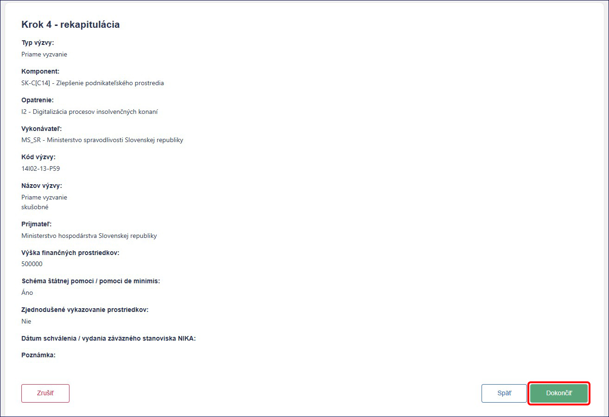

Takto vytvorené priame vyzvanie sa nám objaví v zozname výziev, vždy na
poslednom mieste.

## 5.2) Editácia priameho vyzvania

Po vytvorení priameho vyzvania sa nám zobrazí detail vyzvania. Detail
vyzvania pozostáva z jednotlivých sekcii ako:

1)  Príprava priameho vyzvania

2)  Stanovisko NIKA

3)  Nastavenie ŽoP – povolenie podávania ŽoP na výzve

V časti **Príprava priameho vyzvania** môžeme vidieť *základné údaje*,
*údaje o prijímateľovi* a *údaje o finančných prostriedkoch*, ktoré sme
uviedli pri jeho vytváraní. Kliknutím na tlačidlo **Upraviť** v pravej
časti obrazovky, sa dostaneme do editovacieho módu, v ktorom môžeme
všetky tieto údaje upraviť a následne **Uložiť**.

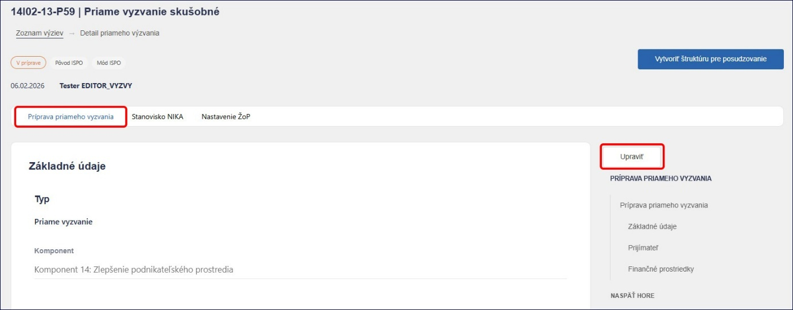

## 5.3) Kontrola a stanovisko NIKA, uzavretie zmluvy

Ako osoba s pracovným oprávnením **Editor výzvy** sme priame vyzvanie
pripravili a je v stave **V príprave**. Pre odoslanie webového znenia
priameho vyzvania na kontrolu NIKA prostredníctvom ISPO je potrebné, aby
sa prihlásila osoba s pracovným oprávnením **Schvaľovateľ výzvy**. Ako
*schvaľovateľ výzvy* skontrolujeme priame vyzvanie (bez možnosti
editácie) a následne ho odošleme na posúdenie NIKA kliknutím na tlačidlo
**Odoslať**.

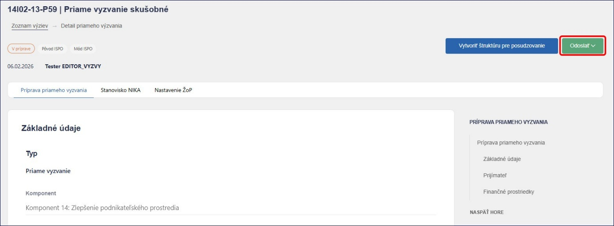

Takto odoslané priame vyzvanie získa stav **Kontrola NIKA**. Priame
vyzvanie v tomto stave nemôžeme editovať a čakáme na stanovisko NIKA.

Po pozitívnom posúdení pracovník NIKA vydá *Záväzné stanovisko NIKA*.
Priame vyzvanie sa dostane do stavu **Pred podpisom zmluvy**. Následne
je potrebné, aby sa do systému prihlásila osoba s pracovným oprávnením
**Administrátor výzvy**, s ktorou môžeme kliknúť na tlačidlo **Uzavrieť
zmluvu**, čím sa priame vyzvanie dostane do stavu **Zmluva uzavretá**
(priame vyzvanie sa zverejní).

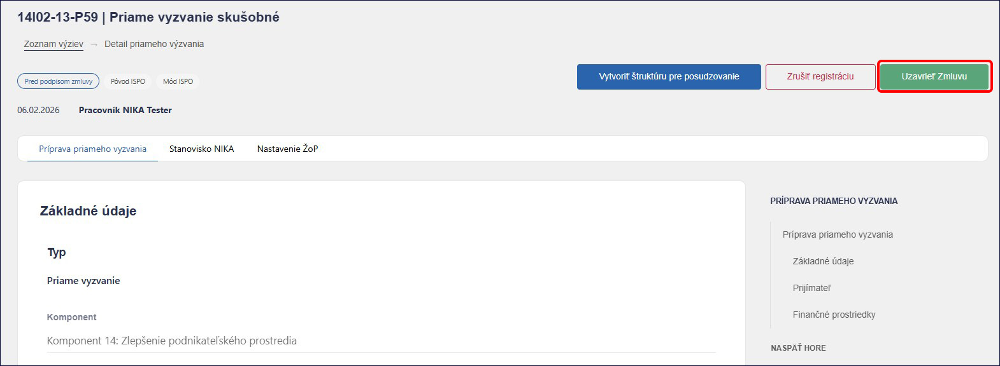

## 5.4) Projekt a stav zazmluvnený

Po tom ako priame vyzvanie dostaneme do stavu **Zmluva uzavretá**, sa
v záložke **Projekty** automaticky vytvorí projekt, ktorý je v stave
**Nový**. Na editáciu a zobrazenie projektu potrebujeme pracovnú pozíciu
**Editor ŽoP a projektu**.

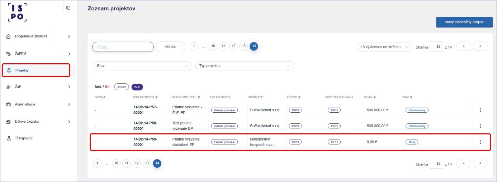

Po tom ako dôjde k zazmluvneniu projektu medzi vykonávateľom
a prijímateľom, potrebujeme túto skutočnosť zaevidovať aj v ISPO a
nastaviť stav projektu na **Zazmluvnený**.

Po kliknutí na vybraný projekt prejdeme do sekcie **Detail projektu**.
V spodnej časti obrazovky klikneme na tlačidlo **Upraviť**, čím
dostaneme projekt do editovacieho módu.

V časti **Základné údaje** v poli **Stav** zmeníme stav **Nový** na
**Zazmluvnený**.

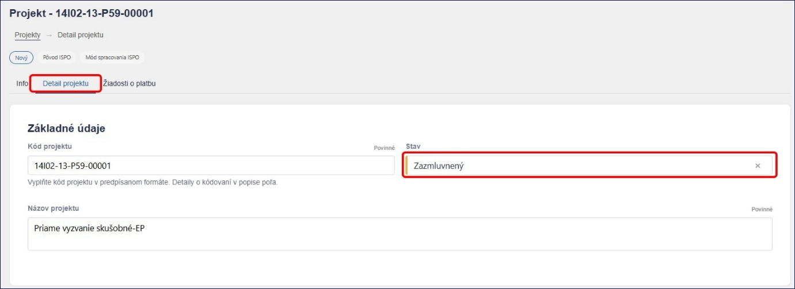

V časti **Výdavky** podľa zmluvy vyplníme polia pre sumy ako ***Suma z
Plánu obnovy bez DPH, Čiastka DPH z Plánu obnovy, Suma vlastných zdrojov
žiadateľa, Suma verejných zdrojov okrem zdrojov EÚ*** a ***Suma
verejných zdrojov EÚ***. Následne klikneme na tlačidlo **Prepočítať**
a pole **Celková suma projektu** sa prepočíta automaticky.

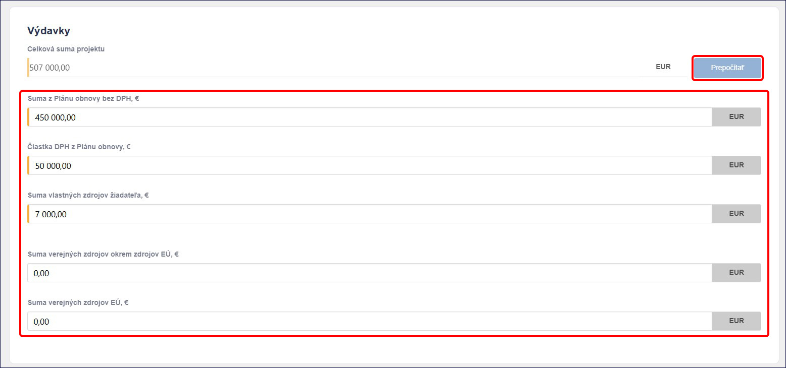

V časti **Zmluva** vyplníme polia ako ***Číslo zmluvy, Dátum platnosti
zmluvy, Dátum uzavretia zmluvy, Dátum zverejnenia zmluvy v CRZ*** a
***Link CRZ***. Zároveň v tejto časti kliknutím na príloha sa nám
zobrazí možnosť pre nahratie súboru zmluvy.

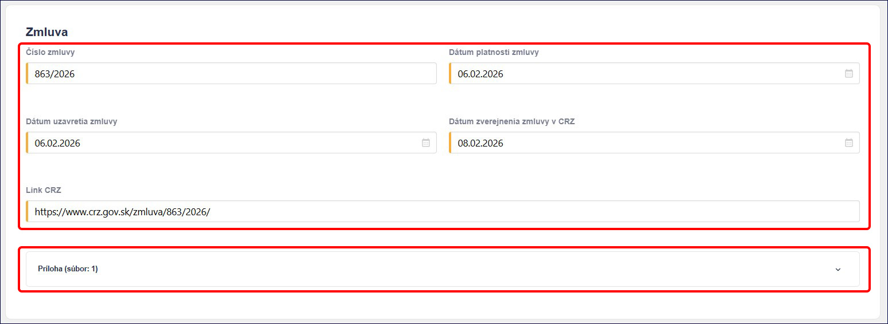

V časti **Prijímateľ** skontrolujeme prijímateľa zadaného na priamom
vyzvaní. Doplniť môžeme aj **Partnera** a **Poznámku**. Následne všetko
uložíme kliknutím na tlačidlo **Uložiť**. Takto pripravený projekt vidí
aj prijímateľ na Portáli ISPO. Po nastavení podávania ŽoP na priamom
vyzvaní bude môcť prijímateľ podať žiadosť o platbu cez Portál ISPO.

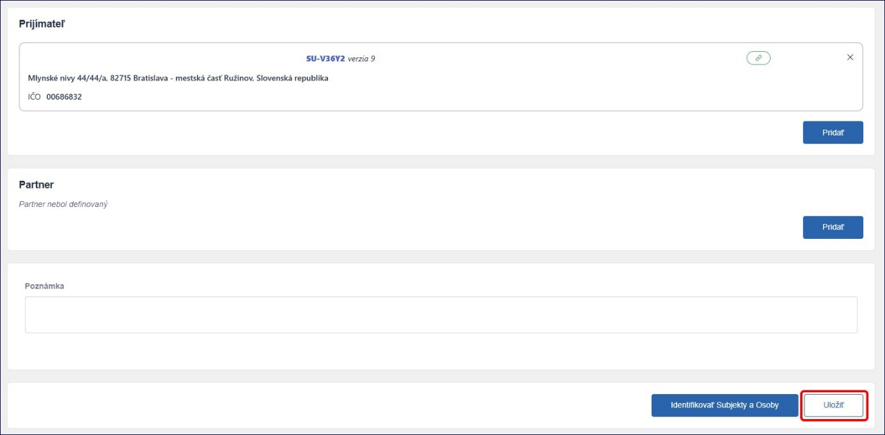

## 5.5) Nastavenie podávania a posudzovania ŽoP na priamom vyzvaní

Nastavenie podávania a posudzovania ŽoP na priamom vyzvaní je totožné
ako na výzve a opisujeme ho v podkapitole **3.8)**. Na nastavenie
podávania a posudzovania ŽoP na priamom vyzvaní potrebujeme pracovnú
pozíciu **Priraďovateľ ŽoP**.