# 6. Posudzovanie ŽoP

Posudzovanie ŽoP začína **Nastavením administrácie ŽoP** a pridelením
spracovateľov ŽoP na výzve alebo priamom vyzvaní podľa podkapitoly
**3.8)**.

## 6.1) Pridelenie ŽoP spracovateľom

Na pridelenie ŽoP spracovateľom potrebujeme pracovnú pozíciu
**Priraďovateľ ŽoP**.

V ľavom panely klikneme na záložku **ŽoP -\> Všetky ŽoP**. V zozname
klikneme na ŽoP, ktorú chceme posudzovať.

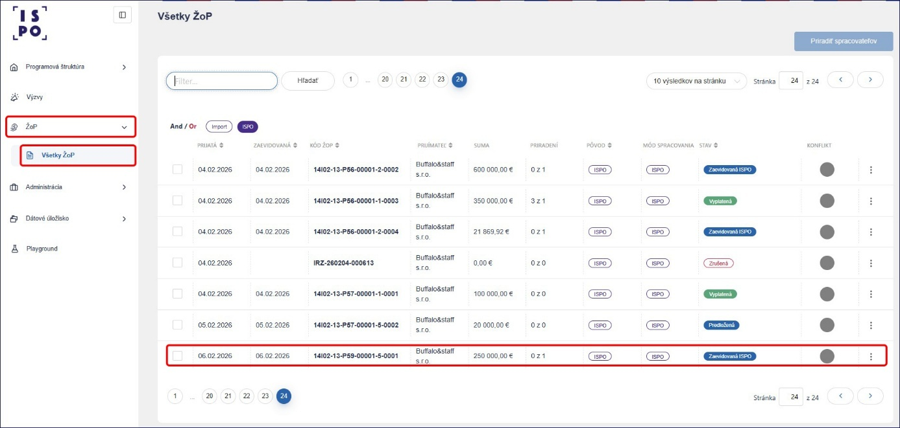

V detaile ŽoP prejdeme do sekcie **Pridelenie** a klikneme na tlačidlo
**Priradiť spracovateľov**.

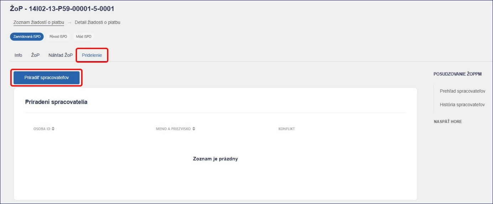

Otvorí sa obrazovka so zoznamom všetkých spracovateľov, ktorí boli
priradení na výzve podľa podkapitoly **3.8.5)**. Kliknutím na tlačidlo
**Prideliť** vyberieme tých, ktorých chceme, aby posudzovali danú
žiadosť o platbu. Pre korektné posúdenie potrebujeme vybrať aspoň jednu
osobu na vytvorenie registratúrneho záznamu, aspoň jedného kontrolóra
úplnosti a aspoň jedného administratívneho finančného kontrolóra.

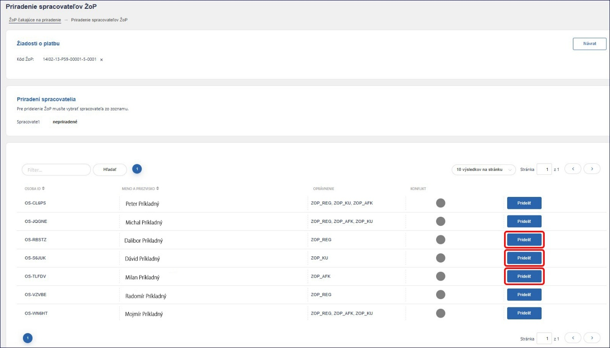

## 6.2) Registratúrny záznam ŽoP

Registratúrny záznam ŽoP vieme zaevidovať s pracovnou pozíciou **Editor
registratúrneho záznamu ŽOP** po tom, ako sme boli pridelení ako
spracovateľ na danú ŽoP.

V ľavom panely klikneme na záložku **ŽoP -\> Moje ŽoP**, v ktorej vidíme
zoznam ŽoP, na ktoré sme boli pridelení ako spracovateľ. Ak je ŽoP
v stave **Zaevidovaná v ISPO**, nemá zaevidovaný registratúrny záznam.

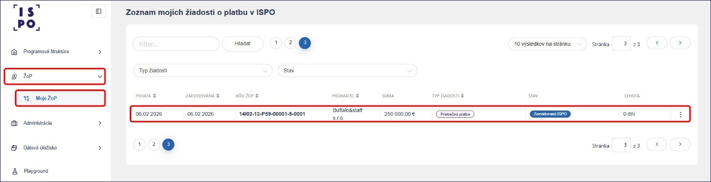

Registratúrny záznam vytvárame vtedy, ak sme prijali žiadateľom
podpísaný Sumár ŽoP PDF v elektronickej alebo listinnej podobe. V
detaile ŽoP prejdeme do sekcie **Registratúrny záznam**. Pre
zaevidovanie klikneme na tlačidlo **Upraviť**. Vyplníme polia ako
**Spisová značka, Dátum prijatia, Číslo registratúrneho záznamu**
a **Link na RZ v registratúre** a klikneme na tlačidlo **Uložiť**.
Žiadosť zmení stav zo **Zaevidovaná ISPO** na **Predložená**.

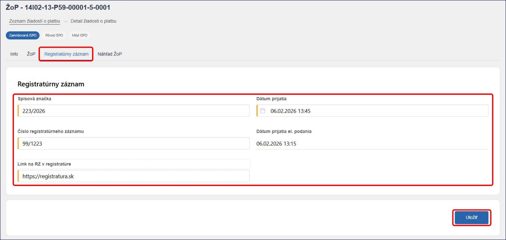

## 6.3) Kontrola úplnosti

Kontrolu úplnosti môžeme vykonať s pracovnou pozíciou **Kontrolór
úplnosti ŽoP** ak je ŽoP v stave **Predložená**. Klikneme na ŽoP, ktorú
ideme posudzovať. V záložkách **Info**, **ŽoP** a **Náhľad ŽoP** môžeme
vidieť údaje zo žiadosti. V záložke **Kontrola úplnosti** stiahneme
*vzorový kontrolný zoznam pre kontrolu úplnosti* a vyplníme ho.

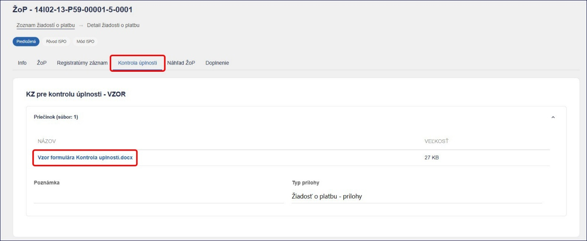

Vyplnený kontrolný zoznam nahráme v časti **Nahrať kontrolný zoznam pre
kontrolu úplnosti** ako prílohu a nahratie potvrdíme tlačidlom **Nahrať
tlačivo pre kontrolu úplnosti**. Kontrolu úplnosti potvrdíme tlačidlom
**Potvrdzujem že žiadosť o platbu je úplna**. V prípade, že chceme
kontrolu úplnosti preskočiť, môžeme kliknúť na tlačidlo **Preskočiť
kontrolu úplnosti**. Po vykonaní kontroly bude mať žiadosť stav
**Dokončená**.

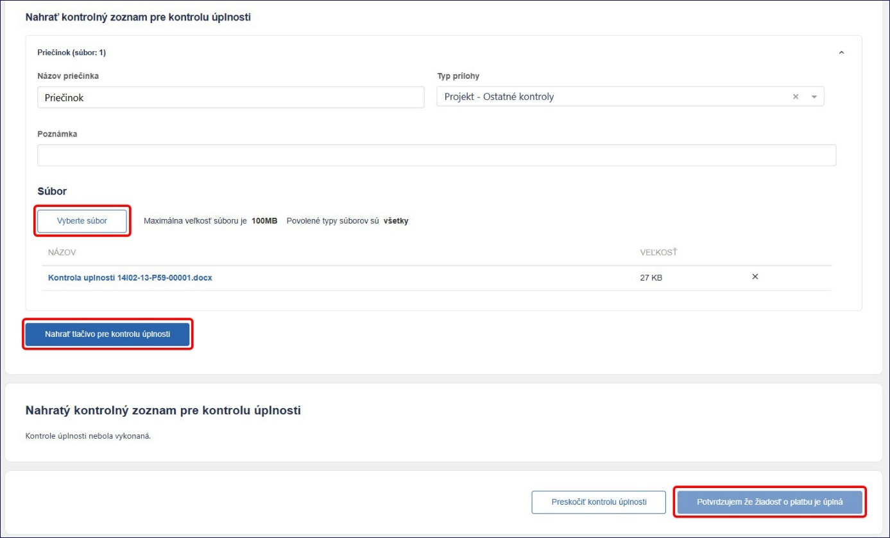

## 6.4) Finančná kontrola na mieste

Finančnú kontrolu na mieste môžeme vykonať s pracovnou pozíciou
**Administratívny finančný kontrolór ŽoP** ak je ŽoP v stave
**Dokončená**. Klikneme na ŽoP, ktorú ideme posudzovať. V záložkách
**Info**, **ŽoP** a **Náhľad ŽoP** môžeme vidieť údaje zo žiadosti.
V záložke **Finančná kontrola na mieste** stiahneme *vzorový kontrolný
zoznam pre finančnú kontrolu na mieste* a vyplníme ho.

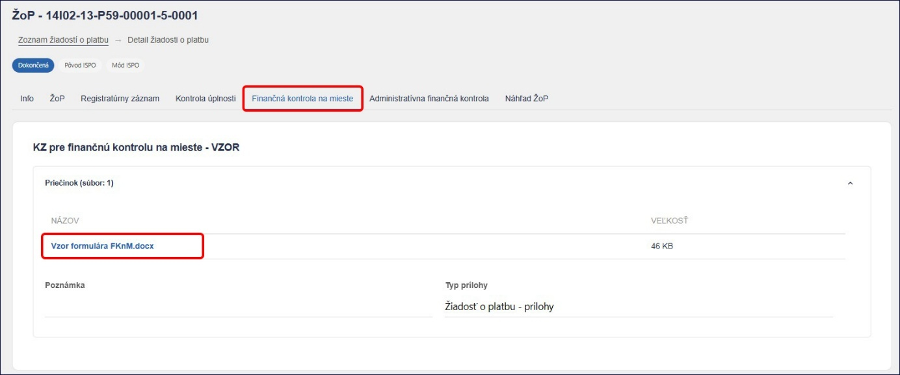

Vyplnený kontrolný zoznam nahráme v časti **Nahrať kontrolný zoznam pre
finančnú kontrolu na mieste** ako prílohu a nahratie potvrdíme tlačidlom
**Nahrať tlačivo pre finančnú kontrolu na mieste**. Kontrolu potvrdíme
tlačidlom **Potvrdzujem finančnú kontrolu na mieste**. V prípade, že
chceme finančnú kontrolu na mieste preskočiť, môžeme kliknúť na tlačidlo
**Preskočiť finančnú kontrolu na mieste – nebola vykonaná**. Po vykonaní
kontroly bude mať žiadosť stav **Finančná kontrola**.

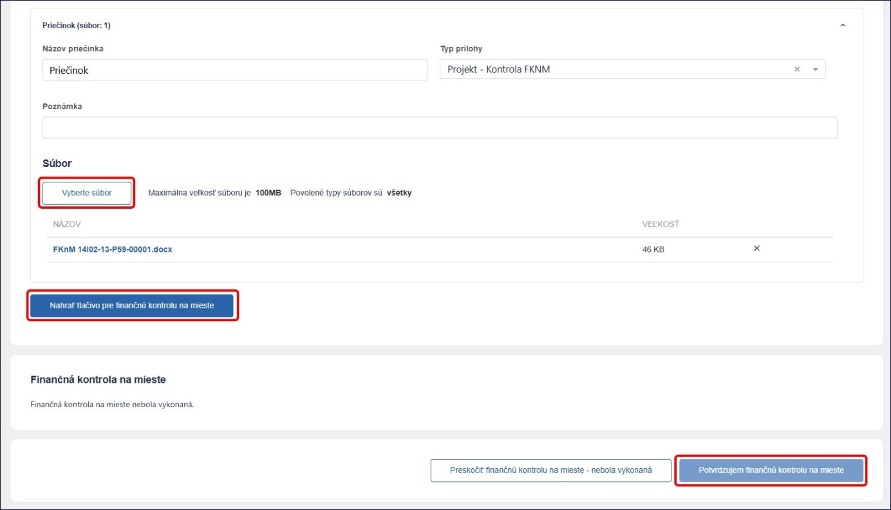

## 6.5) Administratívna finančná kontrola

Administratívnu finančnú kontrolu môžeme vykonať s pracovnou pozíciou
**Administratívny finančný kontrolór ŽoP** ak je ŽoP v stave **Finančná
kontrola**. Klikneme na ŽoP, ktorú ideme posudzovať. V záložkách
**Info**, **ŽoP** a **Náhľad ŽoP** môžeme vidieť údaje zo žiadosti.
V záložke **Administratívna** **finančná kontrola** stiahneme *vzorový
kontrolný zoznam pre administratívnu finančnú kontrolu* a vyplníme ho.

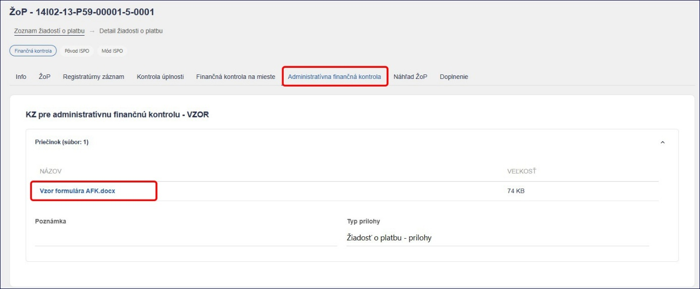

Vyplnený kontrolný zoznam nahráme v časti **Nahrať kontrolný zoznam pre
administratívnu finančnú kontrolu** ako prílohu a nahratie potvrdíme
tlačidlom **Nahrať tlačivo pre administratívnu finančnú kontrolu**.

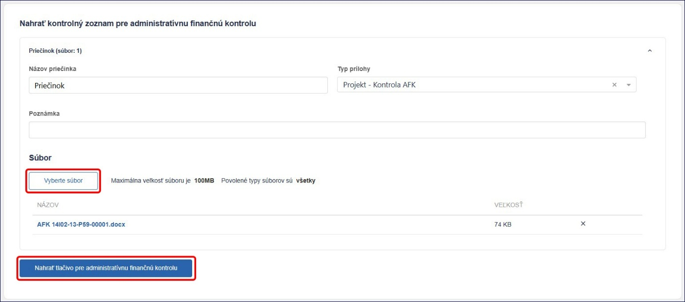

Následne postupujeme v závislosti od typu ŽoP.

6.5.1) Postup pre schválenie typov ŽoP:

- *Poskytnutie zálohy*

- *Vrátenie*

Ak sme posudzovali typ ŽoP **Poskytnutie zálohy** alebo **Vrátenie**, po
nahratí kontrolného zoznamu pre administratívnu finančnú kontrolu sa
sprístupní tlačidlo **Schváliť ŽoP**, čím sa žiadosť dostane do stavu
**Schválená**.

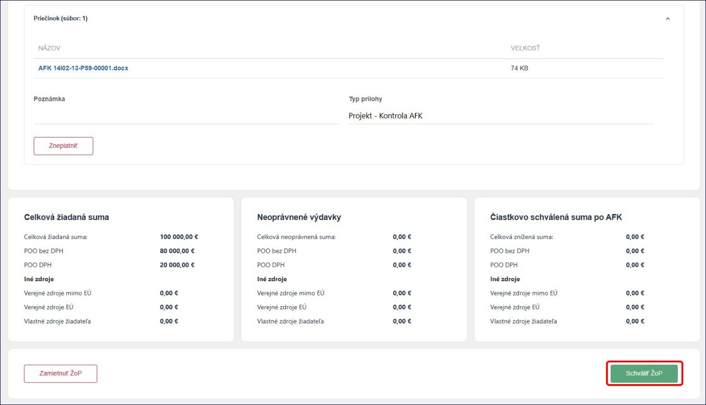

**Poznámka:** *Ak prijímateľovi pri poskytnutí zálohy nechceme schváliť
celú požadovanú sumu, upravíme ju cez priame doplnenie, ktoré opisujeme
v podkapitole **6.6)**.*

6.5.2) Postup pre schválenie typov ŽoP:

- *Priebežná platba / Refundácia*

- *Zúčtovanie zálohy*

- *Poskytnutie predfinancovania*

- *Zúčtovanie predfinancovania*

Ak sme posudzovali typ ŽoP **Priebežná platba, Zúčtovanie zálohy,
Poskytnutie predfinancovania** alebo **Zúčtovanie predfinancovania**, po
nahratí kontrolného zoznamu pre administratívnu finančnú kontrolu sa
sprístupní časť **Zoznam výdavkov ŽoP**. V tomto zozname sa nachádzajú
výdavky tak, ako ich uviedol prijímateľ. V prípade, že sme počas
posudzovania ŽoP neidentifikovali neoprávnené výdavky, klikneme na
tlačidlo **Schváliť**.

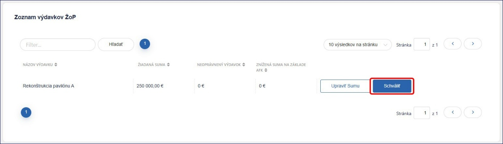

Tým schválime celú čiastku uvedenú prijímateľom. Následne sa sprístupní
aj zelené tlačidlo **Schváliť ŽoP** a po kliknutí naň sa žiadosť dostane
do stavu **Schválená**.

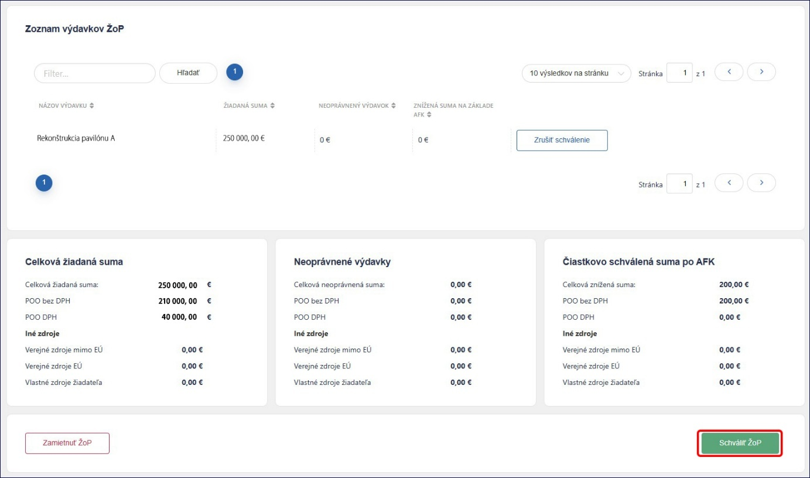

V prípade, že sme identifikovali neoprávnené výdavky, v zozname výdavkom
klikneme na tlačidlo **Upraviť sumu**.

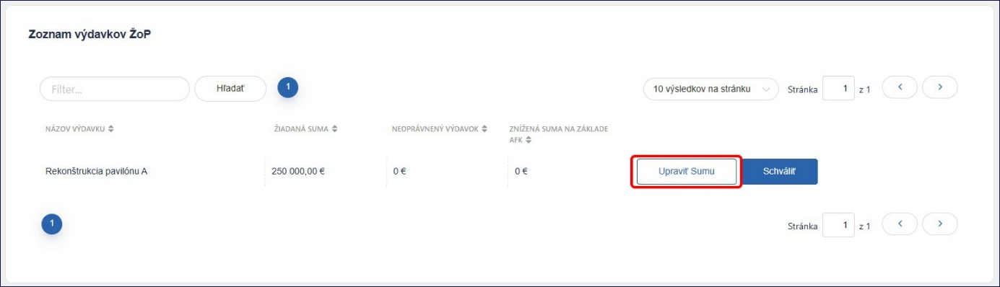

V modálnom okne, v poliach pre sumy, uvedieme sumy po znížení
o neoprávnené výdavky. Zároveň v poli **Dôvod** môžeme uviesť internú
informáciu prečo boli sumy znížené. Následne klikneme na tlačidlo
**Potvrdiť**.

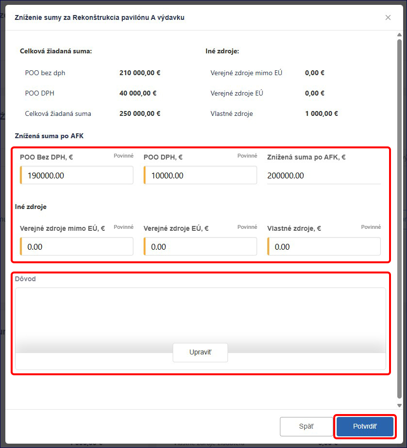

Pri výdavku, v tabuľke, uvidíme upravené sumy a klikneme na tlačidlo
**Schváliť**. Zobrazí sa zoznam súm, ako **Celková žiadaná suma,
Neoprávnené výdavky** a **Čiastkovo schválená suma po AFK**, kde môžeme
overiť správnosť upravených súm. Následne sa sprístupní zelené tlačidlo
**Schváliť ŽoP**, čím sa žiadosť dostane do stavu **Schválená so
zníženou sumou**.

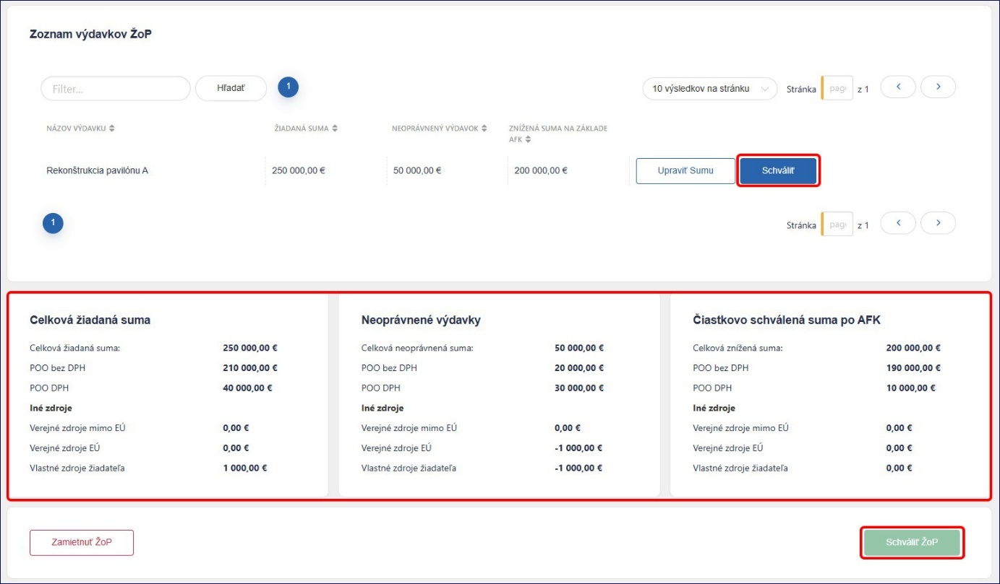

**Poznámka:** *Ak sa v zozname výdavkov nachádza viac ako jeden výdavok
a niektorý z výdavkov neschválime, žiadosť sa dostane do stavu
**Čiastočne schválená**.*

6.5.3) Po schválení ŽoP typov **Priebežná platba**, **Poskytnutie
zálohy** a **Poskytnutie predfinancovania** sa v danej ŽoP v časti
**Info,** v spodnej časti obrazovky, sprístupní tlačidlo **Zaevidovať
údaje o vyplatení**.

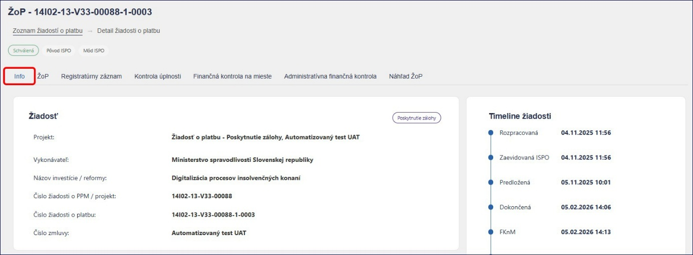

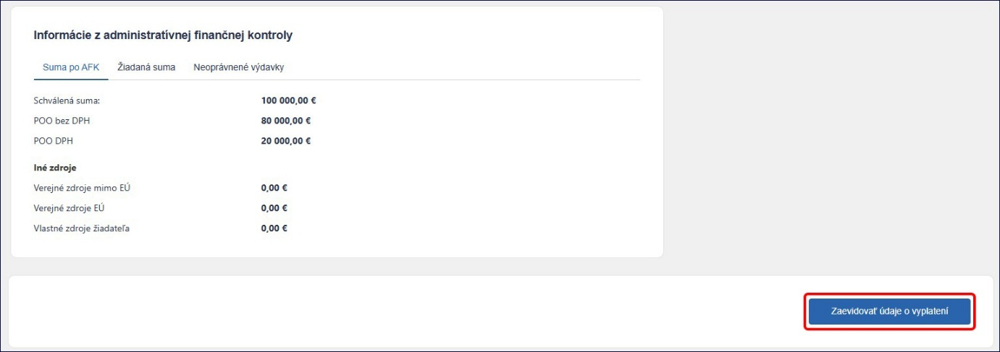

**Poznámka:** *Údaje o vyplatení zaevidujeme až po tom, ako vykonávateľ
vyplatí ŽoP prijímateľovi.*

V modálnom okne sa automaticky vyplnia sumy schválené v ŽoP, ktoré
skontrolujeme a vyplníme IBAN prijímateľa a **Dátum vyplatenia ŽoP**.

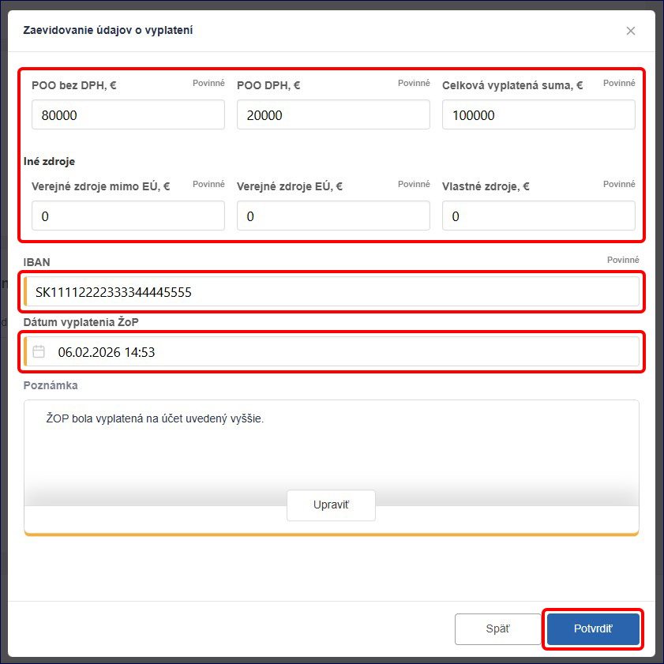

Takáto ŽoP sa dostane do stavu **Vyplatená**, pričom prijímateľ na
Portáli ISPO už vie, že môže podávať **Zúčtovacie ŽoP**.

## 6.6) Doplnenie ŽoP

Doplnenie ŽoP môžeme vykonať počas kontroly úplnosti, s pracovnou
pozíciou **Kontrolór úplnosti ŽoP,** ak je ŽoP v stave **Predložená**
alebo počas administratívnej finančnej kontroly, s pracovnou pozíciou
**Administratívny finančný kontrolór ŽoP,** ak je ŽoP v stave **Finančná
kontrola**.

6.6.1) Po kliknutí na konkrétnu ŽoP prejdeme do záložky **Doplnenie**.
Otvorí sa zoznam doplnení na danej ŽoP. Ak ešte nebolo vykonané žiadne
doplnenie, zoznam je prázdny.

Poznáme dva typy doplnenia a to **Nové priame doplnenie** a **Nové
doplnenie**.

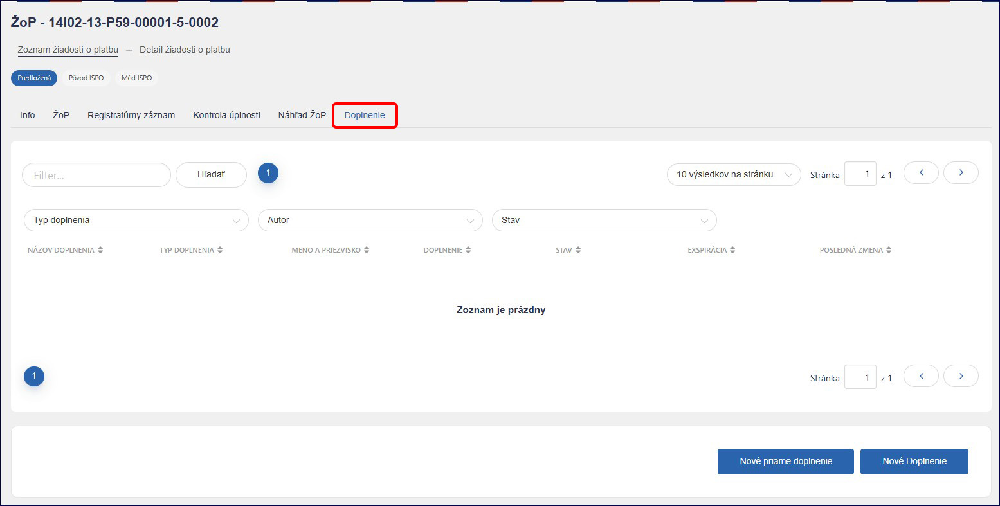

**Nové priame doplnenie** je typ doplnenia, kedy sme chýbajúce údaje od
žiadateľa obdržali mimo ISPO, napr. cez e-mail a do ŽoP tieto údaje
chceme zapracovať. Klikneme na tlačidlo **Nové priame doplnenie.**

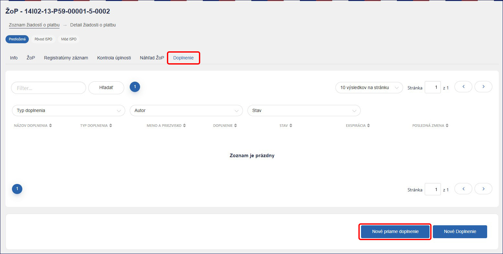

Uvedieme **Názov doplnenia** a klikneme na tlačidlo **Vytvoriť
doplnenie**.

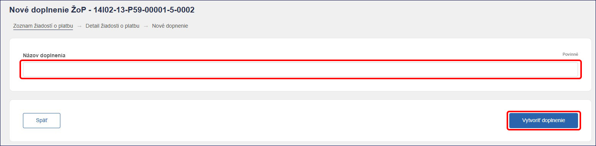

6.6.2) Po vytvorení doplnenia sa otvorí detail doplnenia, v ktorom
môžeme zmeniť názov a doplniť údaje do sekcie **Suma zálohovej platby**
alebo **Vykázané výdavky – zoznam dokladov** (v závislosti od typu ŽoP)
a **Dodatočné prílohy žiadosti o platbu**.

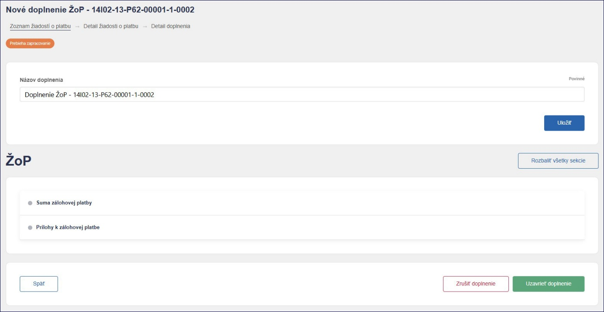

V sekcii **Suma zálohovej platby** môžeme upraviť hodnoty **Sumy z Plánu
obnovy bez DPH,€** a **Čiastky DPH z Plánu obnovy, €** pričom vždy
vidíme aktuálnu hodnotu uvedenú žiadateľom v pôvodnej žiadosti a nami
upravenú hodnotu. Úpravu potvrdíme tlačidlom **Uložiť**.

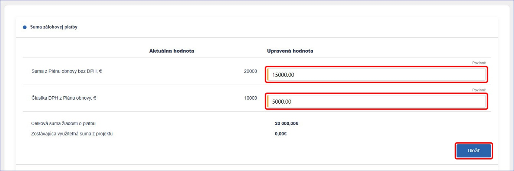

V sekcii **Vykázané výdavky – zoznam dokladov** v časti **Upravená
hodnota** môžeme upravovať výdavky. **Premenovať** alebo **Odstrániť**
výdavok môžeme kliknutím na tlačidlo **Tri bodky** a vybrať možnosť.
Kliknutím na daný výdavok sa dostaneme na zoznam dokladov. Pomocou
tlačidla **Pridať výdavok** pridáme nový výdavok.

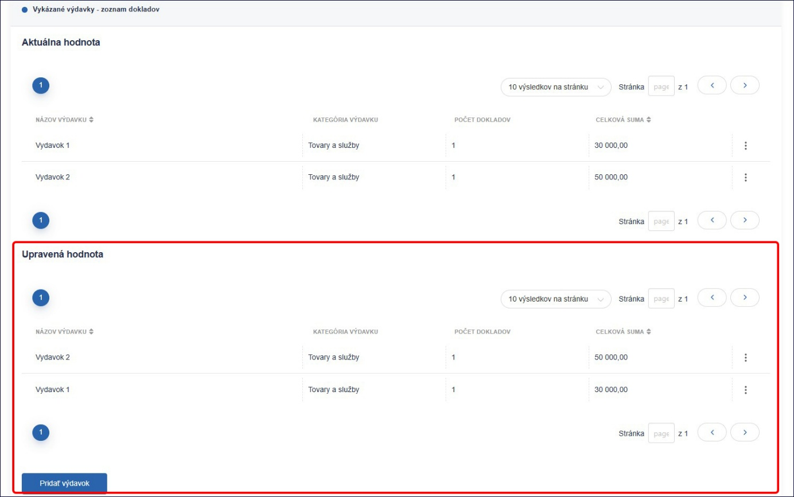

Po kliknutí na daný výdavok alebo po vytvorení nového výdavku sa
dostaneme na zoznam dokladov pod výdavkom, ktoré môžeme pridať, editovať
alebo odstrániť. Nový doklad môžeme pridať kliknutím na tlačidlo **Nový
doklad k výdavku**.

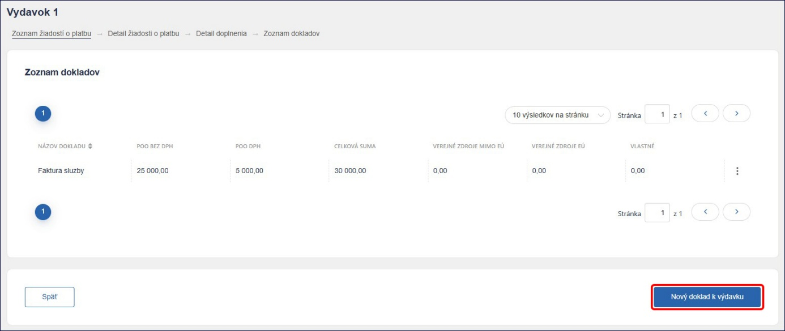

V nasledujúcej obrazovke pre zadávanie údajov nového dokladu nahráme
prílohu k dokladu a vyplníme polia ako **Názov dokladu**, **Číslo
dokladu** a **Dátum úhrady**.

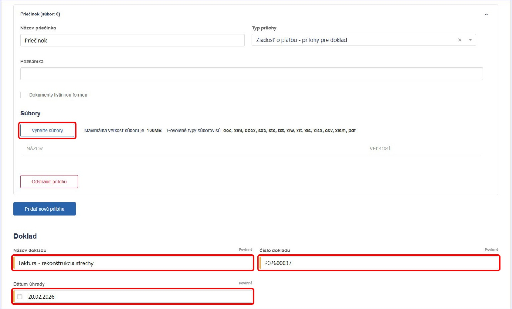

Následne zvolíme typ výdavku z možností **Mzdy, Tovary a služby**
a **Iné**. Ak uvedieme sumy do polí **POO bez dph** a **POO dph**, tak
pole **Celková suma** sa vypočíta automaticky. Následne vyplníme polia
ako **Verejné zdroje mimo EÚ**, **Verejné zdroje EÚ** a **Vlastné
zdroje** a to aj v prípade, že sú nulové.

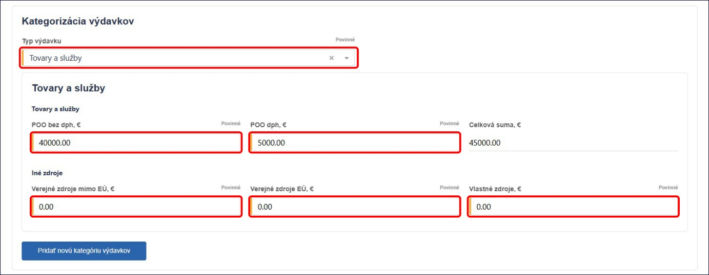

Môžeme tiež vyplniť údaje k zmluve, ak sú relevantné.

Do poľa **Dodávateľ** uvedieme názov alebo IČO dodávateľa. Systém
napojený na RPO v zozname vyhľadá požadovanú organizáciu, na ktorú
klikneme. Ak systém dodávateľa nevyhľadá alebo je dodávateľ zahraničný,
vytvoríme ho kliknutím na tlačidlo **+ Nový dodávateľ**. Po pridaní
dodávateľa sa sprístupní pole pre zadanie subdodávateľa.

Pre pridanie dokladu klikneme na tlačidlo **Uložiť**.

Pokračovať môžeme pridaním ďalších dokladov alebo cez tlačidlo **Späť**
sa môžeme vrátiť na zoznam výdavkov. Doplnením alebo upravením dokladu
sa upraví aj hodnota výdavku. Ak sme dokončili úpravu sekcie výdavkov,
pokračovať môžeme na sekciu **Dodatočné prílohy žiadosti o platbu**,
v ktorej rovnako môžeme porovnať aktuálnu hodnotu a doplniť prílohy
do časti upravená hodnota.

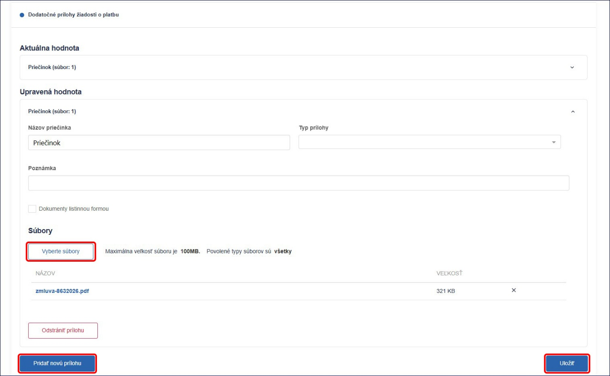

Ak sme zapracovali všetky doplnené údaje, môžeme doplnenie ukončiť
tlačidlom **Uzavrieť doplnenie**. V prípade, že sme toto doplnenie
vytvorili omylom, alebo už nie je relevantné, môžeme ho zrušiť.

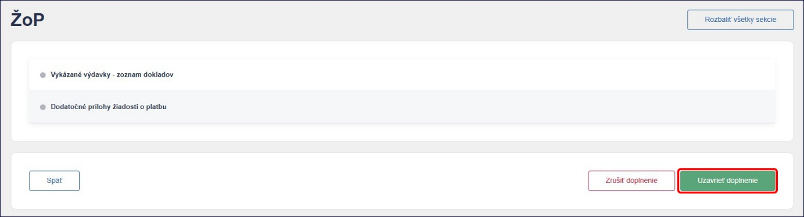

6.6.3) **Nové doplnenie** je typ doplnenia, v ktorom najskôr
vyšpecifikujeme chýbajúce údaje ŽoP a vyzveme žiadateľa cez Portál ISPO,
aby ich doplnil. Žiadateľ ich doplní cez Portál ISPO a odošle späť.
Následne jeho odpoveď zapracujeme do ŽoP. Klikneme na tlačidlo **Nové
doplnenie**.

Po kliknutí na konkrétnu ŽoP prejdeme do záložky Doplnenie. Klikneme na
tlačidlo **Nové doplnenie**.

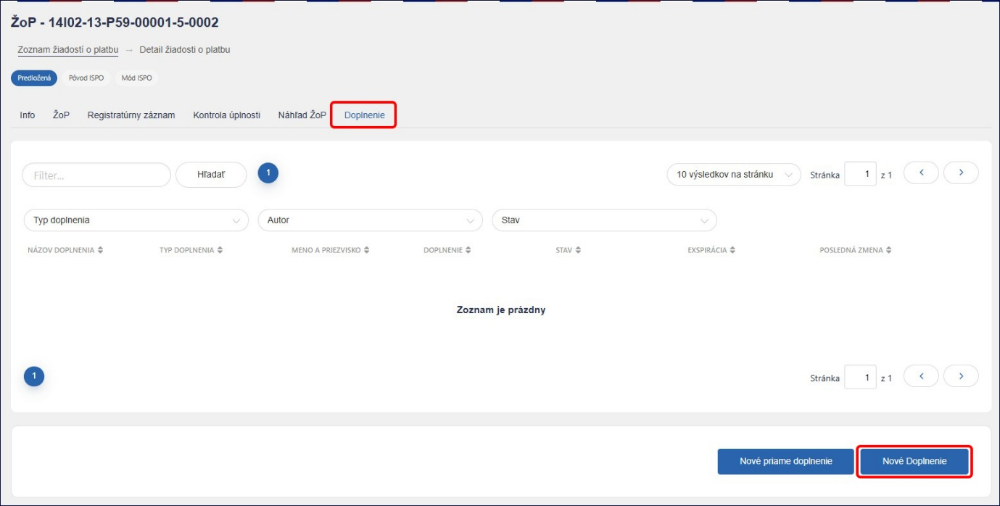

Vyplníme **Názov doplnenia**, napr. *Výzva na doplnenie ŽoP -
14I02-13-V03-00005-5-0001*. Dátum exspirácie je prednastavený na 10 dní,
ale môžeme ho zmeniť. Následne klikneme na pole **Nová požiadavka**.

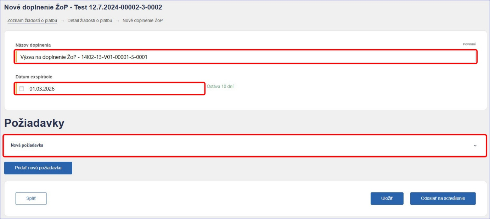

Otvoria sa ďalšie polia ako **Sekcia**, **Názov požiadavky**, **Detail
požiadavky** a možnosť pridať prílohu.

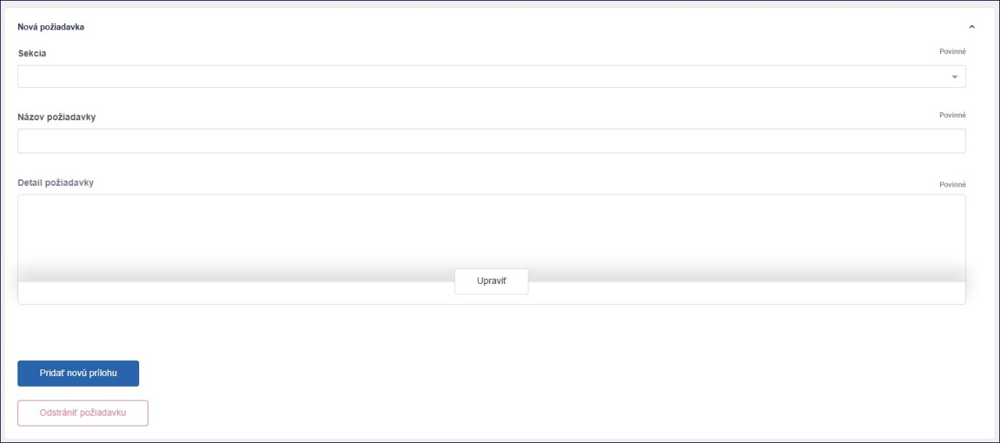

V poli **Sekcia** máme možnosť vybrať **Suma zálohovej platby** alebo
**Vykázané výdavky – zoznam dokladov** (v závislosti od typu ŽoP)
a **Dodatočné prílohy žiadosti o platbu**. Vyberieme jednu z možností,
napr. *Vykázané výdavky – zoznam dokladov.*

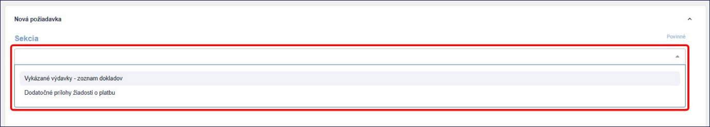

Následne vyplníme **Názov požiadavky** a **Detail požiadavky**, prípadne
nahráme vzorovú prílohu. Kliknutím na tlačidlo **Pridať novú
požiadavku** môžeme nadefinovať ďalšiu požiadavku.

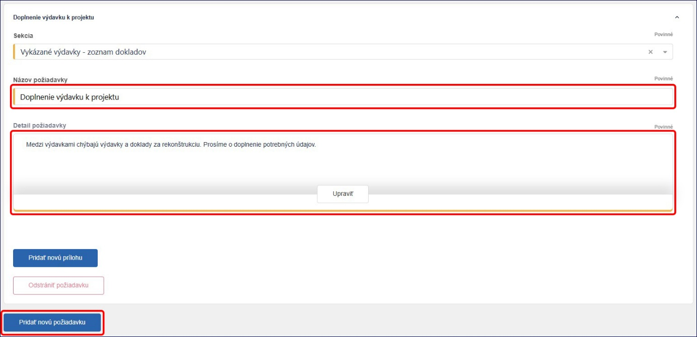

Výzvu na doplnenie môžeme uložiť a pokračovať v práci neskôr alebo ju
môžeme odoslať na schválenie kliknutím na tlačidlo **Odoslať na
schválenie**. Zo zoznamu vyberieme osobu s pracovnou pozíciou
**Schvaľovateľ doplnenia ŽoP**, ktorá výzvu na doplnenie schváli
a odošle žiadateľovi, prípadne vráti späť na dopracovanie.

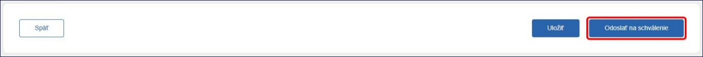

Po odoslaní sa doplneniu vytvorí špecifický kód zložený z piatich
automaticky generovaných znakov, napr. ***L5Y5W***. Takéto doplnenie je
v stave ***Čaká na odpoveď***.

Náhľad výzvy na doplnenie na Portáli ISPO.

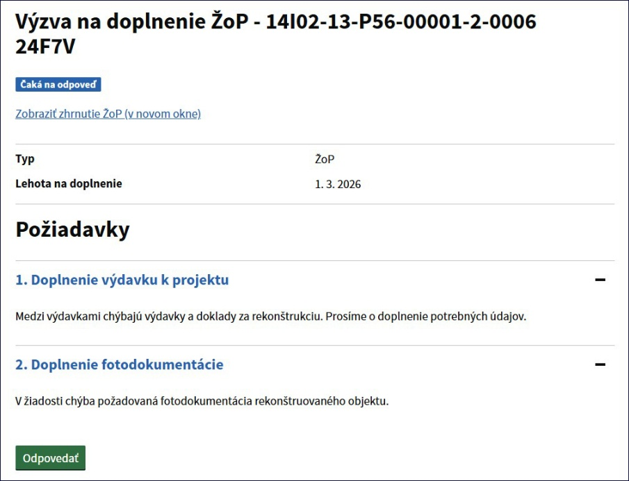

Keď žiadateľ odpovie na naše požiadavky, doplnenie je v stave
***Zodpovedaná***. Klikneme na danú ŽoP a v záložke **Doplnenie**
v zozname klikneme na dané doplnenie.

V prvej časti zodpovedaného doplnenia vidíme našu požiadavku a v druhej
časti odpoveď žiadateľa.

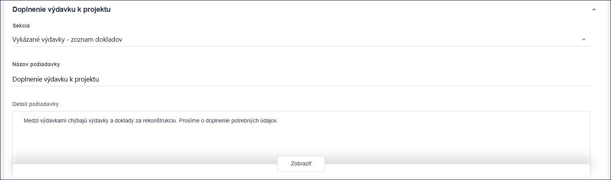

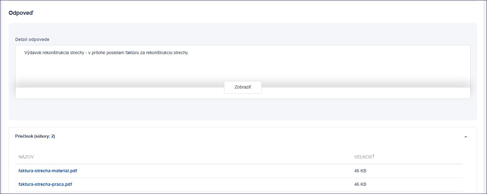

Ak je odpoveď od žiadateľa dostatočná, musíme ju zapracovať do
doplnenia. Klikneme na tlačidlo **Zapracovať doplnenie**.

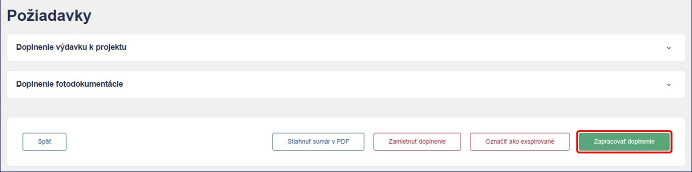

Následne doplníme údaje do požadovaných sekcií tak ako ich opisujeme v
bode **6.6.2)** pričom údaje čerpáme z odpovede žiadateľa. Po
zapracovaní odpovedí žiadateľa odošleme doplnenie na kontrolu
a schválenie tlačidlom **Odoslať na schválenie**. Zo zoznamu vyberieme
osobu, ktorá by mala kontrolu a schválenie vykonať.

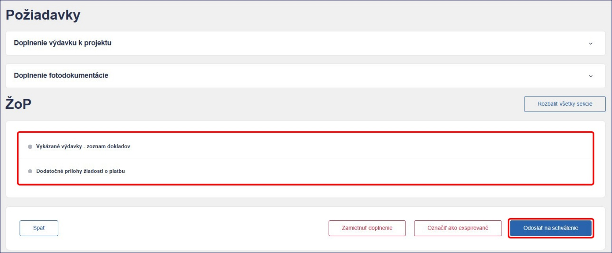

Osoba vykonávajúca kontrolu doplnených údajov môže toto doplnenie vrátiť
späť alebo kliknutím na tlačidlo **Schváliť a odoslať** uzavrieť toto
doplnenie ako dokončené. Takto dokončené doplnenie získa stav
**Vyriešená**.

V prípade, že odpoveď žiadateľa nebola dostatočná alebo chybná,
doplnenie môžeme **Zamietnuť**. V prípade, že žiadateľ neodpovedal do
lehoty, ktorú sme uviedli, môžeme doplnenie **Označiť ako expirované**.