# 7. Evidenčné projekty

Na vytvorenie a editovanie evidenčných projektov ako aj následne
vytváranie interných ŽoP v ISPO potrebujeme pracovnú pozíciu **Editor
ŽoP a projektu**.

## 7.1) Vytvorenie evidenčného projektu

V ľavom panely klikneme na sekciu **Projekty**. Zobrazí sa zoznam
všetkých typov projektov v ISPO pod daným orgánom. Pre vytvorenie nového
evidenčného projektu klikneme na tlačidlo **Nový evidenčný projekt**
v pravom hornom rohu.

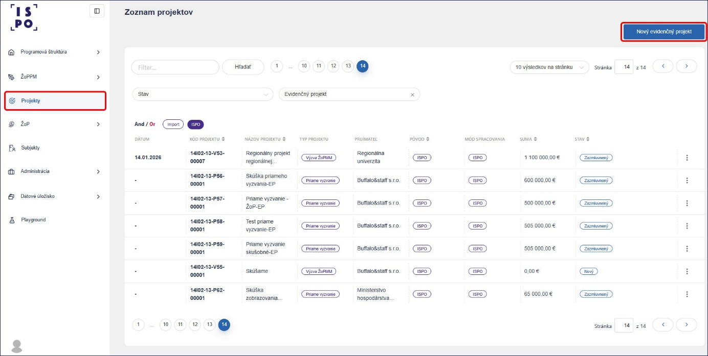

Najskôr vyplníme polia **Opatrenie** a **Vykonávateľ**. Pole **Kód
projektu** systém automaticky vygeneruje podľa príručky k úložisku NIKA
v zložení:

***Číslo komponentu -\> veľké I/R -\> číslo investície/reformy -\>
pomlčka -\> číslo vykonávateľa -\> pomlčka -\> veľké E a poradové číslo
evidenčného projektu***

Kód projektu je možné editovať. Následne vyplníme aj **Názov projektu**
a vyberieme relevantný **stav** projektu.

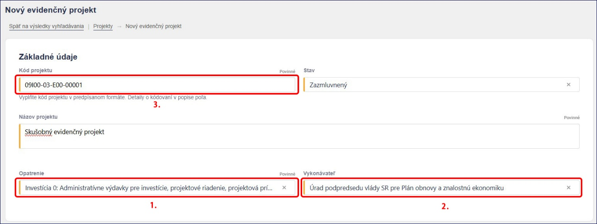

V časti **Výdavky** môžeme vyplniť polia pre sumy ako ***Suma z Plánu
obnovy bez DPH, Čiastka DPH z Plánu obnovy, Suma vlastných zdrojov
žiadateľa, Suma verejných zdrojov okrem zdrojov EÚ*** a ***Suma
verejných zdrojov EÚ***. Následne klikneme na tlačidlo **Prepočítať**
a **Celková suma projektu** sa prepočíta automaticky.

V časti **Zmluva** môžeme vyplniť polia ako ***Číslo zmluvy, Dátum
platnosti zmluvy, Dátum uzavretia zmluvy, Dátum zverejnenia zmluvy
v CRZ*** a ***Link CRZ***. Zároveň v tejto časti môžeme nahrať prílohu
zmluvy tak, že klikneme na tlačidlo **Vyberte súbory** a vyberieme súbor
z nášho zariadenia.

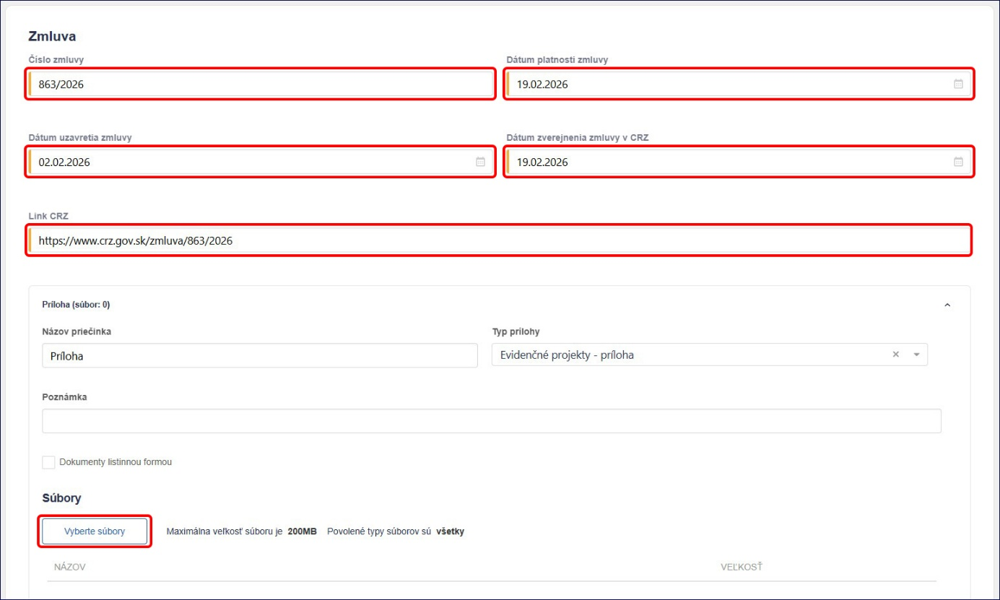

**Upozornenie**! *Pokiaľ sme nastavili stav projektu **Zazmluvnený**,
údaje o zmluve musíme uviesť tiež.*

Pre pridanie **Prijímateľa** klikneme na tlačidlo **Pridať**.

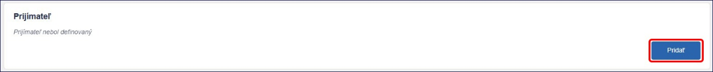

Označíme organizáciu a do poľa **Výber organizácie** uvedieme názov
alebo IČO organizácie, ktorú chceme pridať. Systém ISPO spárovaný s RPO
navrhne zoznam organizácií, z ktorých si vyberieme požadovanú
a potvrdíme tlačidlom **Pridať**.

Takto pridaný prijímateľ sa zobrazí v základnom tvare, systém však na
pozadí dotiahne všetky údaje o organizácii. V časti **Poznámka** môžeme
uviesť doplňujúce údaje k projektu. Následne klikneme na tlačidlo
**Pridať**, čím potvrdíme vytvorenie evidenčného projektu.

Takto vytvorený projekt sa nachádza v zozname **Projekty** vždy na
poslednom mieste.

Pre vyhľadanie evidenčných projektov v zozname **Projekty** môžeme
použiť filter **Typ projektu**, v ktorom vyberieme možnosť **Evidenčný
projekt**. Zároveň musíme zakliknúť možnosť **And** tak, aby bola
označená červenou farbou. Filtrovať môžeme aj pomocou módu spracovania
**Import** a **ISPO**.

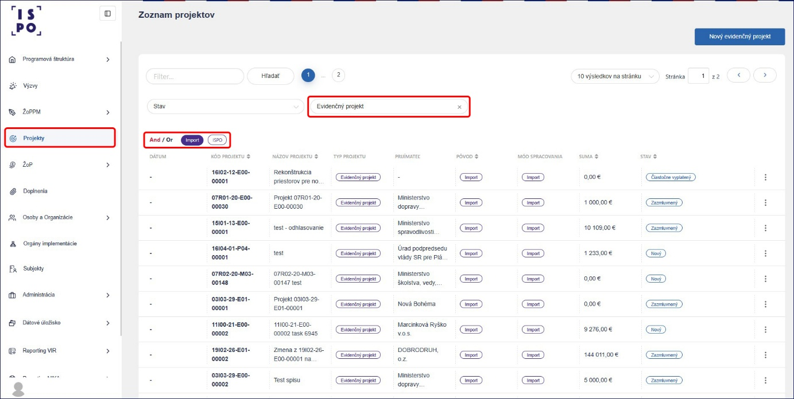

## 7.2) Vytvorenie internej žiadosti o platbu

Na to aby bolo možné vytvoriť internú ŽoP k evidenčnému projektu je
potrebné, aby bol projekt v stave **Zazmluvnený**. V detaile evidenčného
projektu v záložke **Žiadosti o platbu** sa nachádza zoznam žiadostí
o platbu, ktoré boli zaevidované k danému projektu. Ak je zoznam
prázdny, k projektu ešte nebola vytvorená žiadna ŽoP. Pre vytvorenie
novej ŽoP klikneme na tlačidlo **Vytvoriť žiadosť o platbu**.

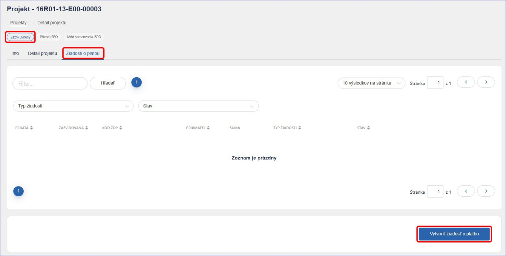

Po otvorení modálneho okna v poli **Typ žiadosti** vyberieme typ ŽoP.

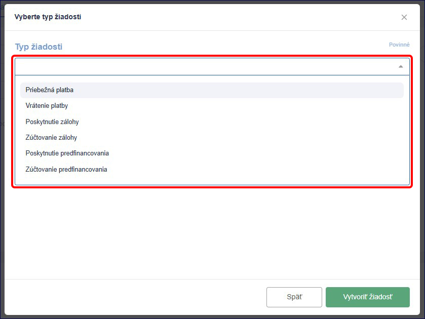

Po výbere jednej z možností napr. *Priebežná platba/Refundácia* môžeme
uviesť, či sa jedná o záverečnú žiadosť o platbu. Následne klikneme na
tlačidlo **Vytvoriť žiadosť**.

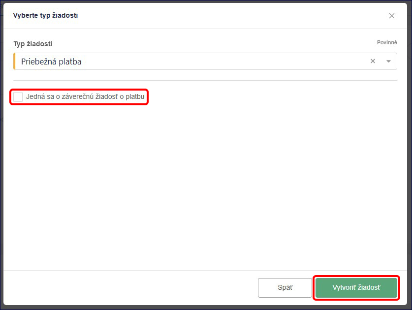

Otvorí sa detail ŽoP v stave **Rozpracovaná** s kódom rozpracovanej
ŽoP*,* vzorovo *IRZ-260220-000752*. Po zaevidovaní ŽoP sa tento kód
zmení na štandardný kód žiadosti. Záložka **Info** pozostáva zo
všeobecných údajov o prijímateľovi a údajov o projekte.

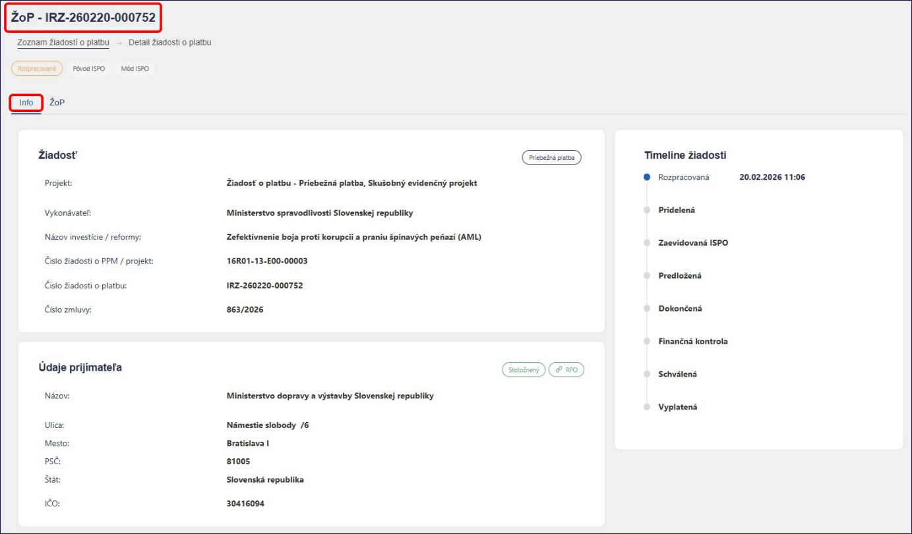

Záložka **ŽoP** je rozdelená do jednotlivých sekcií. Kliknutím na
jednotlivé sekcie sa otvorí ich detail. Tlačidlo **Odoslať žiadosť** je
zablokované, pokiaľ nevyplníme všetky povinné údaje.

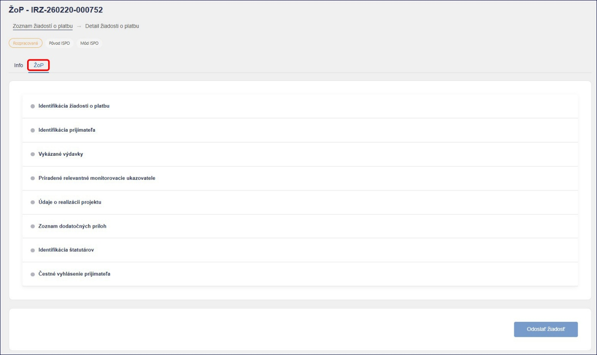

7.2.1) Sekcie **Identifikácia žiadosti o platbu** a **Identifikácia
prijímateľa** sú automaticky vyplnené. Ide o všeobecné informácie
o žiadosti a prijímateľovi.

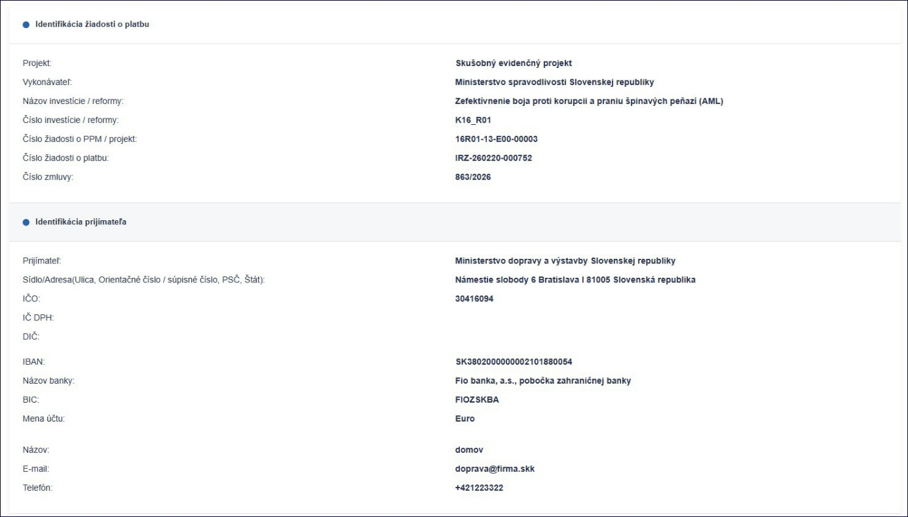

7.2.2) Tretia v poradí je sekcia, ktorej názov a obsah závisí od typu
ŽoP.

V prípade typu ŽoP *Poskytnutie zálohy* sa táto sekcia volá
**Poskytnutie zálohy**. V tejto sekcii vyplníme polia ako **Suma z Plánu
obnovy bez DPH, €** a **Čiastka DPH z Plánu obnovy, €**, prípadne môžeme
doložiť prílohu. Následne klikneme na tlačidlo **Uložiť**.

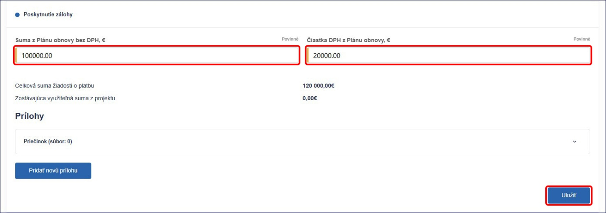

V prípade typu ŽoP *Vrátenie* sa táto sekcia volá **Vrátenie**. Vyplníme
v nej polia ako **Suma z Plánu obnovy bez DPH, €** a **Čiastka DPH z
Plánu obnovy, €**, prípadne môžeme doložiť prílohu. Následne klikneme na
tlačidlo **Uložiť**.

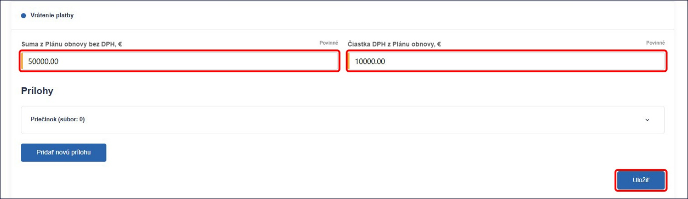

V prípade typov ŽoP ako *Pribežná platba/Refundácia*, *Zúčtovanie
zálohy, Poskytnutie predfinancovania* a *Zúčtovanie predfinancovania* sa
sekcia v poradí nazýva **Vykázané výdavky**. Pre pridanie nového výdavku
klikneme na tlačidlo **Pridať výdavok**.

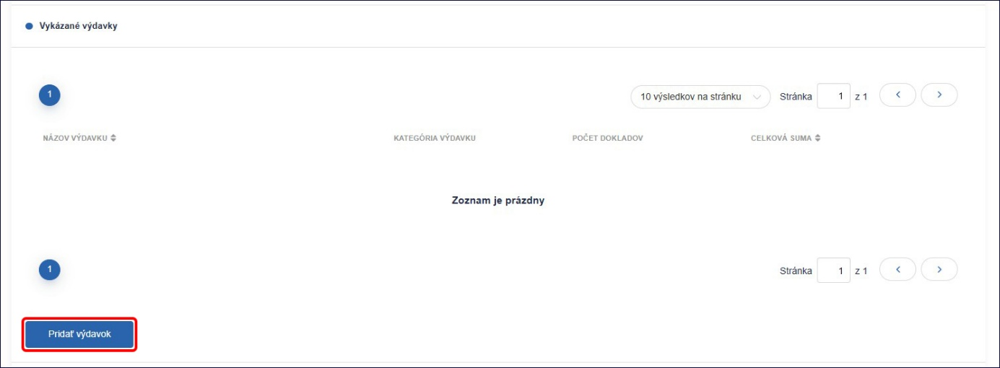

V modálnom okne uvedieme **Názov výdavku** a klikneme na tlačidlo
**Vytvoriť**.

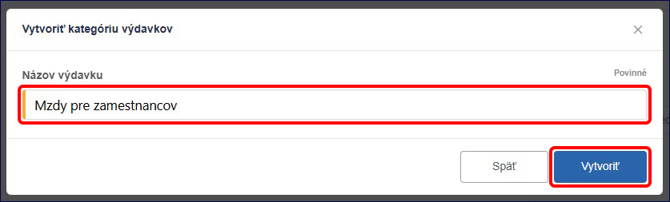

Takto vytvorený výdavok sa zobrazí v zozname výdavkov. Cez tlačidlo
**Tri bodky** na výdavku ho môžeme premenovať, odstrániť alebo sa dostať
do jeho detailu na zoznam dokladov. Na zoznam dokladov sa dostaneme aj
kliknutím na daný výdavok.

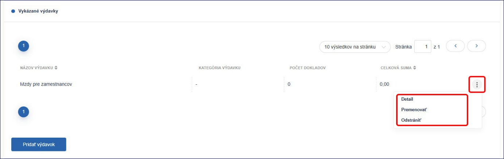

V prípade, že ešte nebol pridaný žiadny doklad k výdavku, zoznam
dokladov je prázdny. Pre pridanie dokladu klikneme na tlačidlo **Nový
doklad k výdavku**.

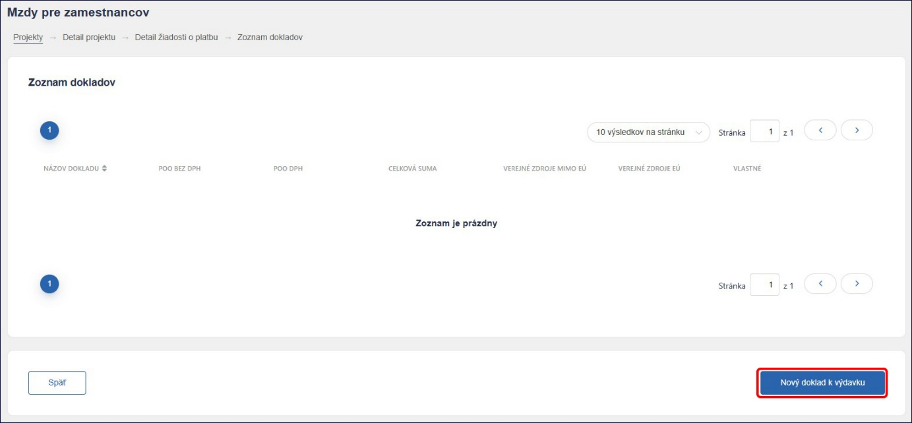

V nasledujúcej obrazovke pre zadávanie údajov nového dokladu nahráme
prílohu k dokladu a vyplníme polia ako **Názov dokladu**, **Číslo
dokladu** a **Dátum úhrady**.

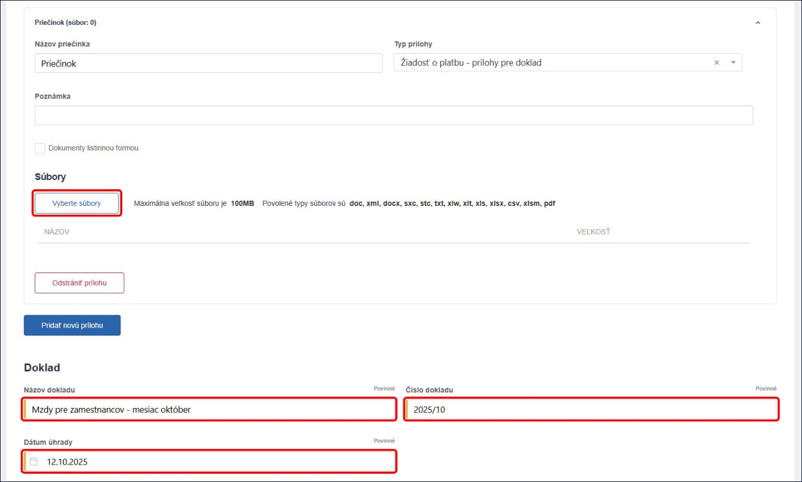

Následne zvolíme typ výdavku **Mzdový, Tovary a služby** a **Iné**. Ak
vyberieme výdavok **Mzdový** uvedieme sumy do polí **POO bez dph**
a pole **Celková suma** sa vypočíta automaticky. Následne vyplníme aj
polia ako **Verejné zdroje mimo EÚ**, **Verejné zdroje EÚ** a **Vlastné
zdroje** a to aj v prípade, že sú nulové.

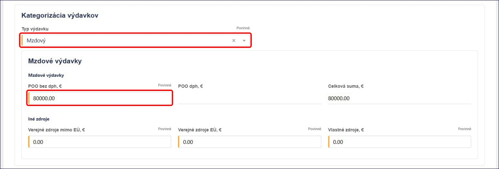

Vyplniť môžeme **Údaje k zmluve** ak sú relevantné.

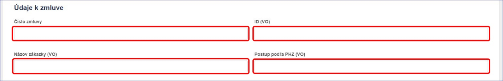

V prípade interných ŽoP sa polia **Dodávateľ** a **Subdodávateľ**
nevypĺňajú. Pre pridanie dokladu klikneme na tlačidlo **Uložiť**.

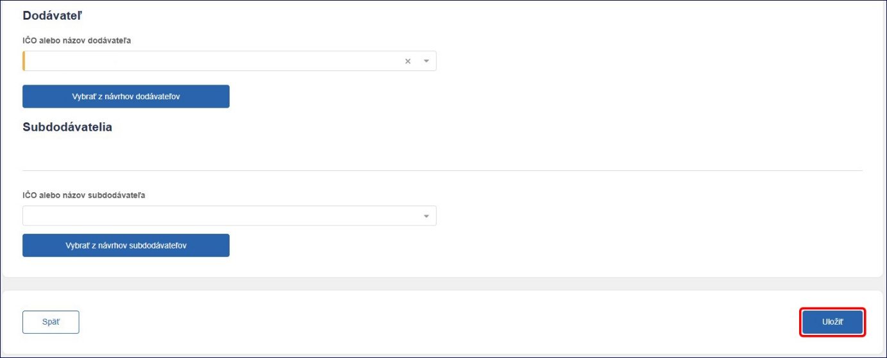

Takto pridaný doklad sa dostane do zoznamu dokladov. Pokračovať môžeme
pridaním ďalších dokladov alebo sa cez tlačidlo **Späť** môžeme vrátiť
na zoznam výdavkov.

7.2.3) Vyplniť môžeme aj sekciu **Údaje o realizácii projektu**.
Klikneme na tlačidlo **Upraviť**.

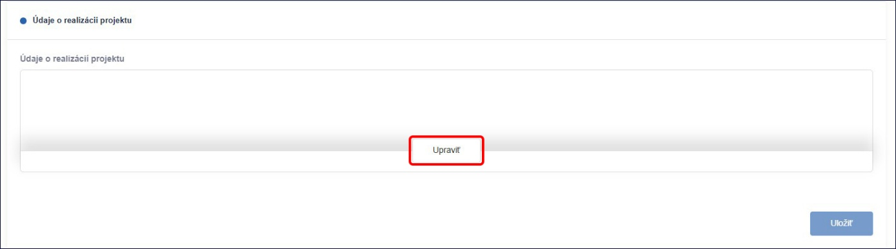

V modálnom okne do textového okna napíšeme text o realizácii projektu.
Následne klikneme na tlačidlo **Zatvoriť**.

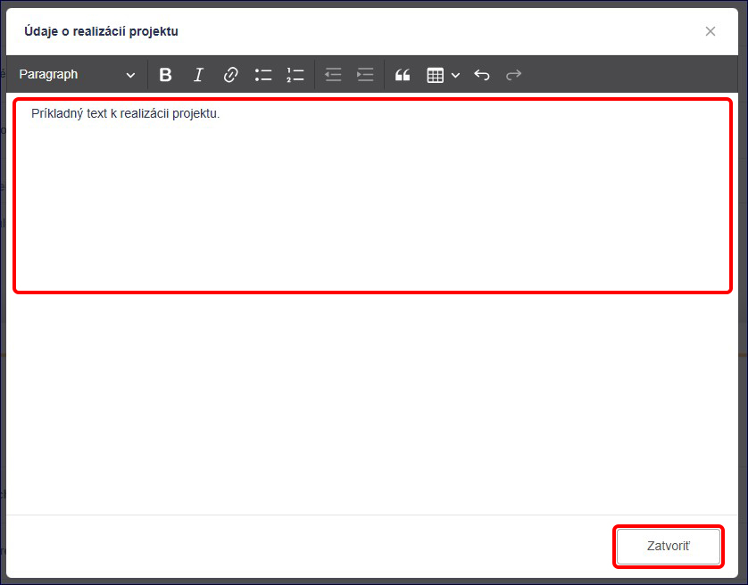

Následne text uložíme kliknutím na tlačidlo **Uložiť**.

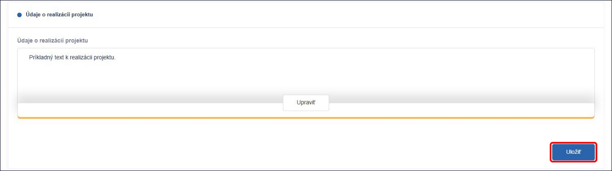

7.2.4) V sekcii **Zoznam dodatočných príloh** môžeme nahrať prílohy
k ŽoP. Po nahratí prílohy klikneme na tlačidlo **Uložiť**.

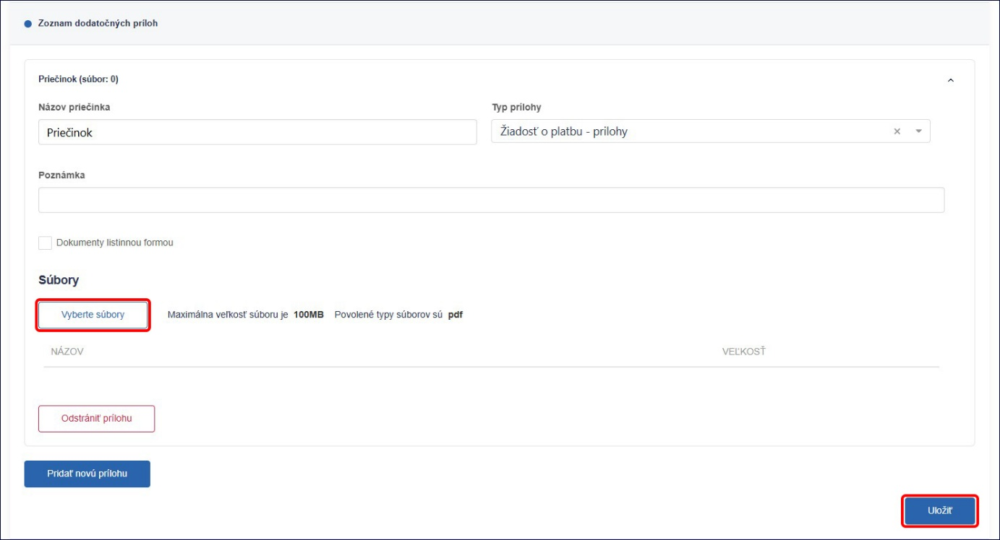

7.2.5) V sekcii **Identifikácia štatutárov** označíme štatutára
označením zaškrtávacieho políčka a potvrdíme pravdivosť tohto údaju
aktivovaním prepínacieho tlačidla. Klikneme na tlačidlo **Uložiť**.

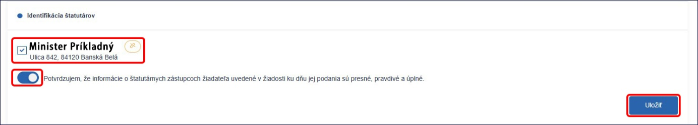

7.2.6) V sekcii **Čestné vyhlásenie prijímateľa** aktivujeme prepínacie
tlačidlo. Ak sme všetko správne vyplnili a uložili, sprístupní sa aj
tlačidlo **Odoslať žiadosť**. Kliknutím naň úspešne zaevidujeme internú
ŽoP na evidenčnom projekte.

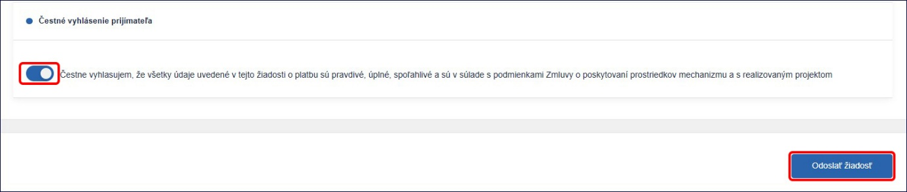

Takto pridaná ŽoP sa zobrazí v zozname **ŽoP -\> Všetky ŽoP** na
poslednom mieste. Vidieť ju môžeme aj v zozname ŽoP v detaile
evidenčného projektu.