# 1. Registrácia

Prístup do neverejnej časti ISPO vyžaduje **registráciu** určených
zamestnancov vykonávateľa zapojených do implementácie POO. Zamestnanci
sa môžu do systému registrovať prostredníctvom **Žiadosti o registráciu
konta v ISPO** na adrese
[<u>https://is.planobnovy.sk/registracia</u>](https://is.planobnovy.sk/registracia).
  

Pri vypĺňaní žiadosti o vytvorenie konta je potrebné zvoliť jedno z
nasledujúcich **zaradení**:   

  - **Nový zamestnanec** - počiatočná pozícia pridelená novému
    používateľovi systému, ktorá umožňuje len základné zobrazenie
    údajov. K tomuto zaradeniu môže byť neskôr pridelená príslušná
    pracovná pozícia podľa kapitoly **2)**.         

  - **Administrátor vykonávateľa** (v ISPO ako **Admin VIR**) - je
    zodpovedný za priraďovanie pracovných pozícií zamestnancom orgánu a
    resetovanie hesiel. Zároveň slúži ako technický kontakt pre Centrum
    podpory ISPO.

  

Po vyplnení registračného formuláru žiadosti o registráciu konta je
potrebné **vygenerovanú žiadosť** vo formáte PDF vytlačiť a podpísať
žiadateľom a oprávnenou osobou (štatutárom) a následne zamestnanec s
pracovnou pozíciou Admin VIR zašle sken žiadosti emailom na
adresu: <ispo_is@vicepremier.gov.sk>   

V prípade **skončenia pracovného pomeru** je používateľ, respektíve jeho
zamestnávateľ, povinný bezodkladne oznámiť túto skutočnosť Centru
podpory ISPO na adrese <ispo_is@vicepremier.gov.sk>. Používateľ je zároveň
povinný bezodkladne oznámiť správcovi systému akékoľvek ďalšie
skutočnosti, ktoré by mali vplyv na informácie uvedené v žiadosti
o registráciu a oprávnenosť prístupu do systému. Zmena prístupových
údajov si vyžaduje opätovné zaslanie žiadosti o registráciu.  

## 1.1) Postup registrácie na neverejnú časť ISPO

1.1.1) Po kliknutí na registračný odkaz sa zobrazí **Žiadosť
o registráciu konta v ISPO**. Vyplníme požadované údaje a zo zoznamu
vyberieme orgán, pod ktorým sa chceme registrovať.

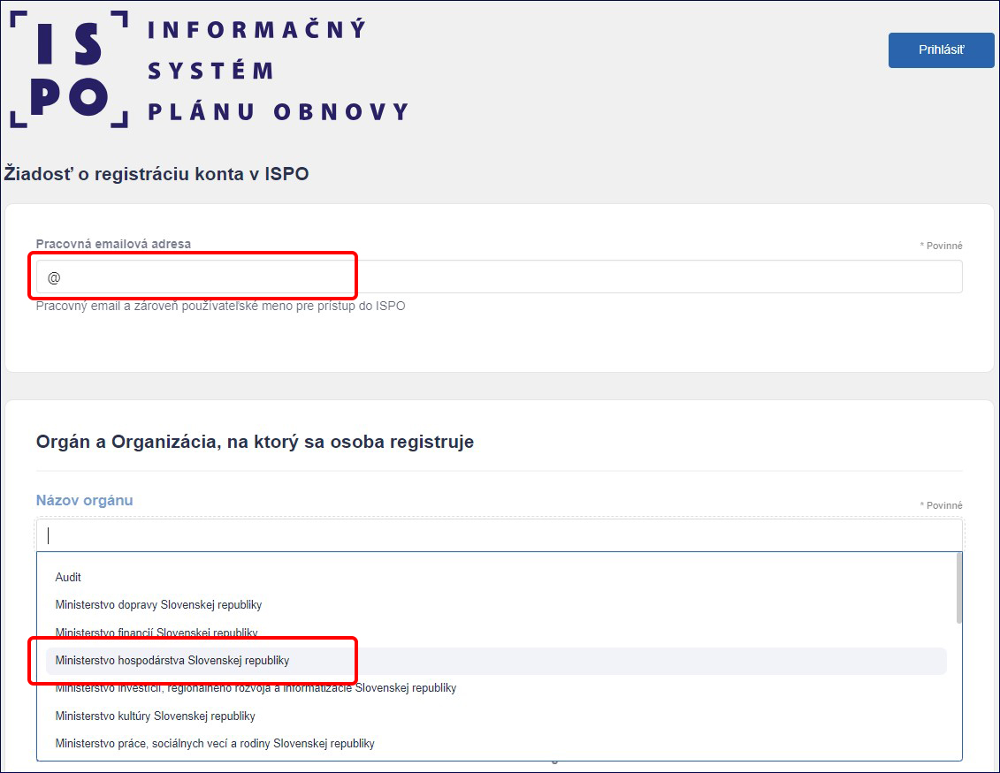

1.1.2) V poli **Zaradenie** vyberieme možnosť **Zamestnanec**. V poli
**Pracovné pozície** vyberieme relevantnú pracovnú pozíciu, v prípade
bežného zamestnanca pozíciu **Nový zamestnanec** a v prípade
administrátora pozíciu **Admin VIR**.

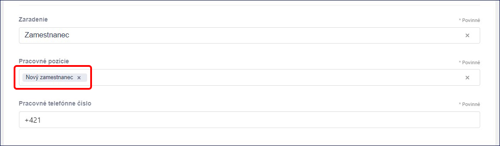 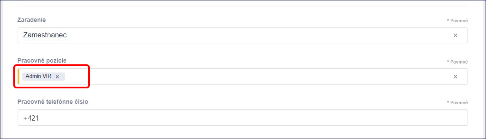

1.1.3) V časti **Identifikácia žiadateľa** môžeme okrem mena
a priezviska uviesť aj titul. Dôležité je uviesť **rodné číslo** (bez
lomítka), bez ktorého nie je možná registrácia. Nie je potrebné uvádzať
dátum narodenia. Dátum narodenia uvádzajú len osoby, ktoré nedisponujú
rodným číslom.

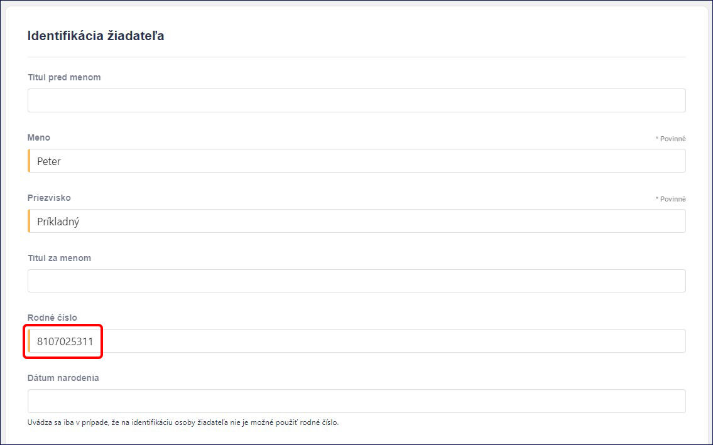

1.1.4) Po vyplnení všetkých relevantných údajov klikneme na tlačidlo
**Odoslať žiadosť o registráciu** v spodnej časti obrazovky.

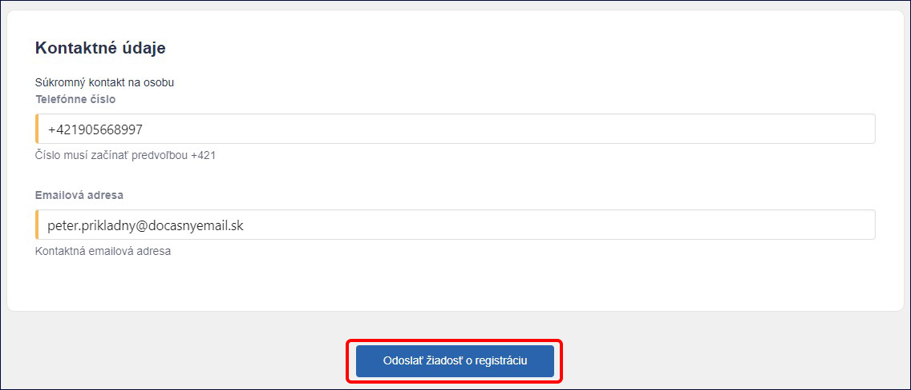

1.1.5) Na zadanú e-mailovú adresu príde e-mail s názvom „*ISPO:
Zaevidovanie žiadosti o registráciu konta v ISPO*“. Vygenerovanú žiadosť vo formáte PDF je potrebné vytlačiť a podpísať žiadateľom a oprávnenou osobou (štatutárom) a následne zamestnanec s pracovnou pozíciou Admin VIR zašle sken žiadosti emailom na adresu: ispo-is@vlada.gov.sk

1.1.6) Po spracovaní žiadosti Centrom podpory ISPO príde na zadanú
e-mailovú adresu e-mail s názvom „*ISPO: Vytvorenie hesla*“. Klikneme na
tlačidlo **Vytvoriť heslo**. V internetovom prehliadači sa otvorí nové
okno, ktoré nás presmeruje na neverejnú časť ISPO.

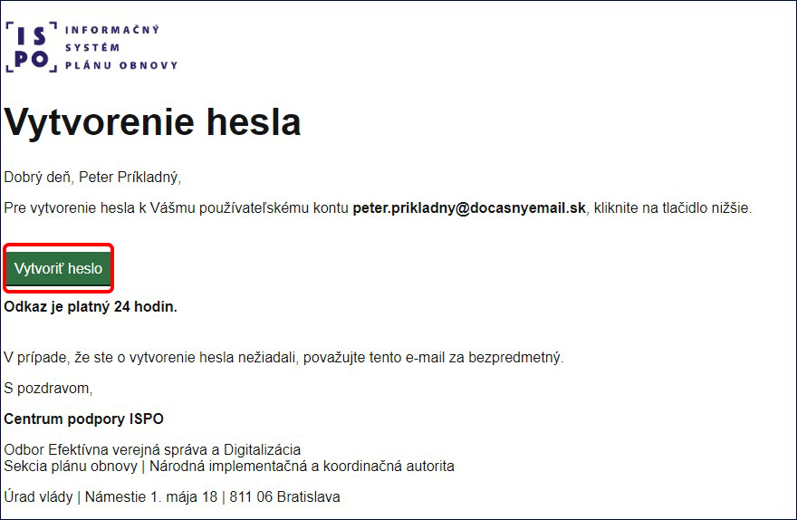

***Poznámka**: Ak nestihneme vytvoriť heslo v danom časovom limite,
kontaktujeme Admina VIR príslušného rezortu so žiadosťou o reset hesla
(Admin VIR má potrebné oprávnenie). V prípade potreby je možné
kontaktovať aj Centrum podpory ISPO.*

V neverejnej časti ISPO klikneme na tlačidlo **Zmeniť heslo**.

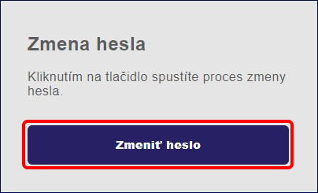

Vytvoríme heslo, ktoré má aspoň 12 znakov a obsahuje aspoň jedno veľké
písmeno, jedno malé písmeno, jednu číslicu a jeden špeciálny znak. Opäť
klikneme na tlačidlo **Zmeniť heslo**.

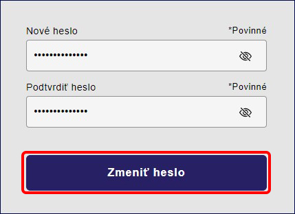

Po úspešnom vytvorení hesla klikneme na tlačidlo **Prejsť do
aplikácie**. Keď nás systém presmeruje do aplikácie, vždy si musíme byť
istí, že pracujeme na stránke
[www.is.planobnovy.sk](https://auth-is.planobnovy.sk/auth/realms/ispo-is-prod/protocol/openid-connect/auth?client_id=ispo-is-prod-client&redirect_uri=https://is.planobnovy.sk/callback&response_type=code&state=bvxzQGTofcFiMuDq).

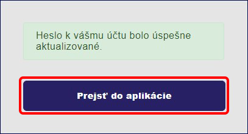

## 1.2) Prihlásenie na neverejnú časť ISPO

1.2.1) Pre prihlásenie na neverejnú časť ISPO na stránke
[www.is.planobnovy.sk](https://auth-is.planobnovy.sk/auth/realms/ispo-is-prod/protocol/openid-connect/auth?client_id=ispo-is-prod-client&redirect_uri=https://is.planobnovy.sk/callback&response_type=code&state=bvxzQGTofcFiMuDq)
napíšeme do poľa **Prihlasovacie meno** **alebo e-mail** e-mailovú
adresu, ktorú sme uviedli pri registrácii a na ktorú sme obdržali e-mail
na vytvorenie hesla. Do poľa **Heslo** uvedieme rovnaké heslo, ktoré sme
si vytvorili a klikneme na tlačidlo **Prihlásiť sa**.

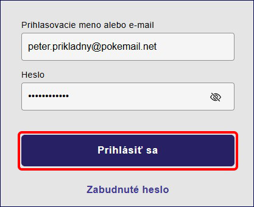

1.2.2) V prípade, že sme zabudli svoje heslo, klikneme na tlačidlo
**Zabudnuté heslo**.

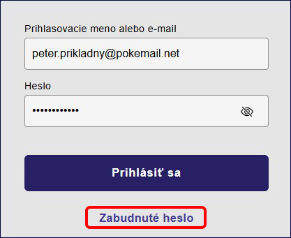

Následne uvedieme do poľa **Prihlasovacie meno alebo e-mail** tú
e-mailovú adresu, ktorú sme uviedli pri registrácii a klikneme na
tlačidlo **Odoslať**.

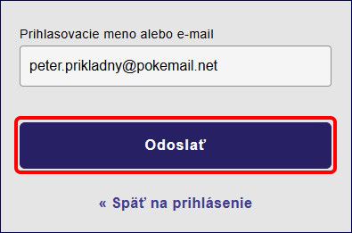

Po obdržaní e-mailu na vytvorenie hesla postupujeme podľa bodu
**1.1.6)**. V prípade, že sme e-mail na zmenu hesla neobdržali do jednej
minúty, skontrolujeme záložku **spam** a **nevyžiadanú poštu**. Ak sa
e-mail nenachádza ani tu, kontaktujeme Centrum podpory ISPO.

1.2.3) Po úspešnom prihlásení na neverejnú časť ISPO vyberieme orgán,
pod ktorým chceme pracovať a klikneme na tlačidlo **Vybrať**.

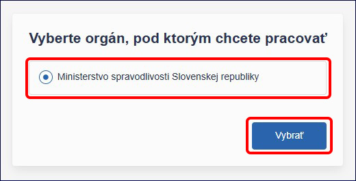

***Poznámka**: Zamestnanci, ktorí majú pracovný pomer s dvoma alebo
viacerými orgánmi štátnej moci, môžu mať po prihlásení sa na výber viac
ako jeden orgán. V takom prípade vyberáme práve ten, pod ktorým chceme
aktuálne pracovať.*

1.2.4) Po prihlásení a výbere orgánu vidíme základnú obrazovku
neverejnej časti ISPO, ktorá je rozdelená na ľavé navigačné menu, ktoré
nám pomáha k lepšej orientácii v systéme a na hlavnú pracovnú časť,
v ktorej môžeme vykonávať konkrétne akcie.

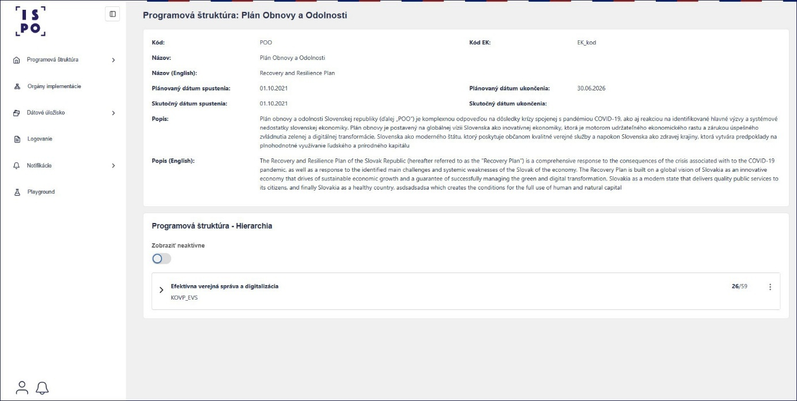

Aktuálny počet položiek v navigačnom menu je len základné zobrazenie pre
nového používateľa s pracovnou pozíciou **Zamestnanec VIR**. Na to aby
sme mohli v systéme vykonávať prácu, ktorou sme poverení, potrebujeme
kontaktovať pracovníka s pracovnou pozíciou **Admin VIR**, ktorý nám
podľa podkapitoly **2.1)** pridelí pracovné pozície, opísané v kapitole
**2)**.

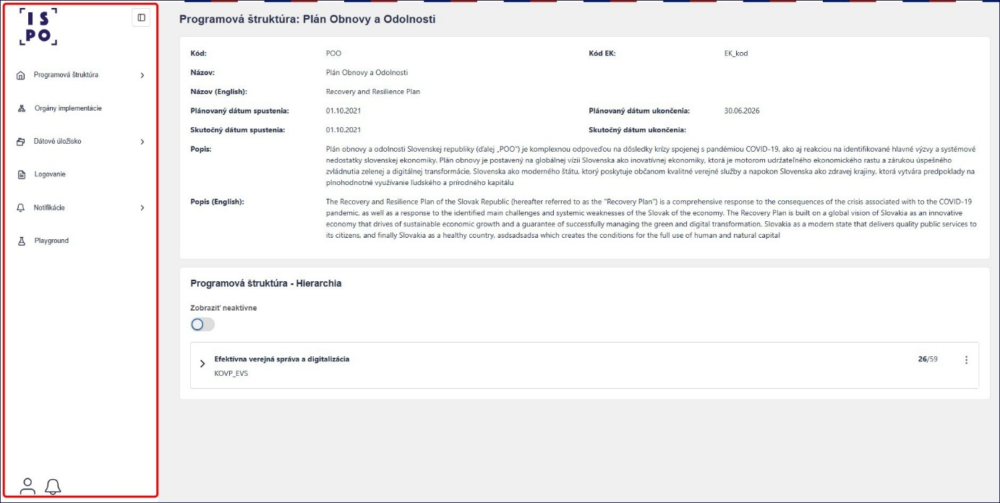

Pomocou tlačidla **Štvorček** v hornej časti navigačného menu môžeme
rozšíriť hlavnú pracovnú časť obrazovky.

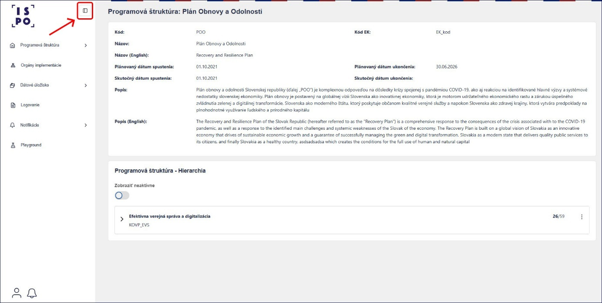

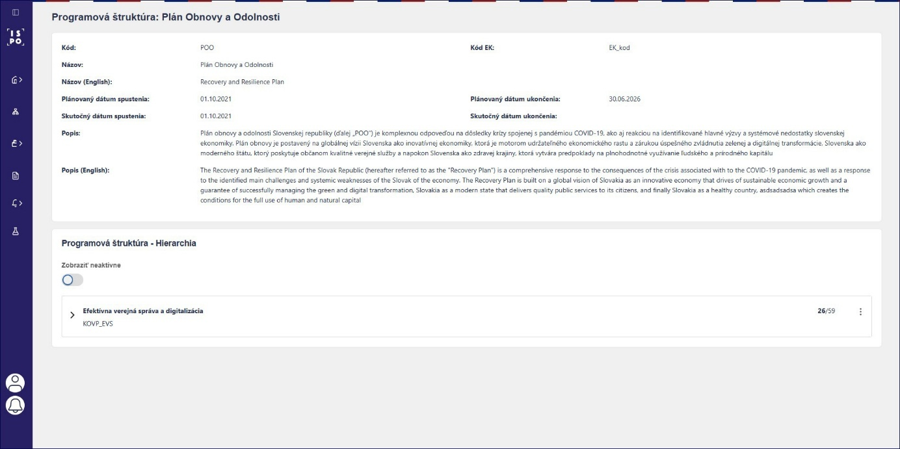

## 1.3) Logovanie a notifikácie na neverejnej časti ISPO

1.3.1) Súčasťou systému ISPO je aj zaznamenávanie jednotlivých krokov
a akcií používateľa v systéme, ďalej len logovanie, ktoré nám pomáha
v prípade, ak potrebujeme dohľadať informácie o tom, v ktorý deň
a v akom čase sme vykonali konkrétnu akciu.

1.3.2) Súčasťou systému ISPO sú aj notifikácie, ktoré dostávame do
zvončeka v spodnej časti navigačného menu a na používateľskú e-mailovú
adresu.

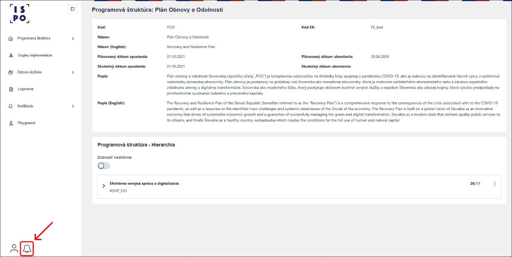

To, aký typ a spôsob notifikácií dostávame, si vieme nastaviť v sekcii
**Notifikácie** v navigačnom paneli v časti **Konfigurácia
notifikácií**. Základné nastavenie notifikácií je pre všetky evidencie
do zvončeka aj na e-mailovú adresu. V prípade, že chceme toto nastavenie
zmeniť, klikneme na tlačidlo **Konfigurovať**.

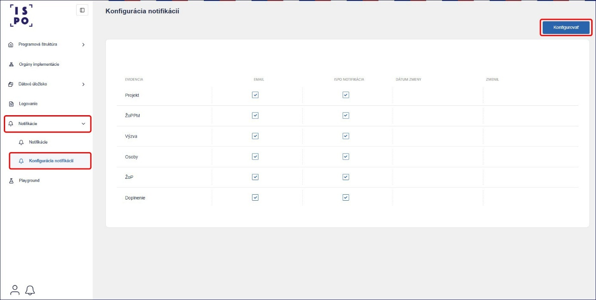

Ak chceme dostávať notifikácie a e-mail z jednotlivých evidencií,
ponecháme zaškrtávacie políčka zaškrtnuté. Ak ich nechceme dostávať,
zaškrtávacie políčka necháme prázdne. Klikneme na tlačidlo **Uložiť**.

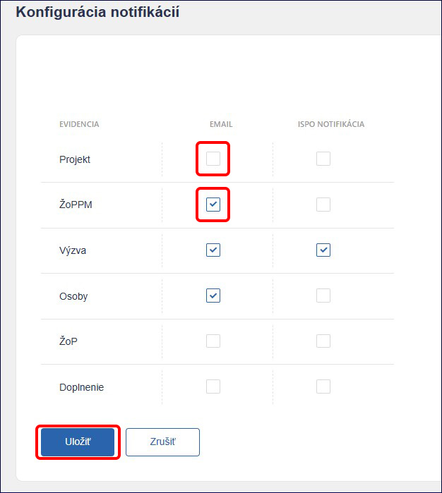

***Poznámka**: V prípade, že si zvolíme niektorú z evidencií, napríklad
Výzvu, neznamená to, že budeme dostávať notifikácie o všetkých výzvach
daného vykonávateľa. Znamená to, že ak máme pridelenú niektorú
z pracovných pozícií podľa kapitoly 2) týkajúcich sa výziev, budeme
dostávať notifikácie o konkrétnych výzvach, na ktorých pracujeme.*
