# 3. Výzva

Pre vytvorenie a editovanie výzvy v ISPO je potrebné, aby sme mali
priradenú pracovnú pozíciou **Editor výzvy**, ktorá nám umožňuje vidieť
sekciu **Výzvy** v ľavom paneli obrazovky.

## 3.1) Vytvorenie výzvy

**Upozornenie!** *Podľa Metodického usmernenia č. 01/2023 v súvislosti
so zavedením Informačného a monitorovacieho systému plánu obnovy (ISPO)
sa v systéme uvádza len skrátené **webové znenie** **výzvy**. Plné
znenie výzvy sa nahrá vo formáte PDF v sekcii **Plné znenie výzvy**.*

3.1.1) V ľavom paneli klikneme na záložku **Výzvy**. Zobrazí sa zoznam
výziev vytvorených pod našim orgánom (v prípade, že sme ešte nevytvorili
žiadnu výzvu, zoznam bude prázdny). Klikneme na tlačidlo **Pridať
výzvu**.

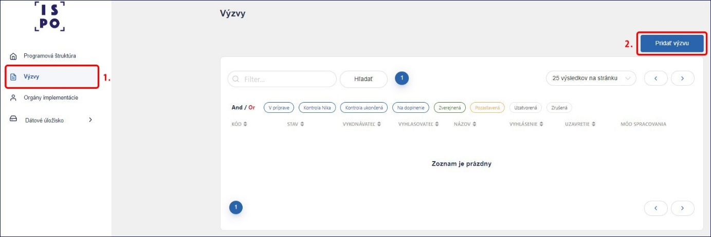

3.1.3) V prvom kroku zvolíme typ výzvy **Štandardná výzva** a klikneme
na tlačidlo **Ďalej**.

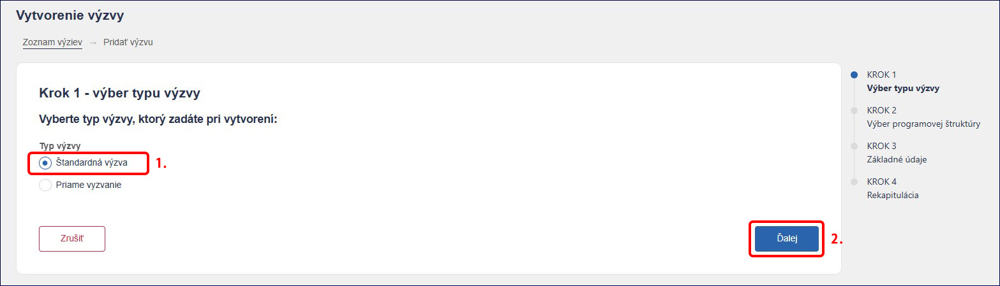

3.1.4) V druhom kroku vyberieme zo zoznamu požadovaný **Komponent**,
**Opatrenie** a **Vykonávateľa** a klikneme na tlačidlo **Ďalej**.

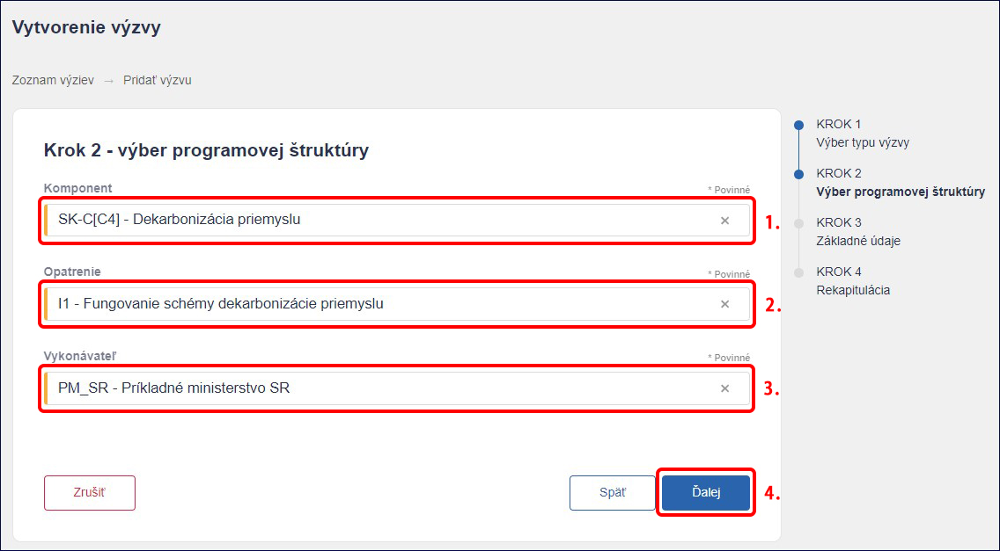

**Upozornenie!** *Vo výbere programovej štruktúry je potrebné uviesť
správny komponent a správne opatrenie, pretože tieto hodnoty po
vytvorení výzvy už nie je možné zmeniť.*

3.1.5) V treťom kroku systém automaticky vygeneruje **kód výzvy** podľa
Príručky k úložisku NIKA v zložení:

***Číslo komponentu -\> veľké I/R -\> číslo investície/reformy -\>
pomlčka -\> číslo vykonávateľa -\> pomlčka -\> veľké V a poradové číslo
výzvy***

*Príklad: 04I01-27-V01 (komponent 4, investícia 1, vykonávateľ Príkladné
ministerstvo SR, výzva číslo 1)*

V prípade potreby môžeme kód výzvy prepísať. Následne uvedieme **Názov
výzvy** a klikneme na tlačidlo **Ďalej**.

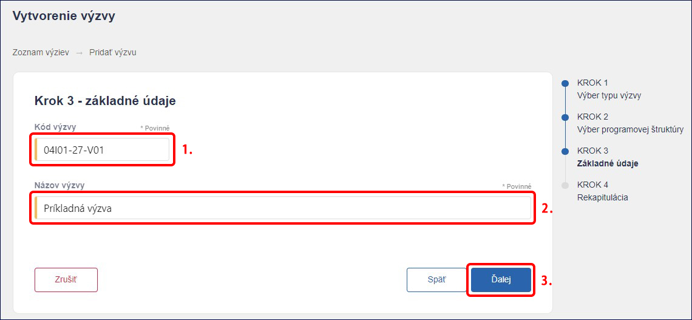

3.1.6) Štvrtý krok obsahuje zhrnutie údajov uvedených v predchádzajúcich
krokoch. V prípade potreby sa môžeme vrátiť pomocou tlačidla **Späť**
a údaje v predchádzajúcich krokoch upraviť. Pokračujeme kliknutím na
tlačidlo **Dokončiť**.

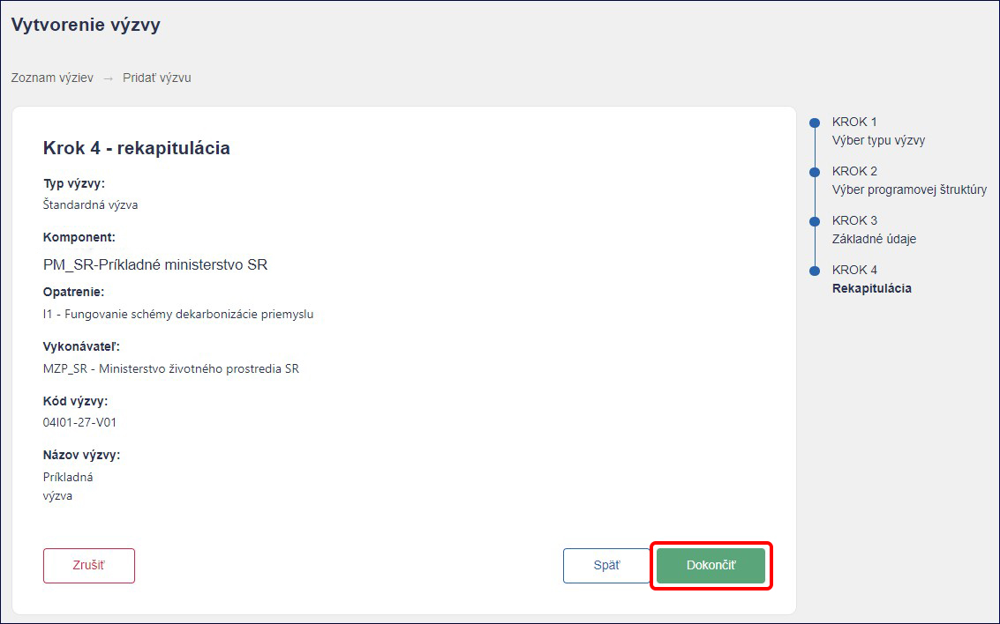

3.1.7) Takto vytvorená výzva sa objaví v zozname výziev vždy na
poslednom mieste. Kliknutím na danú výzvu sa zobrazí detail výzvy, cez
ktorý ju môžeme editovať.

## 3.2) Editácia výzvy

Detail výzvy pozostáva z jednotlivých sekcií, ako sú:

  - Domček – prehľad krokov zverejňovania výzvy

  - Príprava výzvy – editovanie znenia výzvy

  - Špecifikácia ŽoPPM – nastavenie formulára ŽoPPM

  - Stanovisko NIKA – znenie stanoviska NIKA k výzve

  - Nastavenie posudzovania – administrácia posudzovania ŽoPPM

  - Nastavenie ŽoP – povolenie podávania ŽoP vo výzve

  - Logovanie – zaznamenávanie aktivít používateľa

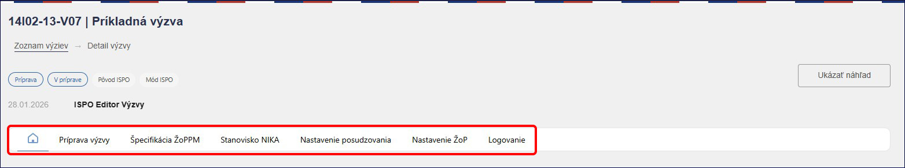

3.2.1) Ikona **Domček** zobrazuje kroky od vytvorenia výzvy až po
uzatvorenie (krok 1 až krok 5).

V systéme máme päť krokov s menom používateľa, ktorý jednotlivé kroky
vykonal.

  - Krok 1: Registrácia výzvy - výzva je v štádiu prípravy v ISPO

  - Krok 2: Kontrola NIKA - výzva bola odoslaná na kontrolu NIKA

  - Krok 3: Kontrola ukončená / Na doplnenie - NIKA odoslala stanovisko
    prostredníctvom ISPO

  - Krok 4: Zverejnená - výzva bola zverejnená na verejnej časti ISPO

  - Krok 5: Uzatvorená - výzva bola uzatvorená v ISPO na základe
    relevantnej skutočnosti

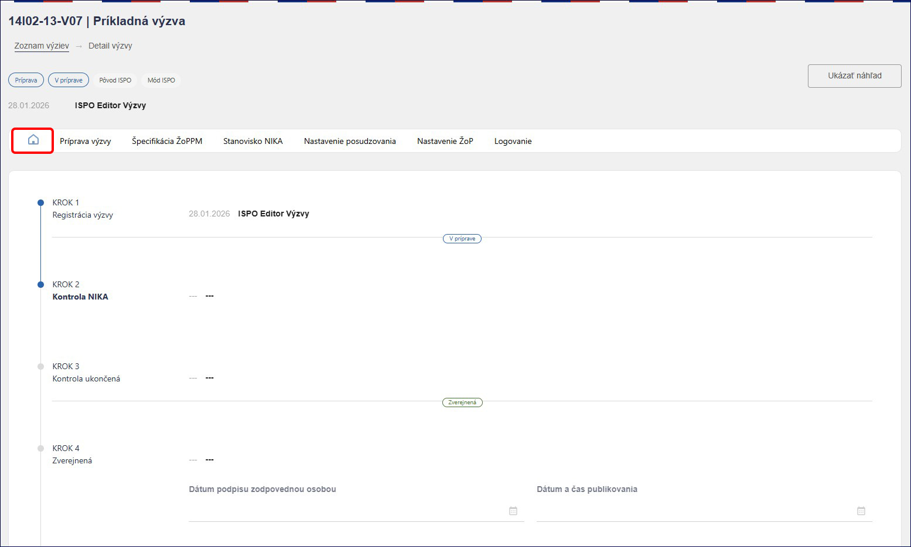

3.2.2) V záložke **Príprava výzvy** sa edituje znenie a obsah výzvy.
Pravý panel slúži na rýchlejší prehľad jednotlivých sekcií výzvy. Ak
chceme výzvu editovať, klikneme na tlačidlo **Upraviť** nad pravým
panelom. Pre uloženie vykonaných zmien klikneme na tlačidlo **Uložiť**.
Zmeny odporúčame ukladať priebežne. 

**Upozornenie!** *Kopírovaný text z iných dokumentov do ISPO si
nezachováva formátovanie. Môže sa zmeniť číslovanie, odrážky a medzery
medzi odsekmi.*

Tlačidlo **Ukázať náhľad** nám pomáha počas celého procesu tvorenia
výzvy a formulára ŽoPPM. Vďaka tomu môžeme sledovať všetky vykonané
zmeny a ich zobrazenie na Portáli ISPO. Môžeme tak na výzvu a formulár
ŽoPPM nahliadať ako žiadateľ a podľa toho vykonávať úpravy a zmeny.
Webový odkaz na zobrazenie náhľadu je platný 10 minút. Po uplynutí tejto
doby klikneme na tlačidlo **Ukázať náhľad** znova. Zmeny v náhľade sa
prejavia až po tom ako ich na neverejnej časti ISPO uložíme.

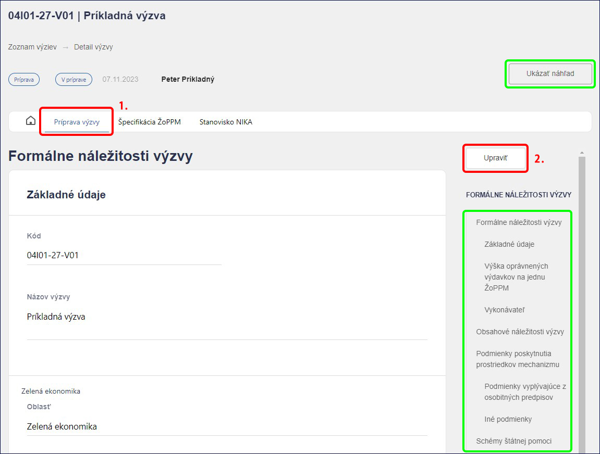

3.2.3) Sekcia **Formálne náležitosti výzvy** sa skladá z troch
podsekcií.

Podsekcia **Základné údaje** obsahuje základné údaje o výzve, ktoré sú
predvyplnené z predchádzajúcich krokov. Dátumy vyhlásenia, uzavretia,
podávania a prijímania ŽoPPM je možné vyplniť v tejto časti, alebo si
ich systém vyžiada vyplniť neskôr pri zverejňovaní výzvy.

**Upozornenie!** *Pri dátume uzavretia výzvy sa nachádza aj čas. Ak
chceme, aby sa výzva uzavrela napríklad dňa 30.11.2023, je dôležité
uviesť maximálny možný čas 23:59. Ak by sme uviedli čas 00:00, výzva by
sa uzavrela o polnoci predchádzajúceho dňa. Ak vykonávateľ uvedie iný
čas ako 23:59, tento čas by mal uverejniť aj v plnom znení výzvy.
Odporúčame vykonávateľom, aby dátum uzavretia výzvy nevychádzal na
pondelok alebo piatok.*

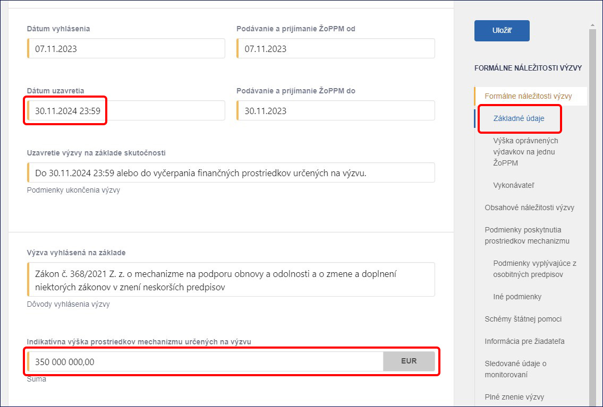

V časti **Indikatívna výška oprávnených prostriedkov mechanizmu určených
na výzvu** uvádzame sumu bez medzier, systém medzery doplní sám.

Špecifickým prvkom pri editovaní výzvy sú tzv. **Dynamické sekcie**,
ktoré sa nachádzajú v častiach ***Špecifikácia výšky prostriedkov
určených na výzvu**, **Špecifikácia oprávnených výdavkov*** a
***Informácia pre žiadateľa***. Pomocou dynamických sekcií dokážeme
vytvoriť ďalšie textové či číselné polia pre doplnenie informácií, ktoré
sa v preddefinovaných poliach nenachádzajú. Pre aktivovanie dynamickej
sekcie musíme kliknúť na tlačidlo **Upraviť**, aktivovať **prepínacie
tlačidlo** a kliknúť na **Upraviť dynamickú sekciu**.

*Príklad: V časti **Indikatívna výška prostriedkov mechanizmu určených
na výzvu** môžeme pomocou dynamickej sekcie vytvoriť nové pole na
celkovú sumu s DPH.*

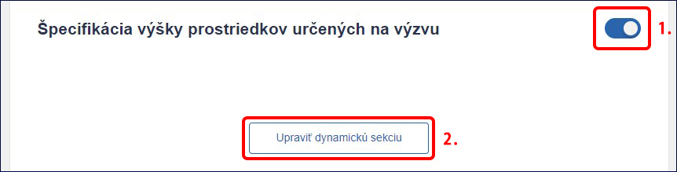

Detailný popis tvorby a fungovania dynamickej sekcie uvádzame
podkapitole **3.4)**.

V rámci podsekcie **Základné údaje** môžeme tiež vyplniť *cieľ výzvy*,
*miesto a spôsob podania žiadosti o poskytnutie prostriedkov*,
*oprávnených žiadateľov* a *formálne náležitosti výzvy*. Ak ktorúkoľvek
z preddefinovaných častí nevyplníme, nezobrazia sa ani na Portáli ISPO
žiadateľom.

V podsekcii **Výška oprávnených výdavkov na jednu ŽoPPM** môžeme *určiť
minimálnu a maximálnu výšku oprávnených výdavkov*, *mieru
spolufinancovania*, prípadne textovo upresniť mieru spolufinancovania.

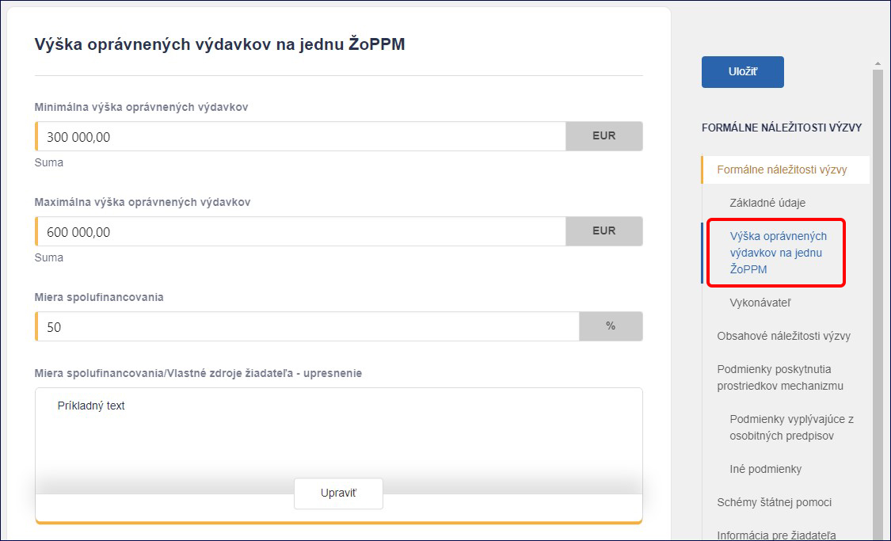

V podsekcii **Vykonávateľ** je pole *Vykonávateľ* už vyplnené na základe
predchádzajúcich krokov vytvárania výzvy. Ak má výzva
**sprostredkovateľa**, uvádzame ho v tejto časti (ak je to potrebné,
môžeme vybrať viacerých sprostredkovateľov). Následne uvádzame aj
*vyhlasovateľa výzvy* a *príjemcu žiadostí*.

Odporúčame vyplniť aj časť ***spôsob komunikácie s
vykonávateľom/sprostredkovateľom***. Uvádzame v nej také kontaktné
údaje, na ktoré chceme prijímať prípadne otázky žiadateľov. Ak tieto
kontaktné údaje neuvedieme, žiadateľ uvidí všeobecné kontaktné údaje na
vykonávateľa a otázky sa nemusia dostať ku zamestnancom, ktorí sú za
danú výzvu zodpovední.

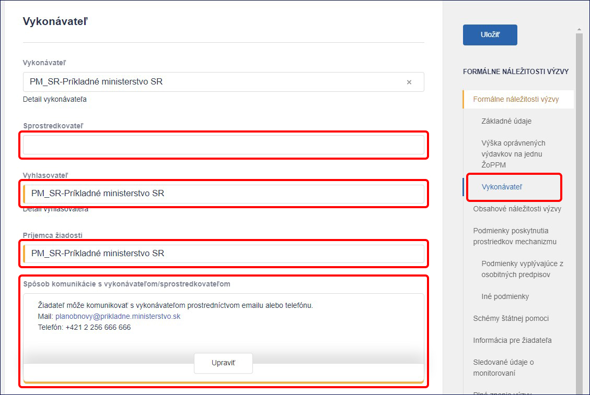

3.2.4) V sekcii **Obsahové náležitosti výzvy** môžeme vyplniť *kritériá
hodnotenia žiadostí o prostriedky mechanizmu, spôsob hodnotenia
žiadostí* a prípadne *iné obsahové náležitosti výzvy*. Pripomíname, že
v tejto časti vypĺňame len skrátené webové znenie výzvy. Údaje, ktoré
nevyplníme, sa na Portáli ISPO nezobrazia.

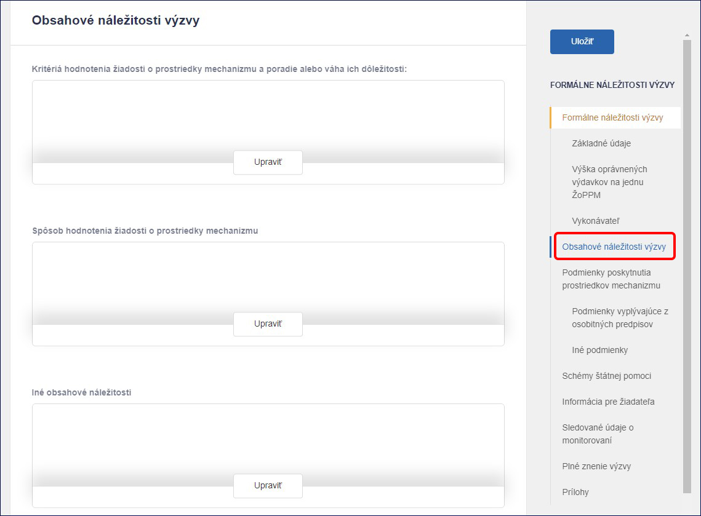

3.2.5) V sekcii **Podmienky poskytnutia prostriedkov mechanizmu** môžeme
vyplniť *podmienky oprávnenosti žiadateľa, podmienky doručenia žiadosti,
podmienky týkajúce sa štátnej pomoci a vyplývajúce zo schém štátnej
pomoci/pomoci de minimis* a *iné podmienky*. Pripomíname, že v tejto
časti vypĺňame len skrátené webové znenie výzvy. Údaje, ktoré
nevyplníme, sa na Portáli ISPO nezobrazia.

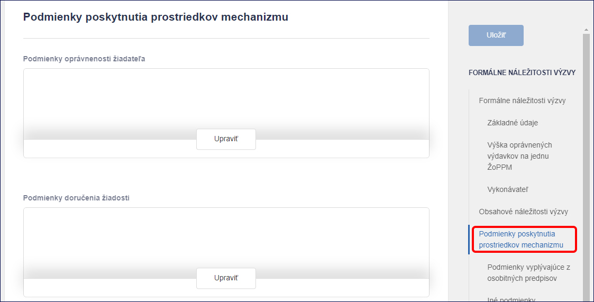

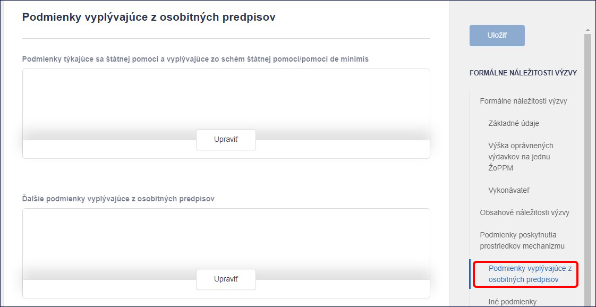

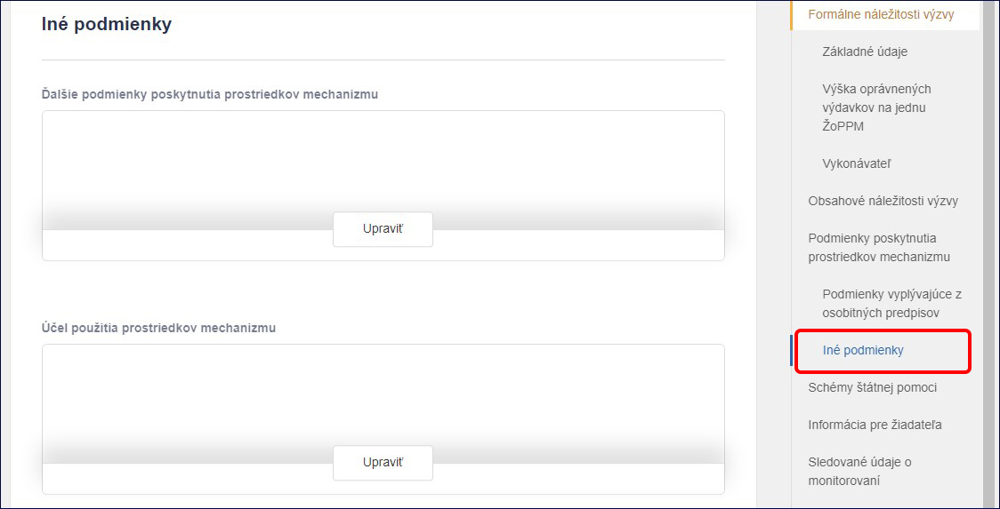

3.2.6) V prípade, že by výzva mala obsahovať schému štátnej pomoci,
aktivujeme sekciu **Schémy štátnej pomoci** cez prepínacie tlačidlo.
Následne môžeme upraviť *nadpis sekcie*, *úvodný text* a môžeme vyhľadať
relevantnú schému zo zoznamu, ktorú následne pridáme.

***Poznámka**: Aktivovanie sekcie **Schémy štátnej pomoci** znamená, že
sa táto sekcia zároveň zobrazí vo formulári ŽoPPM. Ak bude sekcia
aktivovaná, ale nebude v nej priradená žiadna schéma, tento krok vo
formulári ŽoPPM bude irelevantný a nebude mať pre žiadateľa význam.*

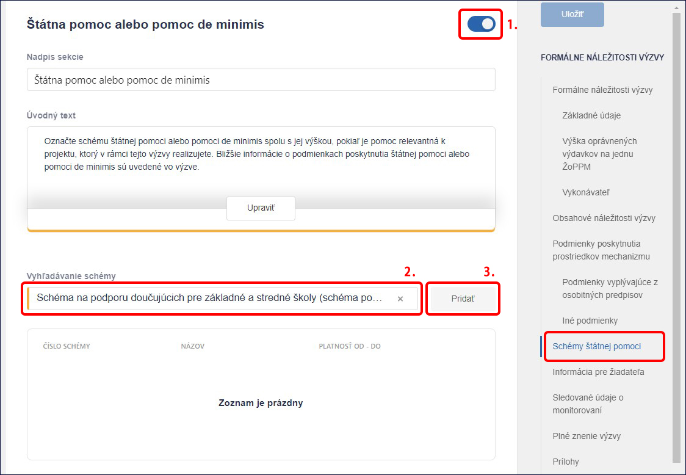

Ak pridaná schéma štátnej pomoci nie je správna alebo ju chceme
odstrániť, môžeme tak urobiť pomocou tlačidla **Tri bodky** a možnosť
**Odstrániť**.

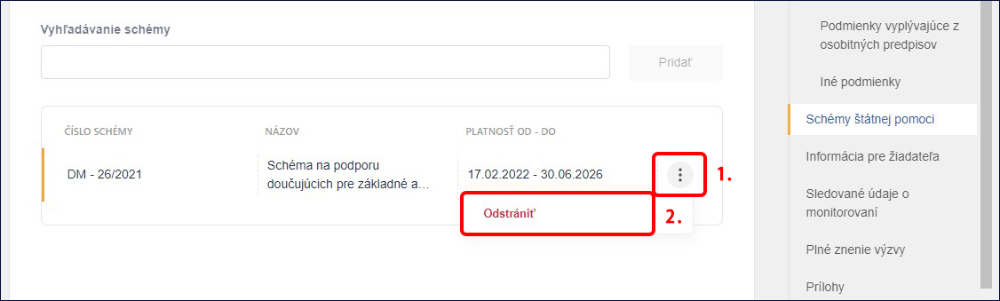

3.2.7) Sekcia **Informácie pre žiadateľa** slúži na doplnenie ďalších
informácií, ktoré nie sú preddefinované systémom.

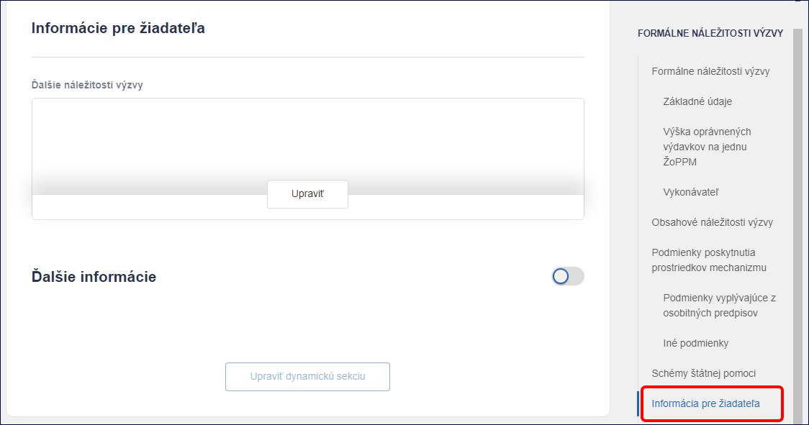

3.2.8) V sekcii **Sledované údaje o monitorovaní** môžeme v prípade
vykazovania ukazovateľov Európskej komisii vybrať preddefinované
ukazovatele alebo môžeme vytvoriť vlastné ukazovatele podľa potreby.
Po aktivácii sekcie pomocou prepínacieho tlačidla vieme upraviť *nadpis
sekcie* a *úvodný text*.

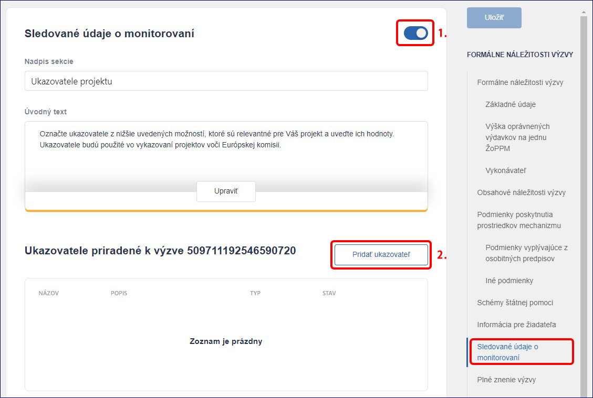

**Upozornenie!** *Ak sme pred kliknutím na tlačidlo **Pridať
ukazovateľ** vykonali nejaké zmeny, po kliknutí naň nás systém upozorní,
aby sme vykonané zmeny uložili. Klikneme na tlačidlo **Zostať**,
následne vpravo hore na tlačidlo **Uložiť** a **Upraviť** a až potom
znova na tlačidlo **Pridať ukazovateľ**. Ak tak nespravíme, môžeme prísť
o neuložené zmeny.*

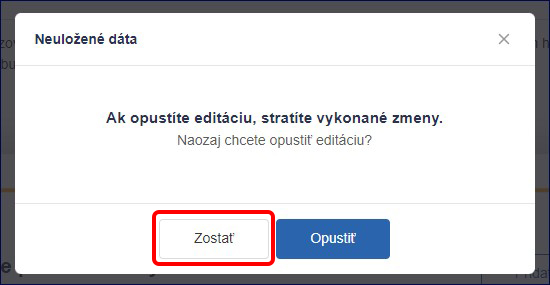

Po kliknutí na tlačidlo **Pridať ukazovateľ** systém ponúkne možnosť
**Pridať ukazovateľ z katalógu** alebo **Vytvoriť nový ukazovateľ**.

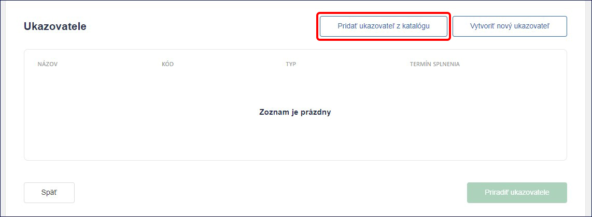

Ak klikneme na výber ukazovateľa z katalógu, pomocou filtra môžeme
vyhľadať ukazovateľ podľa názvu alebo ho hľadať v zozname všetkých
ukazovateľov. Ak nájdeme hľadaný ukazovateľ, klikneme na zaškrtávacie
políčko. Naraz môžeme pridať viac ukazovateľov. Potom klikneme na
tlačidlo **Pridať označené**.

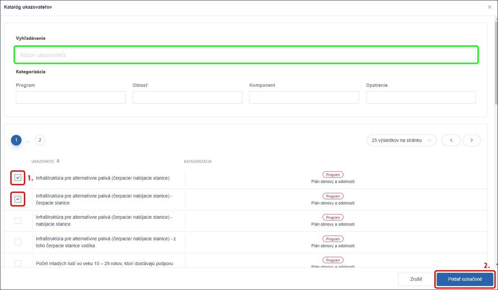

Ak klikneme na vytvorenie vlastného ukazovateľa, musíme vyplniť *kód*
(určíme ho sami), *názov, popis*, zvolíme *typ ukazovateľa*, vyberieme
*mernú jednotku* a *typ agregácie* a klikneme na tlačidlo **Vytvoriť**.

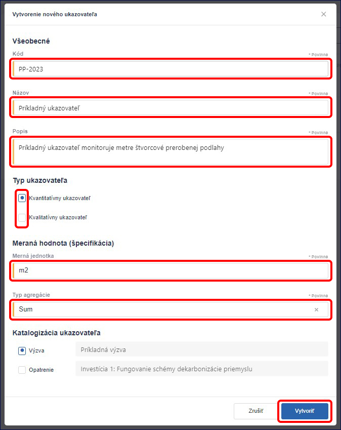

Výber zvolených ukazovateľov potvrdíme kliknutím na tlačidlo **Priradiť
ukazovatele**.

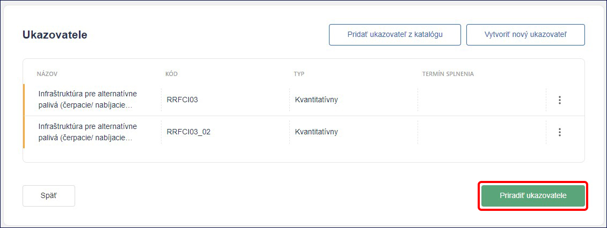

Ak sa rozhodneme ukazovateľ upraviť alebo zneplatniť, klikneme na
tlačidlo **Tri bodky** a vyberieme možnosť.

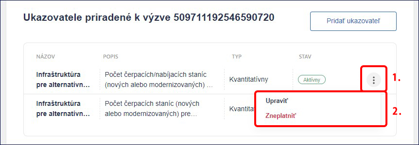

***Poznámka:** Aktivácia **sekcie údajov o monitorovaní** znamená, že sa
táto sekcia zároveň zobrazí vo formulári ŽoPPM. Ak bude sekcia
aktivovaná, ale nebude v nej priradený žiaden ukazovateľ, tento krok vo
formulári ŽoPPM bude irelevantný a nebude mať pre žiadateľa žiadny
význam.*

Náhľad kroku **Ukazovatele projektu** na Portáli ISPO.

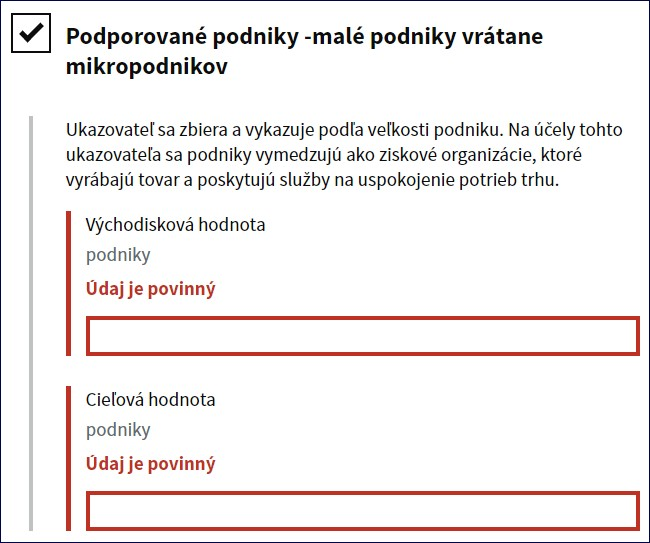

- *Žiadateľ môže začiarknuť ukazovateľ, ku ktorému sa chce vyjadriť.*

- *Ak žiadateľ zaklikne ukazovateľ, musí k nemu uviesť aj hodnoty.*

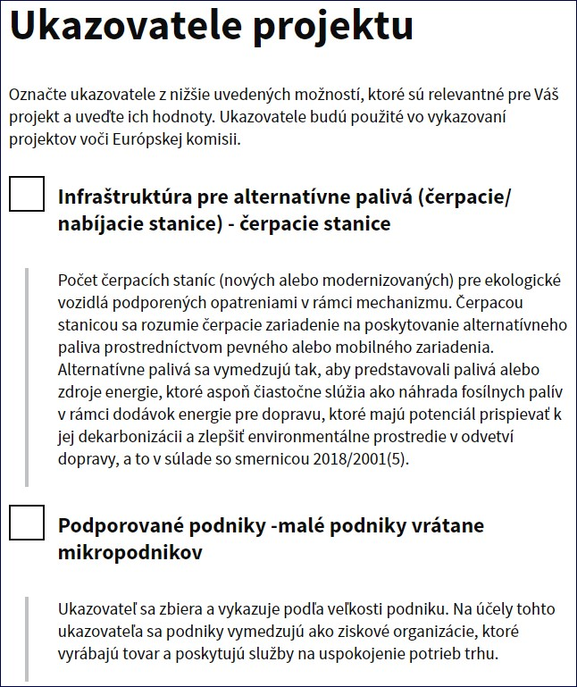

3.2.9) Pripomíname, že v systéme ISPO sa uvádza len skrátené webové
znenie výzvy. Plné znenie výzvy odsúhlasené *Národnou implementačnou a
koordinačnou agentúrou* sa nahráva vo formáte PDF v sekcii **Plné znenie
výzvy**. Uvedieme *názov výzvy* (v prípade potreby aj poznámku) a
klikneme na tlačidlo **Pridať prílohu**.

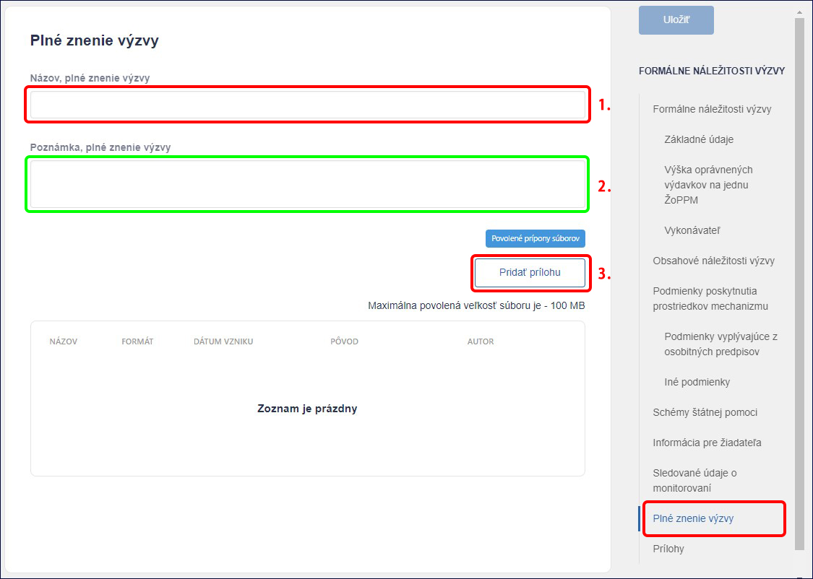

Nahratý dokument sa zobrazí v zozname príloh. Prílohu vieme vymazať
alebo stiahnuť cez tlačidlo **Tri bodky**. V prípade, že po vyhlásení
výzvy dôjde k zmene plného znenia výzvy, v tejto sekcii ponecháme
dokument s pôvodným znením výzvy a k nemu nahráme dokument s novým
znením.

**Upozornenie!** *V **náhľade výzvy** sa na Portáli ISPO napriek tomu,
že sme prílohu nahrali, zobrazí v sekcii Plné znenie výzvy fráza „bez
dokumentu“. Nejde o chybu, je to len náhľad, a po zverejnení výzvy sa
tento dokument zobrazí.*

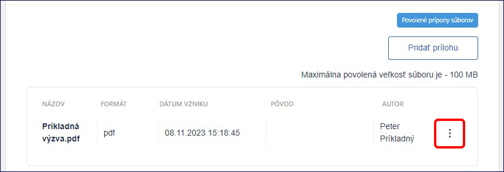

3.2.10) V sekcii **Prílohy** nahrávame prílohy výzvy a prílohy ŽoPPM,
ktoré si žiadateľ stiahne, vyplní a nahrá v relevantnom kroku formulára
ŽoPPM. Klikneme na tlačidlo **Pridať prílohu**.

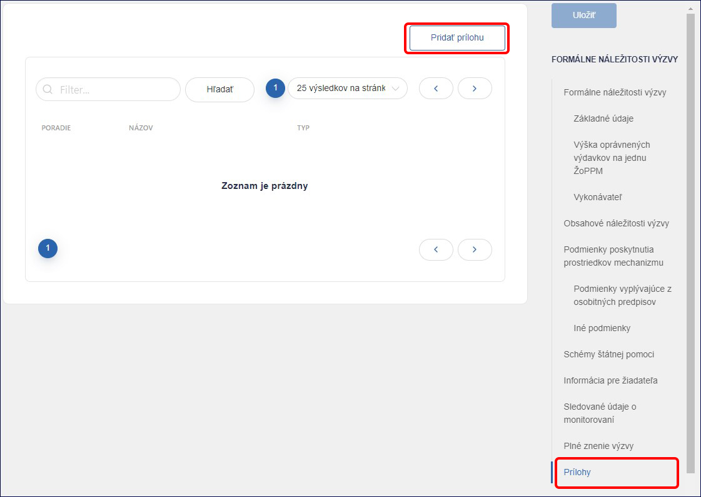

Vytvoríme priečinok s názvom **Prílohy výzvy** a poznámkou a klikneme na
tlačidlo **Dokončiť**.

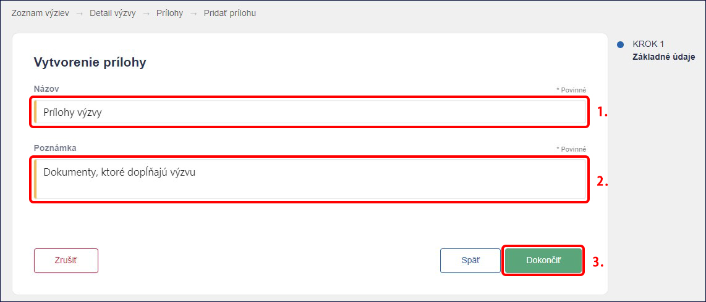

Následne sa dostaneme do vytvoreného priečinka, do ktorého nahráme
jednotlivé dokumenty. Klikneme na tlačidlo **Pridať dokument**.

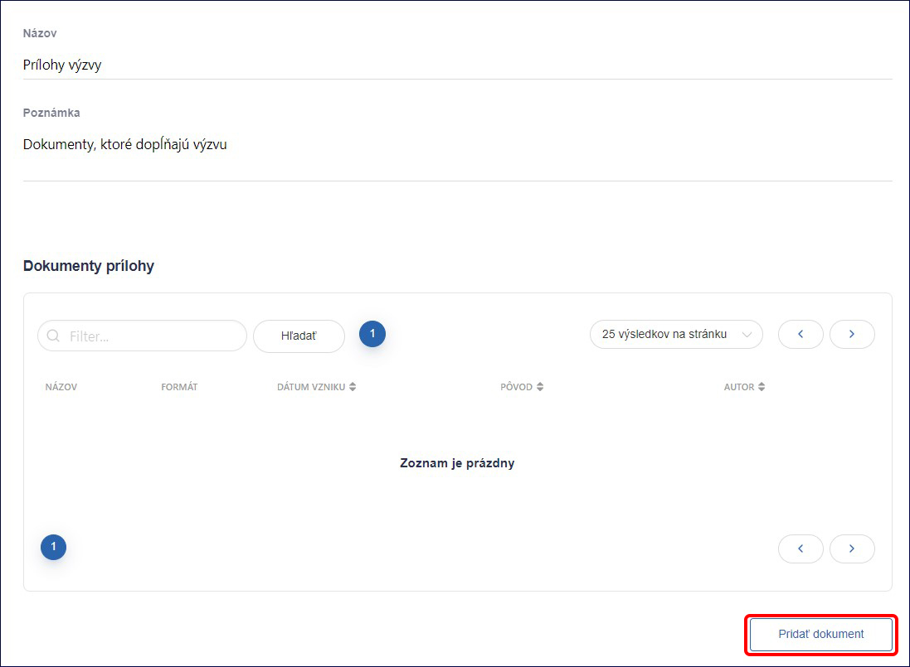

Zobrazí sa možnosť pre vloženie dokumentu. Klikneme na tlačidlo **Vložte
súbor** alebo presunieme súbor z nášho počítača do sivého poľa.

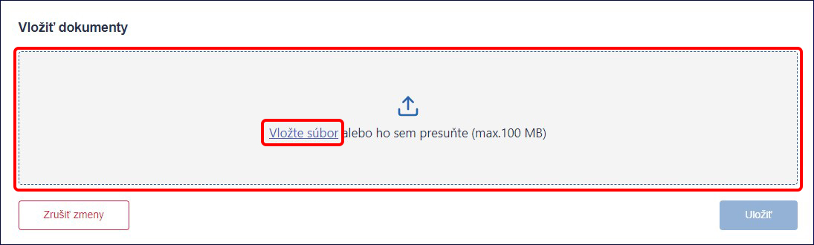

**Upozornenie!** *Nahrávané súbory majú povolenú maximálnu kapacitu
**100MB**. V ich názve nesmie byť bodka ani iné špecifické znaky.
Medzery medzi slovami v názve dokumentu odporúčame vyplniť pomlčkou
alebo podtržníkom. Niektoré súbory systém neakceptuje, pretože ich
koncovka sa uložila veľkými písmenami, ako napr. DOCX., PDF. V takom
prípade je potrebné tieto súbory premenovať cez Prieskumník počítača ->
v hornom paneli Zobraziť -> Prípony názvov súborov -> a prepísať názov
konkrétneho súboru z DOCX na docx.*

Ak je nahraná príloha v poriadku, môžeme prepísať jej názov a klikneme
na tlačidlo **Uložiť**.

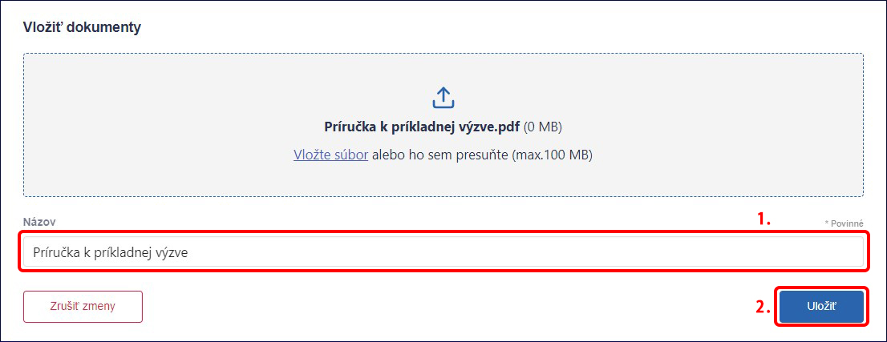

Následne môžeme urobiť niekoľko krokov. Môžeme pridať ďalší dokument do
priečinka, alebo pomocou tlačidla **Tri bodky** môžeme nahratý dokument
odstrániť. Kliknutím na tlačidlo **Prílohy** sa môžeme vrátiť do zoznamu
priečinkov.

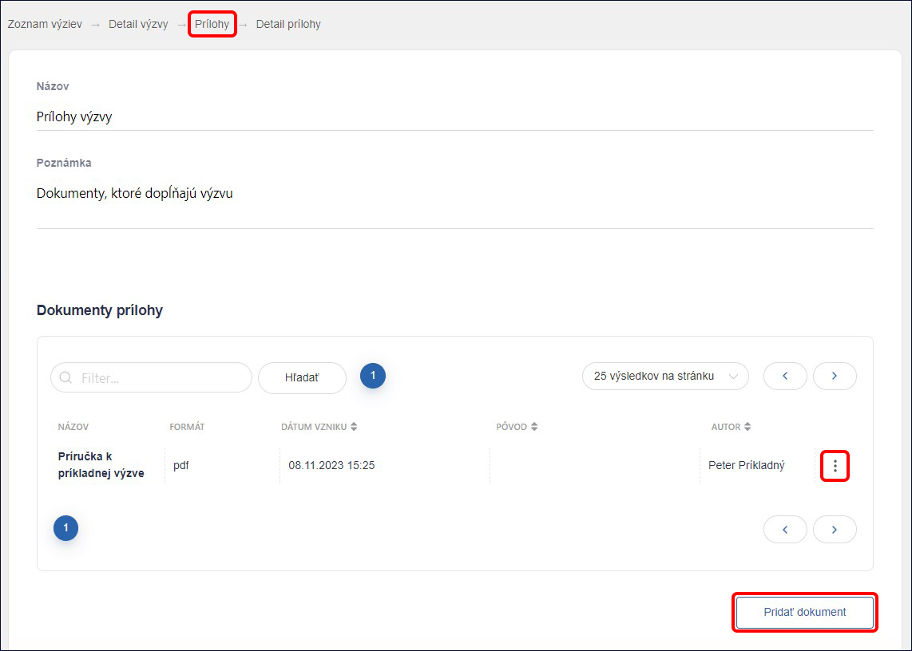

**Upozornenie!** *Nahrávané súbory sa zoradia v poradí, v akom ich
nahráme. Ich poradie nie je možné meniť.*

Odporúčame vytvárať dva priečinky:

- priečinok s názvom **Prílohy výzvy***,* do ktorého sa nahrajú
  dokumenty patriace k výzve

- priečinok s názvom **Prílohy ŽoPPM***,* do ktorého sa nahrajú
  dokumenty,vzory/formuláre, ktoré si bude môcť žiadateľ stiahnuť,
  vyplniť a neskôr priložiť k žiadosti.

**Upozornenie!** *Prílohy, ktoré chceme, aby žiadateľ priložil k ŽoPPM,
definujeme až v časti **Špecifikácia ŽoPPM**. Napriek tomu dokumenty ako
vzory či formuláre nahráme do príloh v časti **Príprava výzvy**.*

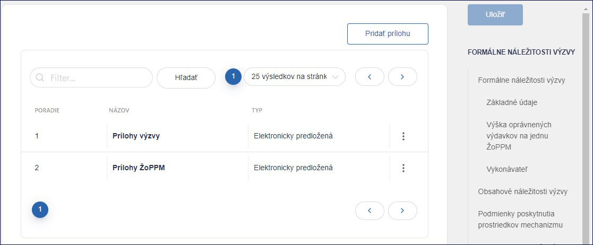

## 3.3) Špecifikácia formulára ŽoPPM

Záložka **Špecifikácia ŽoPPM** slúži na editáciu a nastavenie formulára
ŽoPPM, ktorý bude žiadateľ vypĺňať prostredníctvom Portálu ISPO.
Formulár ŽoPPM je flexibilný a skladá sa z jednotlivých krokov, ktoré
môžeme nadefinovať.

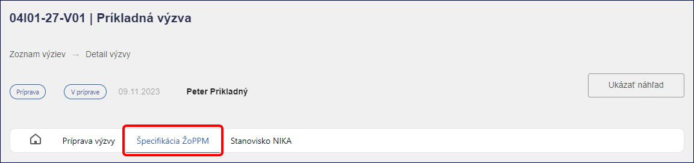

V časti **Špecifikácia ŽoPPM** z pravého navigačného panela sú
automaticky aktivované tieto sekcie:

- **Údaje o projekte** – odporúčame ponechať vždy aktivované

- **Zdroje financovania** – odporúčame ponechať aktivované ak relevantné

- **Prílohy ŽoPPM** – ponechať vždy aktivované

- **Možnosti rozpočtu** – ponechať vždy aktivované

- **Čestné vyhlásenie** – ponechať vždy aktivované

- **Aktivity projektu** – odporúčame ponechať aktivované ak relevantné

- **Miesto realizácie** – odporúčame ponechať aktivované ak relevantné

- **Identifikácia žiadateľa** – ponechať vždy aktivované

- **Vzor žiadosti** – ponechať vždy aktivovanú aspoň jednu možnosť

***Poznámka**: Zobrazenie alebo nezobrazenie sekcií vo formulári ŽoPPM
na Portáli ISPO (ktorý vypĺňa žiadateľ) závisí od ich aktivácie alebo
deaktivácie vykonávateľom v špecifikácii formulára ŽoPPM. Aktivovaná
sekcia v neverejnej časti ISPO teda znamená jeden krok formulára ŽoPPM
na Portáli ISPO.*

Pripomíname tiež dôležitosť tlačidla **Ukázať** **náhľad**, ktoré nám
pomáha počas celého procesu tvorenia formulára ŽoPPM, kedy môžeme všetky
aktivované sekcie a podsekcie, pridané texty a vykonané zmeny vidieť ako
náhľad na Portáli ISPO. Po kliknutí na tlačidlo **Ukázať** **náhľad**
nám internetový prehliadač otvorí novú záložku. V nej uvidíme celú
výzvu, ako sme ju vytvorili v predošlých krokoch. Aby sa nám zobrazil
náhľad formulára ŽoPPM, klikneme na **Pozrieť si vzor žiadosti
(fyzická/právnická osoba)** priamo pod názvom výzvy.

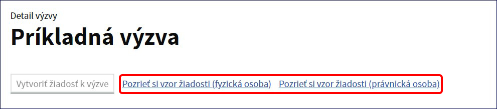

Na nasledujúcej strane, ktorá obsahuje všeobecné pokyny k ŽoPPM, sa
presunieme na dolnú časť obrazovky, kde klikneme na zelené tlačidlo
**Prejsť na vzor žiadosti**. Následne sa nám zobrazia jednotlivé kroky
formulára ŽoPPM, ktoré sme aktivovali na neverejnej časti ISPO.

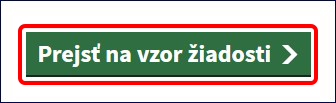

3.3.1) Sekcia **Údaje o projekte** je automaticky aktivovaná. Na Portáli
ISPO sa zobrazia povinné polia *Názov projektu, Krátky názov projektu,
Cieľ projektu* a *Popis projektu.* Odporúčame ponechať túto sekciu
aktivovanú. Údaje z nej sa dotiahnu do úplnej žiadosti, ako aj do Sumára
žiadosti PDF, ktorý žiadatelia po vyplnení žiadosti podpisujú. Zároveň
sa tieto údaje zbierajú do monitorovacích údajov a databázy ISPO.

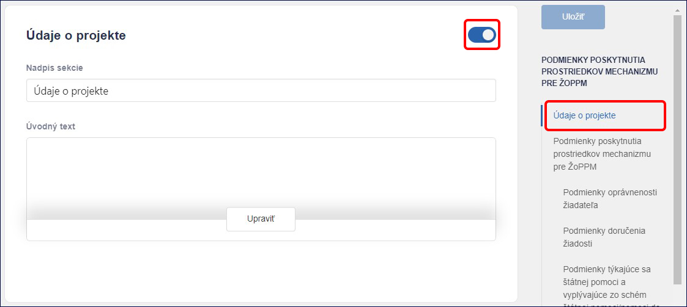

***Poznámka**: V každej sekcii a podsekcii v časti **Špecifikácia
ŽoPPM** môžeme meniť nadpis sekcie a úvodný text, v ktorom môžeme
bližšie špecifikovať, čo má žiadateľ v jednotlivých poliach uviesť.*

Ak preddefinované údaje o projekte nepostačujú, môžeme aktivovať
prepínacie tlačidlo v podsekcii **Ďalšie údaje o projekte**
a sprístupniť dynamickú sekciu, pomocou ktorej môžeme pridať ďalšie
polia. Vzorovo sme doplnili polia ako *Akronym projektu* a *Anglický
názov projektu.* Detailný popis editácie a fungovania dynamickej sekcie
opisujeme v podkapitole **3.4)**.

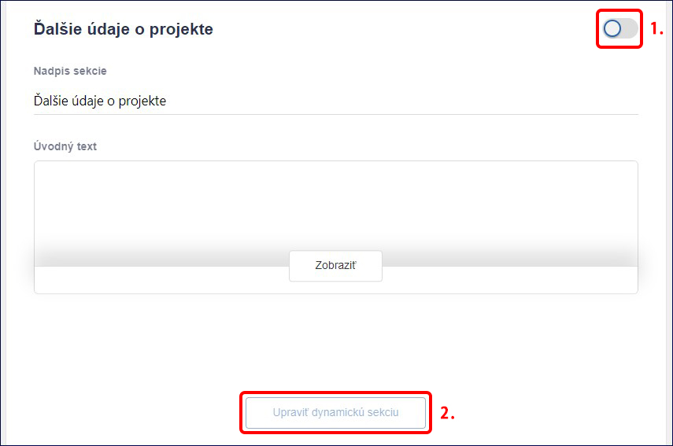

Náhľad kroku **Údaje o projekte** a **Ďalšie údaje o projekte** na
Portáli ISPO.

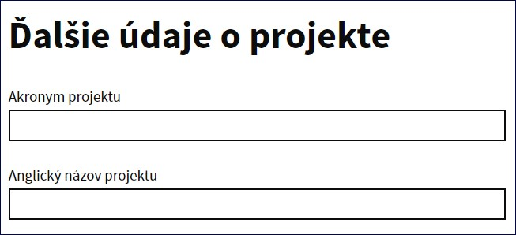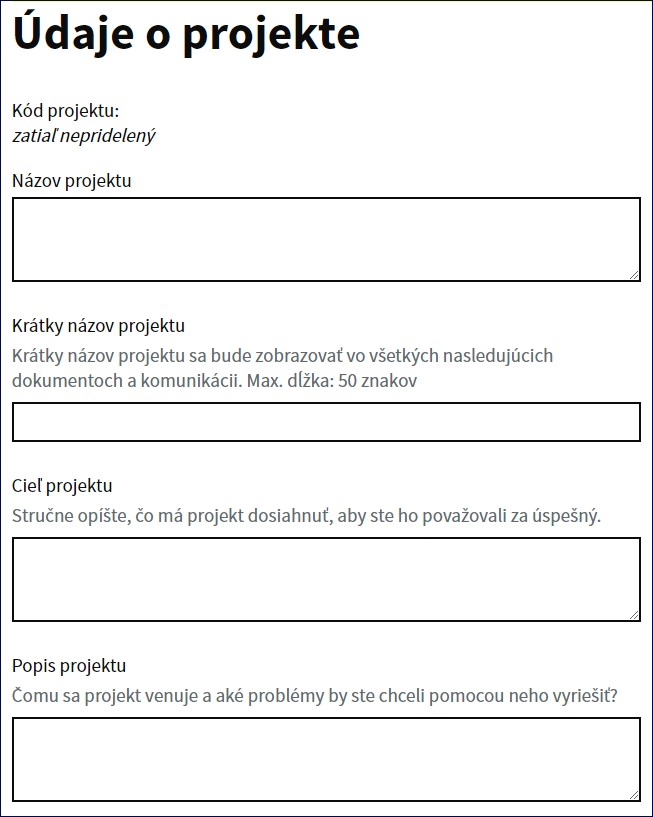

3.3.2) Sekcia **Podmienky poskytnutia prostriedkov mechanizmu pre
ŽoPPM** je automaticky vypnutá a v prípade potreby ju aktivujeme. Môžeme
zmeniť nadpis a upraviť úvodný text. Táto sekcia obsahuje viacero
podsekcií, ktoré môžeme aktivovať (napríklad podmienky oprávnenosti,
podmienky doručenia žiadosti, podmienky týkajúce sa štátnej pomoci
a podobne).

***Poznámka:** Nasledujúce nastavenie podmienok odporúčame len v prípade
jednoduchých podmienok. V prípade zložitejších podmienok môžeme túto
sekciu preskočiť a prílohy, ktoré by mal žiadateľ predložiť na
preukázanie splnenia podmienok, preddefinujeme v sekcii **Prílohy
ŽoPPM.***

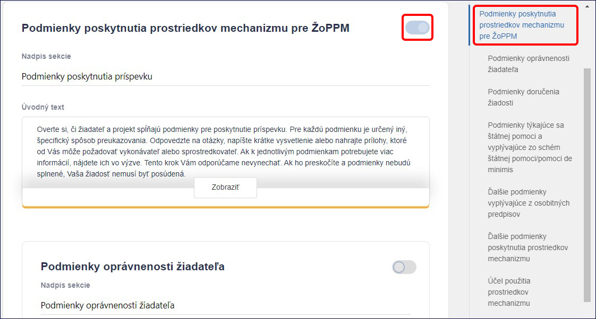

Rozdiel medzi sekciou podmienok *v príprave výzvy* a sekciou podmienok
*v špecifikácii ŽoPPM* spočíva v tom, že *pri príprave výzvy* slovne
popisujeme podmienky tak, ako ich stanovuje výzva. *Pri špecifikácii
ŽoPPM* uvádzame podmienky s cieľom získať odpovede/akcie od žiadateľa.

*Príklad: Jednou z podmienok oprávnenosti žiadateľa je, že žiadateľom
môže byť právnická osoba zapísaná v Obchodnom registri Slovenskej
republiky. V záložke **Príprava výzvy** túto podmienku slovne popíšeme.
V záložke **Špecifikácia ŽoPPM** využijeme **tzv. štruktúrovanú
podmienku**, ktorou vytvoríme v žiadosti priestor pre žiadateľa, aby sa
k danej podmienke vyjadril.*

Nastavenie podmienok oprávnenosti nastavíme podľa príkladu nasledovne.
Najskôr pomocou prepínacieho tlačidla aktivujeme sekciu **Podmienky
oprávnenosti žiadateľa**, následne klikneme na tlačidlo **Pridať
podmienku**.

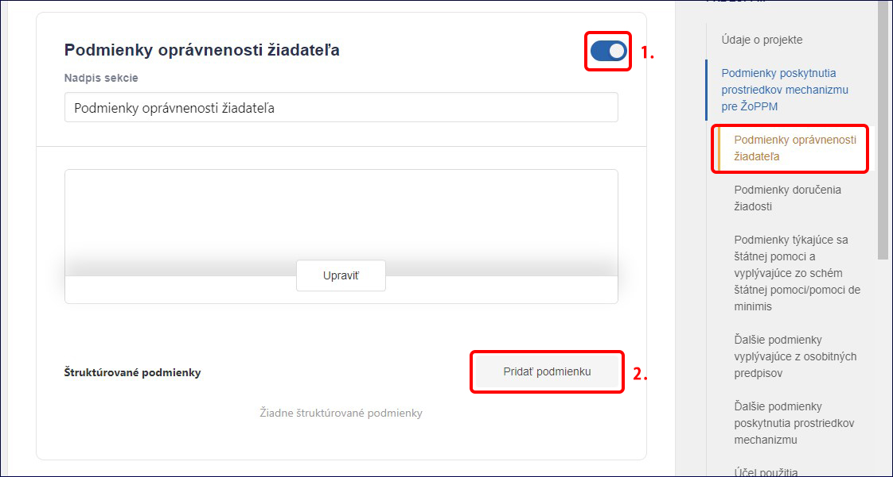

Uvedieme príkladnú podmienku oprávnenosti, v ktorej žiadateľom môže byť
len právnická osoba a ako spôsob preukázania splnenia podmienky uvedieme
predloženie aktuálneho výpisu z OR SR.

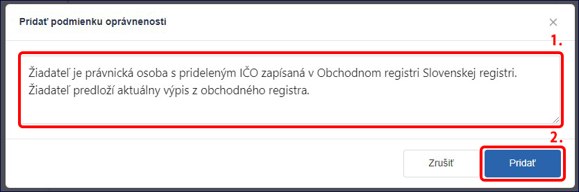

Takto vytvorená štruktúrovaná podmienka sa zobrazí v zozname pod
číslom 1. Túto podmienku môžeme pomocou tlačidla **Tri bodky**
odstrániť, alebo môžeme pridať ďalšiu podmienku.

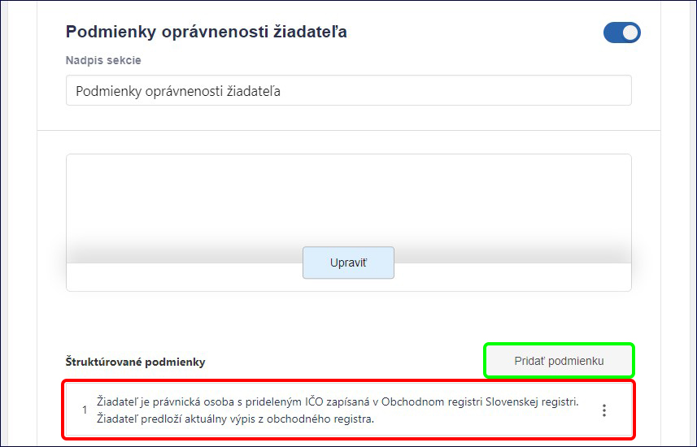

Náhľad kroku **Podmienky poskytnutia prostriedkov mechanizmu pre ŽoPPM**
a **Podmienky oprávnenosti žiadateľa** na Portáli ISPO.

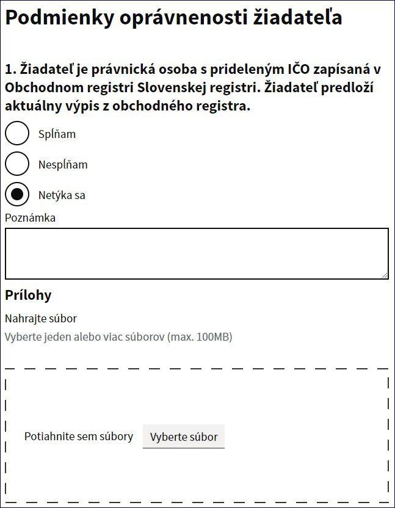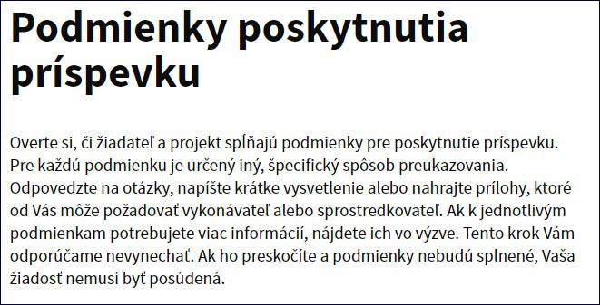

- *Žiadateľ môže reagovať vybraním jednej z možností spĺňam, nespĺňam,
  netýka sa.*

- *Môže uviesť svoje vyjadrenie k podmienke v poznámke.*

- *Môže predložiť dokument nahratím prílohy.*

- *Žiadateľ môže reagovať vybraním jednej z možností spĺňam, nespĺňam,
  netýka sa.*

- *Môže uviesť svoje vyjadrenie k podmienke v poznámke.*

- *Môže predložiť dokument nahratím prílohy.*

3.3.3) Sekcia **Bodové kritériá** môže slúžiť na subjektívne ohodnotenie
žiadateľa samým sebou, prípadne zadanie ľubovoľných kvantitatívnych
parametrov projektu zo strany žiadateľa, ak to výzva predpokladá.

Ak sa nám táto sekcia hodí, aktivujeme prepínacie tlačidlo. Môžeme
upraviť nadpis aj text. Následne klikneme na tlačidlo **Pridať
kritérium**.

Vyplníme názov a popis daného kritéria, uvedieme maximálny počet bodov,
ktoré si žiadateľ môže za dané kritérium priradiť a pomocou prepínacieho
tlačidla aktivujeme **Vypĺňa žiadateľ**. Ak tlačidlo **Vypĺňa žiadateľ**
neaktivujeme, žiadateľ nebude môcť na Portáli ISPO vyplniť pole
s hodnotou. Klikneme na tlačidlo **Uložiť**.

Toto kritérium sa nám zobrazí v zozname. Kliknutím na tlačidlo **Pridať
kritérium** môžeme pridať ďalšie kritérium. Pomocou tlačidla **Tri
bodky** môžeme kritérium odstrániť.

Náhľad kroku **Bodové kritériá** na Portáli ISPO.

- *Žiadateľ môže uviesť počet bodov od 0 do 10, podľa toho, koľko sme
  nastavili*

- *Môže uviesť text do poznámky.*

3.3.4) Sekciu **Iné formálne náležitosti žiadosti** môžeme využiť
v prípade, ak potrebujeme doplniť ďalšie náležitosti, ktoré sa nehodili
do žiadnej z predchádzajúcich sekcií. V tejto sekcii je možné využiť
dynamickú sekciu.

3.3.5) Sekciu **Doplňujúce údaje rozpočtu a finančného plánu** môžeme
využiť v prípade, ak potrebujeme\
od žiadateľa doplniť ďalšie náležitosti rozpočtu, ktoré nebolo možné
vyplniť v rámci sekcie **Možnosti rozpočtu** v bode **3.4.9)**. V tejto
sekcii je možné využiť dynamickú sekciu.

3.3.6) Sekciu **Ďalšie údaje žiadosti** môžeme využiť v prípade, ak
potrebujeme doplniť ďalšie náležitosti, ktoré sa nehodili do žiadnej z
predchádzajúcich sekcií. V tejto sekcii je možné využiť dynamickú
sekciu.

3.3.7) Sekciu **Zdroje financovania** odporúčame ponechať aktivovanú.
Aby bol tento krok relevantný, je potrebné ponechať aktivovanú aj
niektorú z ďalších podsekcií.

Ak chceme, aby si žiadateľ vybral spôsob financovania, ponecháme
aktivovanú podsekciu **Zdroje financovania – spôsob**. Žiadateľ si tak
bude môcť vybrať z možností *systém predfinancovania, systém zálohových
platieb, systém refundácie*.

Ak chceme, aby žiadateľ uviedol, či poberá alebo poberal pomoc z iných
zdrojov, ponecháme aktivovanú podsekciu **Zdroje financovania – iná
pomoc**. Žiadateľ si tak bude môcť vybrať z možností *áno/nie.* Ak zvolí
možnosť áno, vo formulári sa mu objavia ďalšie kolónky na vyplnenie ako
*Poskytovateľ pomoci, Názov pomoci, Rok schválenia pomoci, Číslo zmluvy,
Webová stránka poskytovateľa (link z CRZ, Suma v EUR* a *Čestné
vyhlásenie, že vyššie uvedená pomoc nie je súčasťou žiadnej sumy
v žiadosti.* V prípade, že poberá pomoc z viacerých zdrojov, môže
kliknúť na ***Pridať novú položku*** a opäť uviesť všetky informácie
o tejto pomoci.

**Odporúčanie:** *Sekciu **Zdroje financovania - iná pomoc** odporúčame
aktivovať pre účely jednoduchšieho posúdenia rizika dvojitého
financovania.*

V prípade, že sme v časti **Príprava výzvy** aktivovali sekciu **Schémy
štátnej pomoci** a vybrali sme konkrétnu schému štátnej pomoci zo
zoznamu, v kroku **Zdroje financovania** sa žiadateľovi objaví aj
kolónka **Štátna pomoc alebo pomoc de minimis** s otázkou „*Predstavujú
prostriedky mechanizmu štátnu pomoc alebo pomoc de minimis?*“ Žiadateľ
si tak bude môcť vybrať z možností *áno predstavujú / nie
nepredstavujú.* Ak zvolí možnosť *áno predstavujú*, vo formulári sa mu
objaví *Výber názvu a čísla schémy*, kde zaškrtne nami vybranú schému
a uvedie *Celkovú výšku štátnej pomoci*.

**Upozornenie:** *Sekciu **Schémy štátnej pomoci** sme aktivovali
v časti **Príprava výzvy**, nie v časti **Špecifikácia ŽoPPM.** Napriek
tomu sa objaví vo formulári ŽoPPM v kroku **Zdroje financovania***

Náhľad kroku **Zdroje financovania** na Portáli ISPO.

- *Žiadateľ vyberie z možností áno/nie.*

- *Ak vyberie áno, označí nami preddefinovanú schému štátnej pomoci
  a uvedie Celkovú výšku štátnej pomoci*

- *Žiadateľ vyberie z možností: systém predfinancovania, systém
  zálohových platieb, systém refundácie*

- *Žiadateľ vyberie z možností áno/nie.*

- *Ak vyberie áno, uvedie poskytovateľa pomoci, názov pomoci, rok
  schválenia pomoci, číslo zmluvy, webovú stránku poskytovateľa, sumu
  v eurách a začiarkne čestné vyhlásenie*

3.3.8) Sekciu **Prílohy ŽoPPM** ponecháme aktivovanú, ak chceme od
žiadateľa aby priložil ku žiadosti prílohy. V tejto sekcii nenahrávame
žiadne dokumenty, ale nadefinujeme aké dokumenty má žiadateľ nahrať.
V úvodnom texte môžeme žiadateľovi bližšie popísať, čo od neho
požadujeme a klikneme na tlačidlo **Pridať prílohu**.

Vyplníme povinné údaje, ako *Názov*, *Číslo* a *Spôsob predloženia*.
Údaje ako *Odporúčaný formát* a *Požadovaná originalita dokumentov*
nemusíme vypĺňať, pretože aktuálne nastavenie ISPO ich nikde nezobrazí.
Ak chceme žiadateľovi bližšie špecifikovať konkrétnu prílohu, môžeme mu
uviesť *Popis*.

Takto nadefinovanú prílohu uvidíme v zozname.

V kroku **Prílohy** formulára ŽoPPM na Portáli ISPO sa žiadateľovi
zobrazí zoznam príloh v poradí, ako sme ich nadefinovali. Žiadateľ môže
zaškrtnúť políčko, či už prílohu nahral v predchádzajúcich krokoch
formulára, alebo ju zašle listinne. Ak toto políčko nezaškrtne, zostane
mu možnosť nahrať súbor. Žiadateľ môže nahrávať rôzne typy súborov ako
*jpg, png, docs, xlsx, mp3, mp4, zip, rar,...* Maximálna veľkosť jedného
súboru, ktorý žiadateľ môže nahrať je 100MB.

***Poznámka:** Elektronické aj listinné prílohy sa zobrazia v sumáre
žiadosti. Listinné prílohy je potrebné zaslať na adresu
vykonávateľa/sprostredkovateľa, ktorá sa uvádza vo výzve a v lehote,
ktorá sa uvádza vo výzve.*

Náhľad kroku **Prílohy** na Portáli ISPO.

- *Zoznam požadovaných príloh sa na portálovej časti zobrazí aj na
  úvodnej strane, po kliknutí na „**Vytvoriť žiadosť k výzve**“ hneď pod
  všeobecnými pokynmi. Vďaka tomu sa žiadateľ dozvie hneď na začiatku,
  aké dokumenty si má prichystať a akým spôsobom ich má predložiť.*

- *Ak žiadateľ nahral dokument v predchádzajúcom kroku, alebo ho bude
  predkladať listinne, zaškrtne políčko.*

- *Ak nezaškrtne, ostane mu možnosť nahrať dokument.*

- *Žiadateľ môže predložiť aj ďalšie prílohy, aj keď sme mu ich
  nenadefinovali.*

3.3.9) Sekciu **Možnosti rozpočtu** nie je možné deaktivovať, preto bude
vždy aktívna. Polia v nej však môžeme prispôsobiť. Zvolíme z možností
**Skutočné výdavky** alebo **Výdavky vykazované zjednodušeným
spôsobom.** Podrobné informácie k vyplneniu tejto sekcie môžeme
žiadateľovi uviesť v úvodnom texte.

V prípade, že disponujeme vlastným vzorom rozpočtu, ktorý chceme aby
žiadateľ k žiadosti priložil, odporúčame aktivovať **Výdavky vykazované
zjednodušeným spôsobom**.

Ak aktivujeme podsekciu ***Skutočné výdavky***, musíme vybrať
a aktivovať niektorú z nasledujúcich položiek:

- Tovary

- Služby

- Osobné náklady

- Kapitálové náklady

- Ostatné

Pri každej aktivovanej položke musíme odškrtnúť niektoré z uvedených
políčok:

- Suma z plánu obnovy bez DPH

- Čiastka DPH z Plánu obnovy

- Vlastné zdroje žiadateľa (tzn. Súkromné; ak sú vlastné zdroje verejné
  zdroje, tak sa uvádzajú do verejných)

- Verejné zdroje okrem zdrojov EÚ (napr. štátny rozpočet, výdavky VÚC)

- Verejné zdroje EÚ

Ak aktivujeme podsekciu ***Výdavky vykazované zjednodušeným spôsobom***,
musíme odškrtnúť niektoré z uvedených políčok:

- Suma z plánu obnovy bez DPH

- Čiastka DPH z Plánu obnovy

- Vlastné zdroje žiadateľa (tzn. Súkromné; ak sú vlastné zdroje verejné
  zdroje, tak sa uvádzajú do verejných)

- Verejné zdroje okrem zdrojov EÚ (napr. štátny rozpočet, výdavky VÚC)

- Verejné zdroje EÚ

Žiadateľ tak bude môcť uviesť *Názov výdavku, požadovanú sumu z POO bez
DPH, sumu DPH z POO, uviesť sumu z vlastných súkromných zdrojov, sumu zo
štátneho rozpočtu a sumu verejných zdrojov EÚ*. Systém automaticky
prepočíta aká je jeho celková požadovaná suma z POO. Zároveň ak je miera
spolufinancovania na výzve obmedzená na isté percento, systém po zadaní
týchto údajov vypočíta percento miery spolufinancovania. Žiadateľ
v tejto sekcii má tiež možnosť nahrať prílohu, napríklad vyplnený
vzorový rozpočet vykonávateľa.

**Upozornenie!** *Systém v tomto kroku automaticky vypočíta **Celkové
oprávnené výdavky** zo Sumy z plánu obnovy bez DPH, Čiastky DPH z plánu
obnovy a z Vlastných zdrojov žiadateľa. Z týchto troch súm zároveň
systém prepočíta Podiel miery spolufinancovania. V špecifikácii ŽoPPM
preto odporúčame zakliknúť tieto tri polia, aby sa zobrazili žiadateľovi
pri vypĺňaní formulára ŽoPPM. Sumu uvedenú v Štátnom rozpočte a vo
Verejných zdrojoch EÚ systém do celkových oprávnených výdavkov
nezapočítava a tieto sumy sa neprejavia ani v podiele miery
spolufinancovania.*

Náhľad kroku **Rozpočet** na Portáli ISPO.

- *Žiadateľ môže uviesť Názov výdavku.*

- *Žiadateľ môže vybrať jednu alebo viac možnosti.*

- *Po tom čo vyberie možnosť, môže uviesť Sumu z Plánu obnovy bez DPH a
  Čiastku DPH z Plánu obnovy*

- *Môže nahrať jednu alebo viac príloh*

- *Môže pridať ďalší výdavok projektu*

3.3.10) Sekciu **Čestné vyhlásenie** vždy ponecháme aktivovanú. Môžeme
upraviť úvodný text, nadpis odporúčame ponechať.

V časti **Konfigurovateľné časti vyhlásenia** sú preddefinované dva body,
ktoré vždy ponecháme.

Následne si pomocou tlačidla **Pridať** a **Upraviť** môžeme pridať
ďalšie body čestného vyhlásenia. Každý bod pridávame zvlášť. Tým
docielime, že žiadateľ môže zaškrtnúť políčko za každý bod čestného
vyhlásenia. Upozorňujeme, že tieto políčka nie sú povinné a ak niektoré
z nich žiadateľ nezaškrtne, môže to znamenať, že s daným bodom čestného
vyhlásenia nesúhlasí. Tlačidlom **Odobrať** môžeme pridané body čestného
vyhlásenia odstrániť.

Podsekciu **Podpisová časť žiadosti** vždy ponecháme aktivovanú. Je to
jedna z najdôležitejších častí formulára ŽoPPM. Podpisová časť žiadosti
znamená, že sa na Sumáre žiadosti objaví meno fyzickej osoby (ak žiadosť
podáva fyzická osoba) alebo žiadateľ vyberie osobu (alebo osoby)
zastupujúcu subjekt právnickej osoby, ktorá podpíše (elektronicky cez
ÚPVS alebo vlastnoručne) celý Sumár žiadosti, ktorý mu systém po podaní
žiadosti vygeneruje. Sumár žiadosti zároveň obsahuje všetky body
čestného vyhlásenia.

Náhľad kroku **Čestné vyhlásenie** na Portáli ISPO.

- *Žiadateľ môže označiť body, s ktorými súhlasí.*

- *Žiadateľ Právnická osoba si*

*môže vybrať jednu alebo viac osôb, ktoré sa budú podpisovať.*

- *Žiadateľovi Fyzickej osobe sa automaticky dotiahne meno na Sumár
  žiadosti*

3.3.11) Sekciu **Aktivity projektu** odporúčame ponechať aktivovanú, ak
je pre nás relevantná informácia od žiadateľa, kedy plánuje začať
s realizáciou projektu a kedy predpokladá ukončenie realizácie projektu.

Náhľad kroku **Aktivity projektu** na Portáli ISPO.

- *Žiadateľ môže uviesť Názov aktivity.*

- *Žiadateľ môže uviesť dátum predpokladaného začiatku a konca
  realizácie projektu.*

- *Zároveň môže pridať ďalšiu aktivitu a celý proces zopakovať.*

3.3.12) Sekciu **Miesto realizácie** odporúčame ponechať aktivovanú ak
je pre nás relevantná informácia, na akom mieste sa bude aktivita
projektu realizovať.

Náhľad kroku **Miesto realizácie** na Portáli ISPO.

- *Žiadateľ musí uviesť Názov aktivity, Štát, Samosprávny kraj, Okres,
  Obec, PSČ, Ulicu a Súpisné číslo.*

- *Žiadateľ môže uviesť Orientačné číslo, Katastrálne územie – kód
  a názov, Parcelné číslo.*

- *Žiadateľ môže pridať ďalšie miesto realizácie, v takom prípade musí
  vybrať prevažujúce miesto.*

3.3.13) Sekciu **Identifikácia žiadateľa** ponecháme vždy aktivovanú. Je
to jedna z najdôležitejších častí formulára ŽoPPM. V tomto kroku sa
žiadateľovi do formulára dotiahnu údaje z registrácie.

V prípade, že je žiadateľom **fyzická osoba**, v tejto časti žiadosti sa
mu zobrazia *základné údaje žiadateľa* dotiahnuté z jeho registrácie
a tiež možnosť nastaviť korešpondenčnú adresu v prípade, že je iná ako
adresa trvalého pobytu. Zároveň môže uviesť *bankové spojenie (IBAN).*

V prípade, že je žiadateľom **právnická osoba**, v tejto časti žiadosti
sa mu zobrazia *základné údaje organizácie* dotiahnuté z registrácie
a tiež možnosť nastaviť korešpondenčnú adresu v prípade, že je iná ako
adresa sídla. Zároveň môže uviesť *bankové spojenie (číslo IBAN)*. Okrem
toho musí potvrdiť *štatutárneho zástupcu žiadateľa* a *konečného
užívateľa výhod* a tiež môže pridať *kontaktnú osobu.*

***Poznámka**: Systém žiadateľa nepustí na ďalší krok žiadosti, ak
nebude zadaný aspoň jeden štatutárny zástupca a jeden konečný užívateľ
výhod.*

Náhľad kroku „**Identifikácia žiadateľa**“ na Portáli ISPO.

- *V prípade, ak je žiadateľom fyzická osoba, môže uviesť korešpondenčnú
  adresu a bankové spojenie.*

- *V prípade, ak je žiadateľom právnická osoba, môže uviesť
  korešpondenčnú adresu, bankové spojenie a kontaktnú osobu.*

- *Právnická osoba musí uviesť (potvrdiť) aspoň jedného štatutára
  a aspoň jedného konečného užívateľa výhod.*

3.3.14) Sekciu **Partneri projektu** ponecháme aktivovanú v prípade, že
je pre nás uvádzanie partnerov v žiadosti relevantné.

Náhľad kroku **Partneri projektu** na Portáli ISPO.

- *Žiadateľ môže pridať partnera projektu, alebo preskočiť na ďalší krok
  bez partnera.*

- *Žiadateľ si môže vybrať buď existujúci subjekt z RPO/RFO alebo
  založiť nový.*

3.3.15) V sekcii **Vzor žiadosti** ponecháme vždy aktivovanú aspoň jednu
podsekciu **Vzor žiadosti (právnická osoba)** a **Vzor žiadostí (fyzická
osoba)**, podľa toho, kto môže byť oprávneným žiadateľom na danej výzve,
ktorú do systému nahadzujeme.

Je to spôsob, akým si žiadateľ môže pozrieť, ako vyzerá formulár ŽoPPM
predtým, ako ho pôjde vypĺňať. Na základe toho si môže vopred pripraviť
potrebné údaje. Jedinými rozdielmi medzi vzorom pre fyzickú osobu
a vzorom pre právnickú osobu je krok **Identifikácia žiadateľa** a krok
**Čestné vyhlásenie**.

Náhľad **Vzoru žiadosti** na Portáli ISPO.

## 3.4) Dynamické sekcie

Dynamické sekcie sú špecifickým prvkom pri editácií výzvy a formulára
ŽoPPM. Pomocou nich dokážeme vytvoriť ďalšie textové či číselné polia
pre doplnenie informácií, ktoré sa v preddefinovaných poliach
nenachádzajú.  

Dynamické sekcie sa nachádzajú v nasledujúcich častiach prípravy výzvy
a špecifikácie ŽoPPM:

- *Špecifikácia výšky prostriedkov určených na výzvu*

- *Špecifikácia oprávnených výdavkov*

- *Informácie pre žiadateľa (Ďalšie informácie)*

- *Údaje o projekte*

- *Iné formálne náležitosti žiadosti*

- *Doplňujúce údaje rozpočtu a finančného plánu*

- *Ďalšie údaje žiadosti*

3.4.1) Pre príklad si vyberieme dynamickú sekciu v časti *Špecifikácia
ŽoPPM* v sekcii **Iné formálne náležitosti žiadosti**. Najskôr musíme
stlačiť tlačidlo **Upraviť** v pravom paneli a aktivovať sekciu **Iné
formálne náležitosti**. Následne sa nám sprístupní tlačidlo **Upraviť
dynamickú sekciu**.

3.4.2) Každá dynamická sekcia pozostáva z dvoch častí. Na **ľavej
strane** je modelovacia časť, pomocou ktorej vytvárame potrebné polia.
Vytvorené nové polia sa nám automaticky zobrazujú **v pravej časti**.

3.4.3) V editovateľnej časti dynamickej sekcie môžeme nastaviť niekoľko
základných parametrov:

- **typ poľa** - typ poľa, ktoré sa pomocou dynamickej sekcie vytvorí
  (popísané v bode 3.5.4)

- **názov poľa** - relevantný názov vytvoreného poľa

- **pomocný text** - text, ktorý pomôže žiadateľovi pochopiť, ako má
  dané pole vypĺňať

- **predvyplnená hodnota** - predvyplnená vzorová hodnota, ktorá ukáže
  žiadateľovi, ako má dané pole vyplniť (hodnota sa dá prepísať
  žiadateľom iba v prípade, že neprepneme prepínač do stavu “iba na
  čítanie”)

- **placeholder** - predvyplnená vzorová hodnota (šedý text)
  s inštrukciami pre žiadateľa, cez ktorý je možné písať odpoveď

- **minimálna a maximálna dĺžka** - minimálny a maximálny počet znakov,
  ktorý bude môcť žiadateľ zadať pri vypĺňaní daného poľa

- **merná jednotka -** zoznam merných jednotiek (napríklad euro,
  kilometer, percento, atď.)

***Príklad**: Vo formulári ŽoPPM chceme vytvoriť nové textové pole,
ktoré bude musieť žiadateľ vyplniť. Vyberieme typ poľa **Textový
riadok**. Aktivujeme prepínacie tlačidlo, aby bol tento údaj od
žiadateľa povinný. Do názvu poľa napíšeme relevantný názov, vzorovo
**Akronym projektu**. Do pomocného textu napíšeme, čo má žiadateľ vo
formulári uviesť, vzorovo **Žiadateľ uvedie akronym projektu podľa**. Do
časti Placeholder napíšeme vzorovo **max.50 znakov**.*

Po uložení dynamickej sekcie sa zobrazí tabuľka s názvom a typom poľa
a s informáciou o povinnosti. Takýmto spôsobom môžeme skontrolovať
vytvorenie a uloženie dynamickej sekcie.

Náhľad takto nastavenej **dynamickej sekcie** na Portáli ISPO.

- *Žiadateľ je povinný uviesť Akronym projektu.*

- *Dali sme mu radu, ako to má urobiť.*

- *Odporučili sme mu uviesť maximálne 50 znakov.*

3.4.4) V editovateľnej časti dynamickej sekcie môžeme vytvoriť niekoľko
**typov polí**:

- **sekcia** - pomocou tohto poľa môžeme pri tvorbe výzvy/formulára
  ŽoPPM vytvoriť nový nadpis

- **textový riadok** - toto pole vytvorí vo formulári ŽoPPM priestor na
  odpoveď žiadateľa (ak sa od žiadateľa vyžaduje krátka odpoveď)

- **textová oblasť** - toto pole vytvorí vo formulári ŽoPPM priestor na
  odpoveď žiadateľa (ak sa od žiadateľa vyžaduje dlhšia odpoveď) 

- **oddeľovač** - rovná čiara, ktorá oddelí dva texty

- **číslo** - pole, do ktorého je možné vpísať iba hodnotu vo forme
  čísla

- **webová adresa** - pole, do ktorého je možné vpísať iba webovú adresu
  organizácie

- **telefón** - pole, do ktorého je možné vpísať telefónne číslo

- **e-mail** - pole, do ktorého je možné vpísať emailovú adresu

- **dátum** - pole, do ktorého je možné vpísať dátum (žiadateľovi povolí
  vpísanie dátumu vo formáte deň/mesiac/rok)

- **čas** - pole, do ktorého je možné vpísať čas

- **dátum a čas** - pole, do ktorého je možné vpísať dátum a čas

- **začiarkavacie políčka** – pole, ktoré žiadateľovi umožní vybrať
  jednu alebo viacero možností

- **rozbaľovacie pole** - pole, ktoré žiadateľovi umožní vybrať iba
  jednu možnosť

- **skupina prepínačov -** pole, ktoré žiadateľovi umožní vybrať iba
  jednu možnosť

- **viacnásobný výber** - pole, ktoré žiadateľovi umožní vybrať jednu
  alebo viac možností

Náhľad **typov polí** dynamickej sekcie na Portáli ISPO.

3.4.5) V editovateľnej časti dynamickej sekcie môžeme vytvoriť ďalšie
špeciálne **typy polí** ako:

- **začiarkavacie políčka** – pole, ktoré žiadateľovi umožní vybrať
  jednu alebo viacero možností

- **rozbaľovacie pole** - pole, ktoré žiadateľovi umožní vybrať iba
  jednu možnosť

- **skupina prepínačov -** pole, ktoré žiadateľovi umožní vybrať iba
  jednu možnosť

- **viacnásobný výber** - pole, ktoré žiadateľovi umožní vybrať jednu
  alebo viac možností

***Začiarkavacie políčka*** môžeme nastaviť tak, že uvedieme názov poľa
a pomocný text. Následne vyberieme aspoň dve možnosti. Počet možností
nie je limitovaný.

Náhľad typu poľa **Začiarkavacie políčka** dynamickej sekcie na Portáli
ISPO.

- *Žiadateľ vyberie jednu alebo viac možností\
  zo zoznamu*

**Rozbaľovacie pole** môžeme nastaviť tak, že uvedieme názov poľa
a pomocný text. Následne vyberieme aspoň dve možnosti. Počet možností
nie je limitovaný.

- *Žiadateľ vyberie len jednu možnosť\
  zo zoznamu*

Náhľad typu poľa **Rozbaľovacie pole** dynamickej sekcie na Portáli
ISPO.

**Skupinu prepínačov** môžeme nastaviť tak, že uvedieme názov poľa
a pomocný text. Následne vyberieme aspoň dve možnosti. Počet možností
nie je limitovaný.

Náhľad typu poľa **Skupina prepínačov** dynamickej sekcie na Portáli
ISPO.

- *Žiadateľ vyberie len jednu možnosť\
  zo zoznamu*

**Viacnásobný výber** môžeme nastaviť tak, že uvedieme názov poľa
a pomocný text. Následne vyberieme aspoň dve možnosti. Počet možností
nie je limitovaný.

- *Žiadateľ vyberie jednu alebo viac možností\
  zo zoznamu*

Náhľad typu poľa **Viacnásobný výber** dynamickej sekcie na Portáli
ISPO.

***Poznámka**: Pomocou prepínacieho tlačidla **Povinné** v dynamickej
sekcii môžeme určiť, či je daný typ poľa povinný. Ak tlačidlo
aktivujeme, systém žiadateľa pri vypĺňaní žiadosti nepustí ďalej, ak
pole nevyplní.*

## 3.5) Kontrola a stanovisko NIKA

3.5.1) Ako osoba s pracovnou pozíciou **Editor výzvy** sme výzvu
a formulár ŽoPPM do systému ISPO nahodili. Jej stav je ***V príprave***.
Pre odoslanie webového znenia výzvy a formulára ŽoPPM na kontrolu NIKA
prostredníctvom ISPO je potrebné, aby sa prihlásila osoba s pracovným
pozíciou **Schvaľovateľ výzvy**. Ako *schvaľovateľ výzvy,* skontrolujeme
výzvu aj formulár ŽoPPM (bez možnosti editovať) a následne ju odošleme
na posúdenie NIKA. Klikneme na tlačidlo **Odoslať** a možnosť **Odoslať
na kontrolu NIKA**.

Takto odoslaná výzva sa dostane do stavu ***Kontrola NIKA***. Výzvu
v tomto stave nemôžeme editovať a čakáme na stanovisko NIKA.

3.5.2) Pracovník NIKA môže výzvu posúdiť dvomi spôsobmi. Buď napíše
stanovisko na doplnenie, kedy sa stav výzvy zmení na ***Na doplnenie***.
V takom prípade, musíme s pracovnou pozíciou **Schvaľovateľ výzvy**
stanovisko na doplnenie najskôr prevziať pomocou tlačidla **Prevziať**.

Tým dostaneme výzvu opäť do stavu ***V príprave*** a ako osoba
s pracovnou pozíciou **Editor výzvy** môžeme výzvu a formulár ŽoPPM
editovať. Stanovisko na doplnenie si vieme pozrieť v sekcii **Stanovisko
NIKA**.

Po zapracovaní pripomienok zo strany NIKA opäť ako **Schvaľovateľ
výzvy** odošleme výzvu na kontrolu NIKA podľa bodu **3.6.1)**.

3.5.3) Pracovník NIKA môže výzvu a formulár ŽoPPM posúdiť pozitívne
a vydať *Záväzné stanovisko NIKA*. Pozitívne posúdená výzva sa dostane
do stavu ***Kontrola ukončená***. Sprístupni sa záložka **Záväzné
stanovisko**. Následne je potrebné, aby sa do systému prihlásila osoba
s pracovnou pozíciou **Administrátor výzvy**. Ako *administrátorovi
výzvy* sa nám sprístupni tlačidlo **Zverejniť**.

## 3.6) Zverejnenie, pozastavenie, uzatvorenie a zrušenie výzvy

3.6.1) Kliknutím na tlačidlo **Zverejniť** sa objaví obrazovka
s dátumami, ktoré je potrebné vyplniť. Pokiaľ sme dátumy vyplnili pri
príprave výzvy (podľa bodu **3.2.3)**, systém automaticky vyplní dátumy
ako *Dátum vyhlásenia výzvy*, *Podávanie a prijímanie ŽoPPM od*,
*Podávanie a prijímanie ŽoPPM do* a *Dátum uzatvorenia výzvy.* Ak sme
ich nevyplnili pri príprave výzvy, vyplníme ich teraz.

Zároveň nás systém vyzve vyplniť *Dátum podpisu zodpovednou osobou*
a *Dátum a čas publikovania.* Čas publikovania môže byť okamžitý, alebo
ho môžeme naplánovať na konkrétny deň a čas.

**Upozornenie!** *Pri dátume uzavretia výzvy sa nachádza aj čas. Ak
chceme, aby sa výzva uzavrela napríklad dňa 30.11.2023, je dôležité
uviesť maximálny možný čas 23:59. Ak by sme uviedli čas 00:00, výzva by
sa uzavrela o polnoci predchádzajúceho dňa. Ak vykonávateľ uvedie iný
čas ako 23:59, tento čas by mal uverejniť aj v plnom znení výzvy.
Odporúčame vykonávateľom, aby dátum uzavretia výzvy nevychádzal na
pondelok alebo piatok.*

Následne klikneme na tlačidlo ***Zverejniť***.

Výzva sa dostane do stavu **Zverejnená**. Takto zverejnená výzva sa
podľa dátumu a času ukáže v zozname výziev na Portáli ISPO na stránke
[www.ispo.planobnovy.sk](https://ispo.planobnovy.sk/app/vyzvy).

Zverejnenú výzvu nie je možné editovať.

Ako osoba s pracovnou rolou **Administrátor výzvy** môžeme zverejnenú
výzvu kedykoľvek pozastaviť, uzatvoriť alebo úplne zrušiť.

3.6.2) Tlačidlo **Pozastaviť** nám slúži na pozastavenie výzvy. Na
Portáli ISPO sa pri pozastavenej výzve zablokuje tlačidlo **Vytvoriť
žiadosť** a žiadatelia nebudú môcť podávať žiadosti. Pre pozastavenie
výzvy klikneme na tlačidlo **Pozastaviť**, uvedieme *dôvod
pozastavenia*, *dátum a čas* a následne potvrdíme kliknutím na tlačidlo
**Pozastaviť výzvu**.

Výzva sa dostane do stavu **Pozastavená** a ako osoba s pracovným
oprávnením **Editor výzvy** ju môžeme znova editovať.

**Upozornenie!** *Keď je výzva v stave **Pozastavená**, nie je možné na
ňu podávať žiadosti. Z tohto dôvodu odporúčame minimalizovať dĺžku
trvania pozastavenia výzvy a opravy technického charakteru odporúčame
realizovať v čase, kedy je predpoklad dopadu na žiadateľov minimálny (vo
večerných alebo nočných hodinách).*

**Upozornenie!** *Pri pozastavení výzvy je potrebné rešpektovať platné
ustanovenia Systému implementácie plánu obnovy a odolnosti Slovenskej
republiky (SIPOO), a to najmä v súvislosti so zmenou plného znenia
výzvy. Administratívne a technické úpravy webového znenia výzvy nie sú
považované za zmenu výzvy podľa SIPOO.*

Po vykonaní zmien opäť ako osoba s pracovnou pozíciou **Administrátor
výzvy** môžeme výzvu obnoviť. Klikneme na tlačidlo **Obnoviť**, uvedieme
*dôvod obnovenia*, *dátum a čas* a následne klikneme na tlačidlo
**Obnoviť výzvu**.

Výzva sa na Portáli ISPO opäť zobrazí v stave **Zverejnená**, čím sa
opätovne sprístupní možnosť podania ŽoPPM.

3.6.3) Keď je dosiahnutý dátum ukončenia výzvy, na Portáli ISPO sa
na danej výzve zablokuje tlačidlo **Vytvoriť žiadosť** a žiadatelia
ďalej nemôžu na výzvu podávať žiadosti. Výzvu je však potrebné manuálne
uzatvoriť. Na neverejnej časti ISPO klikneme na tlačidlo **Uzatvoriť**.
Systém nás vyzve na zadanie dôvodu uzatvorenia. V zozname dôvodov sa
nachádzajú možnosti:

- Vyčerpané peňažné prostriedky

- Dosiahnutý časový horizont

- Iné (potrebné uviesť)

Jednu z možností vyberieme a potvrdíme kliknutím na tlačidlo **Uzatvoriť
výzvu**. Takto uzatvorená výzva sa dostane do stavu **Uzatvorená**.

**Upozornenie!** *Ak výzvu uzavrieme, budeme môcť editovať už len
niektoré časti výzvy podľa bodu **3.6.4)**.* *Proces uzavretia je
nenávratný.*

155.jpeg"

3.6.4) V systéme ISPO je po uzatvorení výzvy možné editovať už len
určité časti výzvy. Pre editáciu uzatvorenej výzvy potrebujeme pracovnú
pozíciu **Editor výzvy**.

Po uzatvorení výzvy sa vo výzve, v záložke ***Príprava výzvy*** nad
pravým panelom, objaví tlačidlo **Upraviť uzatvorenú výzvu**.

alt="Obrázok, na ktorom je text, snímka obrazovky, softvér, webová stránka Obsah vygenerovaný pomocou AI môže byť nesprávny." />

Po kliknutí na toto tlačidlo v sekcii ***Formálne náležitosti výzvy***
môžeme editovať polia *Dátum uzavretia*, *Predpokladaný dátum uzavretia*
a *Zostatok Finančných prostriedkov*.

alt="Obrázok, na ktorom je text, softvér, webová stránka, počítačová ikona Obsah vygenerovaný pomocou AI môže byť nesprávny." />

V sekcii ***Plné znenie výzvy*** môžeme editovať *Názov a Poznámku,
plného znenia výzvy* a dokážeme nahrať nový dokument kliknutím na
tlačidlo **Pridať prílohu**.

V sekcii ***Prílohy*** môžeme pridať nový priečinok kliknutím na
tlačidlo **Pridať prílohu**. Do neho môžeme nahrať konkrétne súbory.

**Upozornenie**! *Súbory, ktoré boli nahraté v čase pred uzatvorením
výzvy nie je možné odstrániť ani zmeniť.*

3.6.5) Tlačidlo **Zrušiť registráciu** používame len po dohode s Centrom
podpory ISPO a po dostatočnom odôvodnení. To znamená, že takto zrušená
výzva sa nebude dať obnoviť ani editovať. Takto zrušená výzva sa dostane
do stavu **Registrácia zrušená**.

## 3.7) Nastavenie posudzovania ŽoPPM na výzve

3.7.1) Funkcionalita umožňuje vykonať celý proces posudzovania
a hodnotenia ŽoPPM priamo v systéme ISPO. Nastavenie posudzovania začína
na výzve, kde ho môžeme s pracovnou pozíciou **Editor výzvy**
administrovať.

Nastavenie posudzovania ŽoPPM na výzve môžeme vykonať v akomkoľvek čase,
nezáleží, či je výzva v príprave, zverejnená, pozastavená alebo
uzatvorená. Informácie uvedené v nastavení posudzovania sú interné pre
vykonávateľa a NIKA, žiadateľovi sa na Portáli ISPO nezobrazia.

3.7.2) V záložke **Nastavenie posudzovania** vyplníme polia v sekcii
**Parametre** a klikneme na tlačidlo **Uložiť**.

3.7.3) V sekcii **Referenčné registre** zo zoznamu môžeme označením
zaškrtávacieho políčka vybrať, ktoré referenčné registre sa budú
hodnotiť a či sa bude hodnotiť osoba, organizácia alebo obe. Toto
nastavenie potvrdíme kliknutím na tlačidlo **Nastaviť** na konci
zoznamu. Ako prebieha hodnotenie takto nastavených referenčných
registrov uvádzame v bode v podkapitole **4.4)**.

3.7.4) V záložke **Kontrolné zoznamy** môžeme nahrať vzory kontrolných
zoznamov pre posudzovateľov\
a hodnotiteľov, ktoré si budú môcť posudzovatelia a hodnotitelia
stiahnuť, vyplniť a nahrať v záverečnom stanovisku posudzovanej ŽoPPM.
Nahratie súboru potvrdíme kliknutím na tlačidlo **Uložiť**.

3.7.5) Ďalším krokom nastavenia posudzovania je výber osôb:
posudzovateľov, hodnotiteľov, arbitrov a zazmluvniteľov pre danú výzvu,
ktorí budú neskôr priraďovaní ku konkrétnym ŽoPPM, ktoré budú posudzovať
(opisujeme v kapitole **4.4**).

**Upozornenie**! *Na to, aby bolo možné v tomto kroku vybrať a priradiť
osobu, je potrebné, aby jej Admin VIR pridelil vhodnú pracovnú pozíciu
podľa kapitoly **2)** a to: Posudzovateľ ŽoPPM, Hodnotiteľ ŽoPPM,
Arbiter a Zazmluvniteľ. Následne sa osoby s týmito pracovnými pozíciami
zobrazia v zozname pre priradenie spracovateľov ŽoPPM.*

**Príklad:** *Ak chceme aby posudzovateľmi na danej výzve boli osoby
Peter Príkladný a Michal Príkladný, **Admin VIR** im musí priradiť
pracovnú pozíciu **Posudzovateľ ŽoPPM**. Následne ako **Editor výzvy**
môžeme tieto osoby prideliť. Keď z Portálu ISPO na výzvu obdržíme ŽoPPM,
môže osoba s rolou **Prideľovateľa ŽoPPM** následne osobu Petra
Príkladného prideliť tejto konkrétnej ŽoPPM. Viac o priraďovaní osôb na
ŽoPPM uvádzame v bode 4.4.2).*

V sekcii **Spracovatelia ŽoPPM** klikneme na položku **Posudzovatelia**.
V poli **Štandardný počet posudzovateľov** môžeme uviesť počet
posudzovateľov, ktorí budú priradení na posudzovanie žiadostí. Ide
o internú informáciu pre vykonávateľa. Potvrdíme kliknutím na tlačidlo
**Nastaviť**.

Pre priradenie osôb posudzovateľov klikneme na tlačidlo **Priradiť
posudzovateľa**.

Otvorí sa modálne okno so zoznamom všetkých osôb na orgáne, ktoré majú
pridelenú pracovnú pozíciu **Posudzovateľ ŽoPPM**. Okrem mena môžeme
vidieť aj počty ŽoPPM, na ktoré bola daná osoba už pridelená. Z tohto
zoznamu si vzorovo vyberieme osoby Peter Príkladný a Michal Príkladný.
Môžeme kliknúť na tlačidlo **Prideliť**, alebo označiť obe osoby
kliknutím na zaškrtávacie políčko a na tlačidlo **Prideliť vybraných
posudzovateľov**, alebo ak chceme vybrať všetky osoby zo zoznamu,
klikneme na tlačilo **Prideliť všetkých posudzovateľov**.

Pridelené osoby sa zobrazia v zozname. Kliknutím na tlačidlo **Odobrať**
môžeme pridelenie osoby zrušiť.

Rovnakým spôsobom prideľujeme osoby hodnotiteľov, arbitrov
a zazmluvniteľov.

Nastavenie posudzovania ŽoPPM je takto ukončené. Samotné posudzovanie
ŽoPPM na základe týchto nastavení opisujeme v podkapitole **4.4)**.

## 3.8) Nastavenie podávania a posudzovania ŽoP na výzve

3.8.1) Funkcionalita umožňuje vykonať celý proces od podania žiadosti
o platbu prijímateľom cez Portál ISPO až po posúdenie na neverejnej
časti ISPO. Pre aktivovanie podávania ŽoP cez Portál ISPO a pre
nastavenie posudzovania ŽoP je potrebná pracovná pozícia **Priraďovateľ
ŽoP**.

Nastavenie podávania a posudzovania ŽoP na výzve môžeme vykonať
v akomkoľvek čase, nezáleží či je výzva v príprave, zverejnená,
pozastavená alebo uzatvorená. Informácie uvedené v nastavení
posudzovania ŽoP sú interné pre vykonávateľa a NIKA, žiadateľovi sa na
Portáli ISPO nezobrazia.

3.8.2) Ak chceme umožniť prijímateľom podávanie ŽoP cez Portál ISPO,
musíme povoliť a aktivovať prepínacie tlačidlo v záložke **Nastavenie
ŽoP** na výzve. Po aktivovaní klikneme na tlačidlo **Uložiť**.

\
**Poznámka:** *Pole **Text upozornenia** je predvyplnené a slúži ako
upozornenie pre prijímateľov v prípade, ak neumožníme podávanie ŽoP cez
Portál ISPO.*

3.8.3) V záložke **Nastavenie administrácie ŽoP** vyplníme **Nastavenie
parametrov** a potvrdíme kliknutím na tlačidlo **Uložiť**.

3.8.4) V sekcii **Nahratie kontrolného zoznamu** nahráme vzory
kontrolných zoznamov pre *kontrolu úplnosti*, *finančnú kontrolu na
mieste* a *administratívnu finančnú kontrolu*, ktoré si budú môcť osoby
priradené pre posudzovanie ŽoP stiahnuť, vyplniť a nahrať v posudzovanej
ŽoP.

Klikneme na oblasť priečinka, ktorá sa nám otvorí.

Môžeme upraviť **Názov priečinka** alebo ponechať prednastavený. V poli
**Typ prílohy** vyberieme zo zoznamu **Žiadosť o platbu – prílohy**.
Kliknutím na tlačidlo **Vyberte súbory** vyberáme dokumenty z nášho
zariadenia. Pokračujeme nahratím vzoru kontrolného zoznamu aj pre FKNM
a AFK.

3.8.5) V sekcii **Spracovateľ ŽoP** vyberieme osoby pre posudzovanie
ŽoP, ktoré budú zvlášť vykonávať úlohy ako *zaevidovanie registratúrneho
záznamu prijatej ŽoP*, *kontrolu úplnosti, finančnú kontrolu na mieste*
a *administratívnu finančnú kontrolu*. Tieto osoby budú neskôr
jednotlivo prideľované pod konkrétnu ŽoP.

**Poznámka:** *Na to aby bolo možné v tomto kroku vybrať a priradiť
osobu, je potrebné, aby jej Admin VIR pridelil pracovnú pozíciu podľa
kapitoly **2)**. Následne sa osoby s týmito pracovnými pozíciami
zobrazia v zozname pre priradenie ŽoP.*

**Príklad:** *Ak chceme aby kontrolórom úplnosti pre ŽoP na danej výzve
bola osoba Peter Príkladný, **Admin VIR** mu musí priradiť pracovnú
pozíciu **Kontrolór úplnosti ŽoP**. Následne ako **Priraďovateľ ŽoP**
môžeme túto osobu prideliť na danú výzvu. Keď z Portálu ISPO obdržíme
ŽoP, môže osoba s rolou **Prideľovateľa ŽoP** osobu Petra Príkladného
prideliť tejto konkrétnej ŽoP. Viac o priraďovaní osôb na ŽoP uvádzame
v kapitole **6)**.*

V sekcii **Spracovateľ ŽoP** v poli **Štandardný počet posudzovateľov**
môžeme uviesť počet spracovateľov, ktorí budú priradení na posudzovanie
ŽoP. Ide o internú informáciu pre vykonávateľa. Potvrdíme kliknutím na
tlačidlo **Nastaviť**.

Pre priradenie osôb posudzovateľov ŽoP klikneme na tlačidlo **Priradiť
spracovateľa**.

Otvorí sa modálne okno so zoznamom všetkých osôb na orgáne, ktoré majú
pridelené pracovné pozície **Editor registratúrneho záznamu ŽoP**,
**Kontrolór úplnosti ŽoP** a **Administratívny finančný kontrolór ŽoP**.
Z tohto zoznamu si vzorovo vyberieme osoby Milan Príkladný (editor
registratúrneho záznamu ŽoP), Peter Príkladný (kontrolór úplnosti)
a Michal Príkladný (administratívny finančný kontrolór ŽoP). Môžeme
kliknúť na tlačidlo **Prideliť**, alebo označiť osoby kliknutím na
zaškrtávacie na tlačidlo **Prideliť vybraných**, alebo ak chceme vybrať
všetky osoby zo zoznamu, klikneme na tlačilo **Prideliť všetkých**.

Pridelené osoby sa zobrazia v zozname. Kliknutím na tlačidlo **Odobrať**
im môžeme pridelenie zrušiť.

