# 8. Vkladanie monitorovacích údajov do ISPO

Pre používanie funkcionality **Vkladanie údajov**, ktorá umožňuje
pridávať a editovať monitorovacie údaje do ISPO, potrebujeme mať
priradenú pracovnú pozíciu **Monitorovací manažér VIR**. Na základe
tohto oprávnenia môžeme editovať a evidovať monitorovacie údaje výzvy,
priameho vyzvania, ŽoPPM, projektu a ŽoP v časti Vkladanie údajov.

Táto funkcionalita nahrádza zber monitorovacích údajov cez ***Prílohu
SIPOO č. 5.1 - 2 Vzor monitorovacích údajov***. Funkcionalita slúži
predovšetkým na vkladanie monitorovacích údajov, ktoré nebolo možné
zbierať automaticky prostredníctvom funkcionalít ISPO. Napríklad výzvy
vyhlásené mimo ISPO, priame vyzvania vyhlásené mimo ISPO, ŽoPPM
predložené mimo ISPO, projekty predložené mimo ISPO, ŽoP predložené mimo
ISPO.

Po pridaní pracovnej pozície **Monitorovací manažér VIR** sa v pracovnom
paneli objaví záložka **Vkladanie údajov**. Kliknutím na šípku sa objaví
zoznam so záložkami:

- ***Výzvy*** -\> Obsahuje priame vyzvania aj štandardné výzvy

- ***ŽoPPM*** -\> Žiadosti o poskytnutie prostriedkov mechanizmu

- ***ŽoP*** -\> Žiadosti o platbu

- ***Projekty*** -\> Projekty a prijímatelia

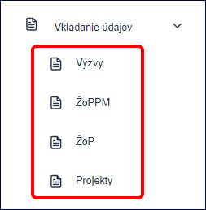
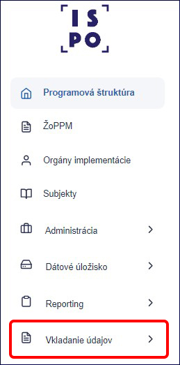

## 8.1) Pridanie výzvy / priameho vyzvania

V menu **Vkladanie údajov** rozklikneme záložku **Výzvy**. Zobrazí sa
zoznam výziev a priamych vyzvaní, ktoré už systém eviduje.

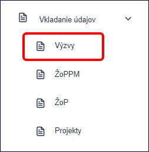

V zozname sa orientujeme cez ***Kód výzvy*** a ***Názov výzvy***. To, či
ide o výzvu alebo priame vyzvanie, vidíme v stĺpci ***Typ***. To, v akom
stave je výzva či priame vyzvanie, vidíme v stĺpci ***Stav***. To, akým
spôsobom sa údaje dostali do ISPO, indikuje stĺpec ***Mód
spracovania***. Pre lepšiu orientáciu v zozname nám pomáha ***Filter***.

Mód spracovania nám hovorí o tom, akým spôsobom sa výzvy, priame
vyzvania ako aj ďalšie údaje dostali do ISPO. Poznáme 3 spôsoby:

1.  Výzvu sme vyhlásili cez ISPO (mód spracovania ISPO)

2.  Výzva / Priame vyzvanie nahralo Centrum podpory ISPO importom
    z excelu podľa ***Prílohy SIPOO č. 5.1 - 2 Vzor monitorovacích
    údajov***, ktoré sme nahrali na Úložisko NIKA (mód spracovania
    Import)

3.  Výzvu / Priame vyzvanie sme pridali cez funkcionalitu **Vkladanie
    údajov** (mód spracovania Import)

Výzvy a priame vyzvania s módom spracovania **ISPO** nie je možné
editovať cez funkcionalitu **Vkladanie údajov**, pretože ich editujeme
priamo v záložke **Výzvy** podľa kapitoly **3)** a **5**).

8.1.1) Pre pridanie výzvy klikneme na tlačidlo **Vytvoriť výzvu**.

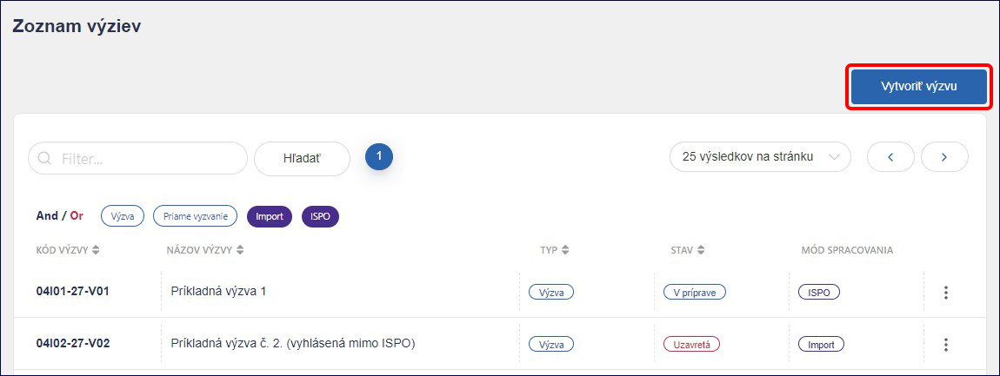

Typ výzvy vyberieme **Štandardná výzva**. Do poľa **Link** vložíme odkaz
na webové znenie vyhlásenej výzvy. Zo zoznamu vyberieme **Komponent**,
**Opatrenie** a **Vykonávateľa**. **Kód výzvy** sa na základe uvedených
údajov vygeneruje automaticky, ale v prípade, že nie je správny, môžeme
ho zmeniť. Ďalej uvedieme **Názov výzvy**.

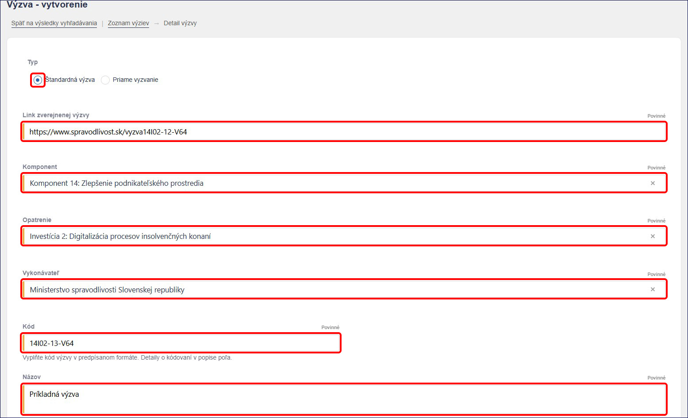

V nasledujúcej časti zo zoznamu vyberieme ***Stav výzvy***, uvedieme
***Dátum vyhlásenia***, ***Predpokladaný dátum uzavretia***, ***Skutočný
dátum uzavretia*** (ak je známy), ***Výšku finančných prostriedkov*** a
***Zostatok finančných prostriedkov*** (ak sú známe). Ku ***Schéme
štátnej pomoci / pomoci de minimis*** a k ***Zjednodušenému vykazovaniu
prostriedkov*** sa môžeme vyjadriť (*áno, nie, netýka sa*). Môžeme
uviesť ***Dátum schválenia záväzného stanoviska NIKA***
a ***Poznámku***. Keď máme všetko potrebné vyplnené, klikneme na
tlačidlo **Pridať**.

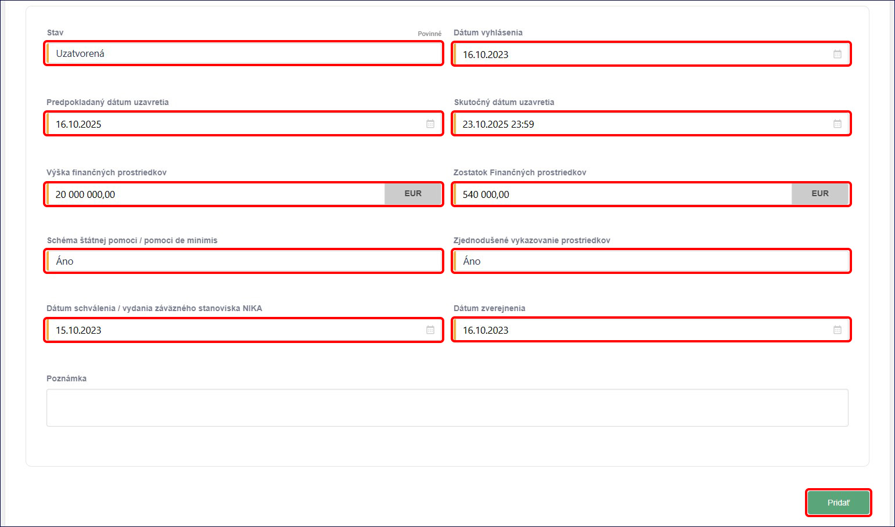

Takto založená výzva sa dostane do zoznamu **Vkladanie údajov - Výzvy**
a kedykoľvek sa k nej môžeme vrátiť a upraviť.

8.1.2) Pre pridanie priameho vyzvania klikneme na tlačidlo **Vytvoriť
výzvu**.

Typ vyberieme **Priame vyzvanie**. Do poľa **Link** vložíme odkaz na
webové znenie priameho vyzvania. Zo zoznamu vyberieme **Komponent**,
**Opatrenie** a **Vykonávateľa**. **Kód** sa na základe uvedených údajov
vygeneruje automaticky, ale v prípade, že nie je správny, môžeme ho
zmeniť. Ďalej uvedieme **Názov priameho vyzvania**.

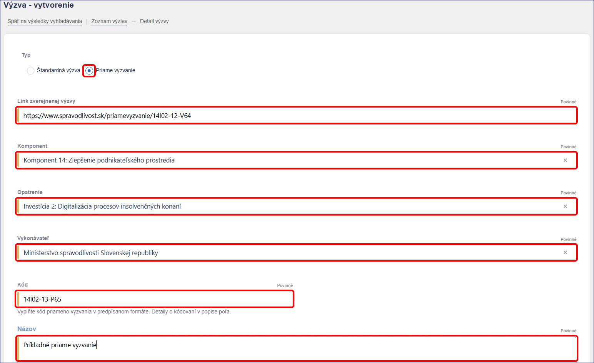

Zo zoznamu vyberieme ***Stav*** priameho vyzvania. V časti
**Prijímateľ** klikneme na tlačidlo **Pridať**. Označíme organizáciu a
do poľa Výber organizácie uvedieme názov alebo IČO organizácie. Systém
ISPO spárovaný s RPO navrhne zoznam organizácií, z ktorých si vyberieme
požadovanú a potvrdíme kliknutím na tlačidlo **Pridať**.

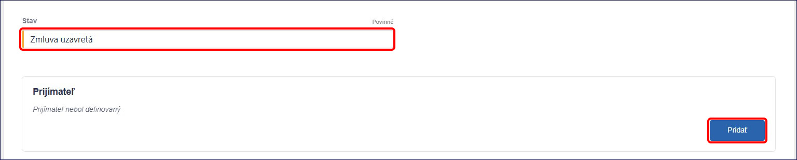

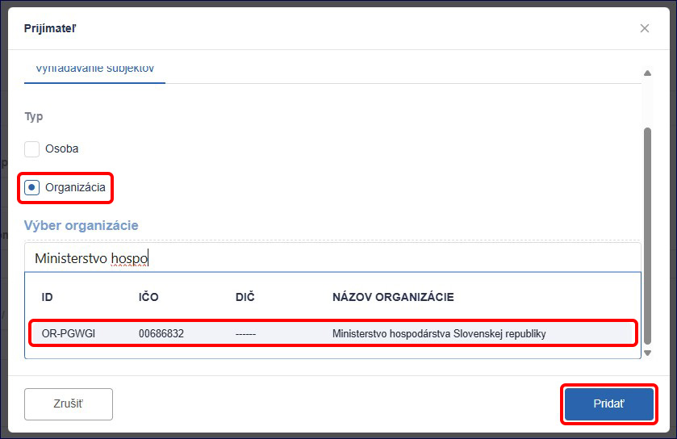

Následne môžeme vyplniť polia ako **Výška finančných prostriedkov**,
**Schéma štátnej pomoci/pomoci de minimis**, **Zjednodušené vykazovanie
prostriedkov** a **Dátum schválenia / vydania záväzného stanoviska
NIKA**. Keď máme všetko potrebné vyplnené, klikneme na tlačidlo
**Pridať**.

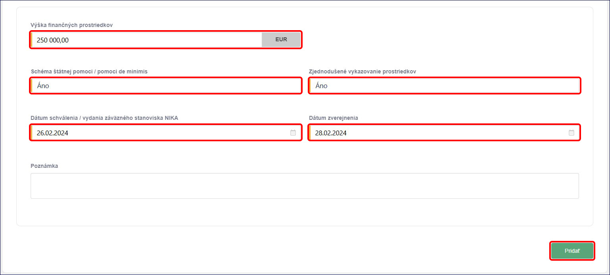

Takto založené priame vyzvanie sa dostane do zoznamu **Vkladanie
údajov - Výzvy** a kedykoľvek sa k nemu môžeme vrátiť a upraviť.

## 8.2) Pridanie ŽoPPM

Pre pridanie ŽoPPM v menu **Vkladanie údajov** rozklikneme záložku
**ŽoPPM**. Zobrazí sa zoznam ŽoPPM, ktoré systém eviduje.

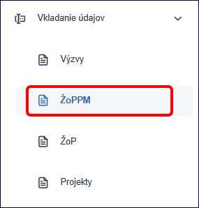

V zozname sa orientujeme pomocou stĺpcov ***Kód žiadosti**, **Kód
výzvy**, **Názov / meno žiadateľa**, **Dátum predloženia žiadosti**,
**Požadovaná suma*** a ***Mód Spracovania*** Pre lepšiu orientáciu
v zozname nám pomáha ***Filter***. Pre pridanie ŽoPPM klikneme na
tlačidlo **Vytvoriť žiadosť**.

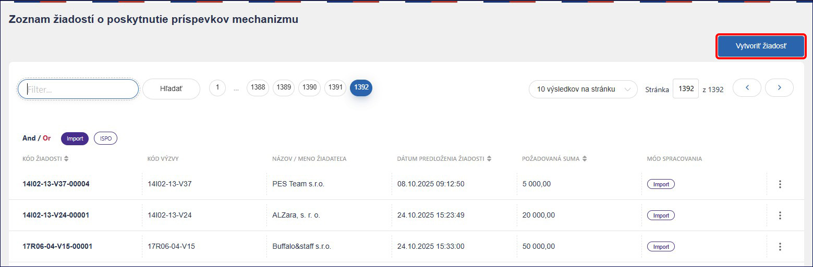

Ak zo zoznamu v poli ***Kód výzvy*** vyberieme výzvu, ***Kód ŽoPPM***
nám systém automaticky vygeneruje. Ak systém kód žiadosti nevygeneruje
alebo nie je správny, môžeme ho upraviť. Následne vyberieme ***Stav***
žiadosti a uvedieme ***Požadovanú sumu*** a ***Dátum predloženia***
***žiadosti***. V časti žiadateľ klikneme na tlačidlo **Pridať**.

**Upozornenie**! *Nie je možné pridať ŽoPPM, ak v systéme nie je
evidovaná výzva. Ak v zozname nenájdeme kód výzvy, ktorý hľadáme, výzva
nie je v systéme evidovaná.*

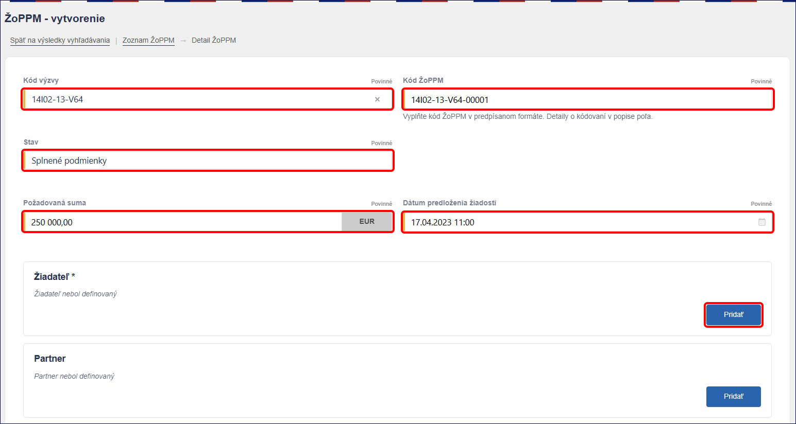

Po kliknutí na tlačidlo **Pridať** vyberieme typ osobu/organizáciu do
poľa **Výber osoby** / **Výber organizácie** uvedieme meno
a priezvisko/názov alebo IČO organizácie. Systém ISPO spárovaný
s RFO/ RPO navrhne zoznam osôb/organizácií, z ktorých si vyberieme
požadovanú a potvrdíme tlačidlom **Pridať**.

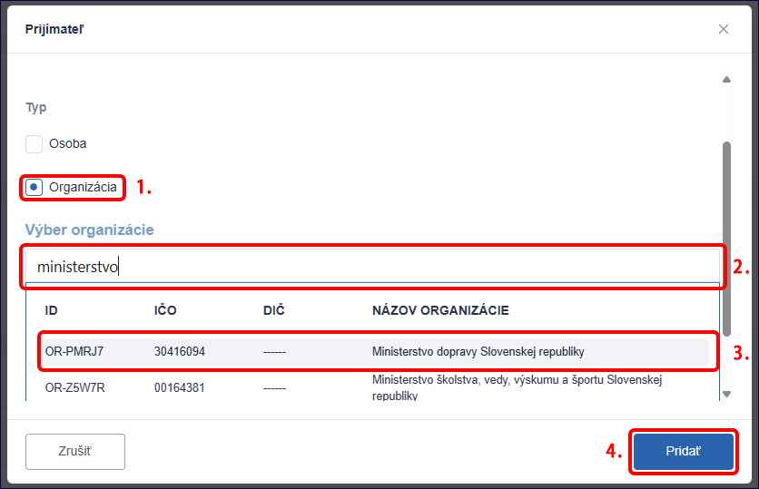

Takto pridaný žiadateľ sa zobrazí v základnom tvare, systém však na
pozadí dotiahne všetky údaje o osobe /organizácii. Rovnakým spôsobom
môžeme pridať aj partnera.

Ďalej môžeme vyplniť polia ako ***Právny predpis, Výsledok***
(splnené/nesplnené podmienky), ***Námet zmluvy zaslaný žiadateľovi***
(áno, nie, netýka sa), ***Poradie, Poznámku*** a môžeme nahrať
***Prílohy***. Keď máme všetko potrebné vyplnené, klikneme na zelené
tlačidlo **Pridať**.

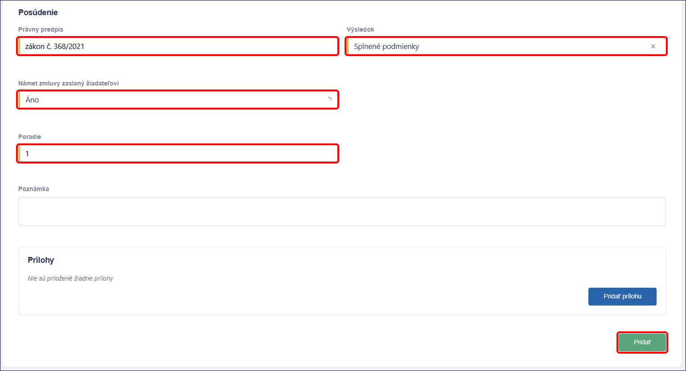

Takto založená ŽoPPM sa dostane do zoznamu **Vkladanie údajov – ŽoPPM**
a kedykoľvek sa k nej môžeme vrátiť a upraviť.

## 8.3) Pridanie Projektu

Pre pridanie projektu v menu **Vkladanie údajov** rozklikneme záložku
**Projekty**. Zobrazí sa zoznam projektov, ktoré systém eviduje.

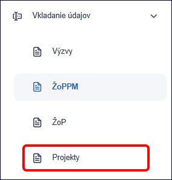

V zozname sa orientujeme pomocou stĺpcov **Kód projektu**, **Názov**,
**Celková suma** a **Mód Spracovania.** Pre lepšiu orientáciu v zozname
nám pomáha **Filter**. Pre pridanie Projektu klikneme na tlačidlo
**Vytvoriť projekt**.

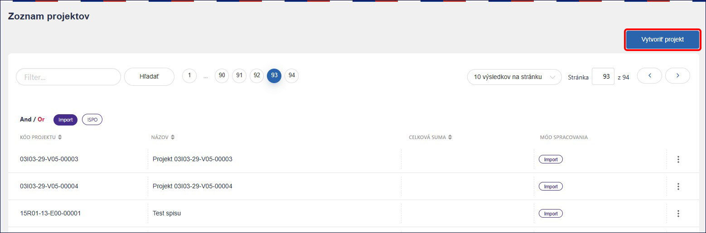

V nasledovných poliach najskôr vyberieme jednu z možností, v závislosti
od toho o aký typ projektu ide:

- ***Kód ŽoPPM***

- ***Kód priameho vyzvania***

- ***Opatrenie***

V prípade, že vytvárame projekt na priame vyzvanie, vyberieme ***Kód
priameho vyzvania*** zo zoznamu, ale <u>NEvyplníme ***Kód ŽoPPM*** ani
***Opatrenie***</u>.

V prípade, že vytvárame projekt na ŽoPPM, vyberieme ***Kód ŽoPPM*** zo
zoznamu, ale <u>NEvyplníme ***Kód priameho vyzvania*** ani
***Opatrenie***.</u>.

**Upozornenie!** *Nie je možné zaevidovať Projekt, ak v systéme nie je
evidovaná ŽoPPM alebo priame vyzvanie, na ktoré chceme projekt pridať.*

V prípade, že vytvárame evidenčný projekt, vyberieme ***Opatrenie*** zo
zoznamu, ale <u>NEvyplníme ***Kód priameho vyzvania*** ani ***Kód
ŽoPPM***</u>.

**Kód projektu** systém automaticky vygeneruje po zvolení jednej
z vyššie uvedených možností. Ak kód projektu systém nevygeneruje alebo
nie je podľa nás správny, môžeme ho upraviť. Následne vyberieme **Stav**
a uvedieme **Názov projektu**.

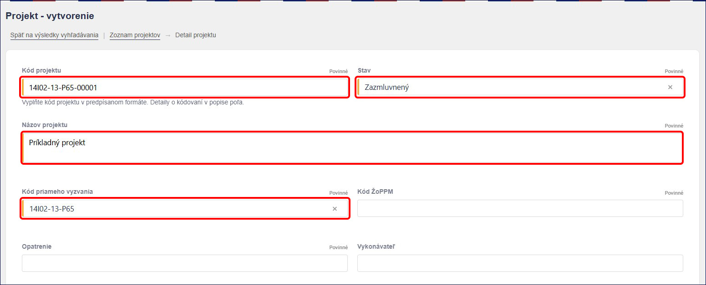

V časti **Výdavky** môžeme vyplniť polia pre sumy ako ***Suma z Plánu
obnovy bez DPH, Čiastka DPH z Plánu obnovy, Suma vlastných zdrojov
žiadateľa, Suma verejných zdrojov okrem zdrojov EÚ*** a ***Suma
verejných zdrojov EÚ***. Následne klikneme na tlačidlo **Prepočítať**
a pole **Celková suma projektu** sa prepočíta automaticky.

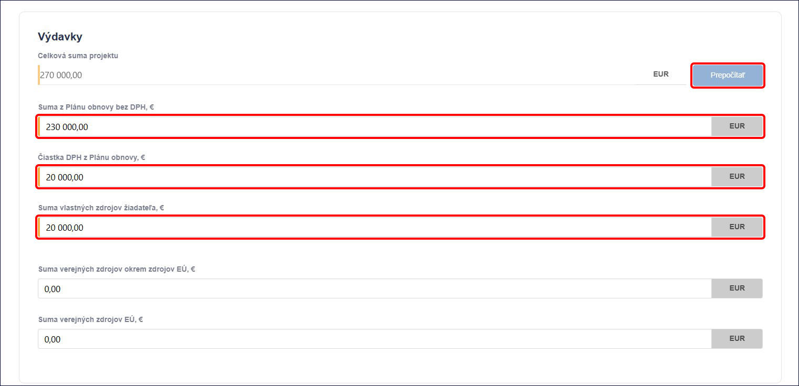

V časti **Zmluva** môžeme vyplniť polia ako ***Číslo zmluvy, Dátum
platnosti zmluvy, Dátum uzavretia zmluvy, Dátum zverejnenia zmluvy
v CRZ*** a ***Link CRZ***.

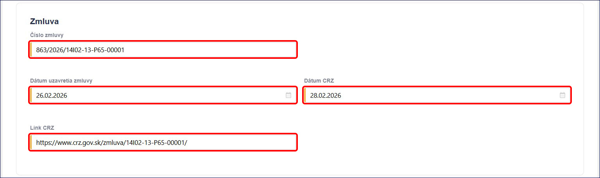

**Upozornenie**! *Pokiaľ sme nastavili stav projektu **Zazmluvnený**,
údaje o zmluve musíme uviesť tiež.*

V časti prijímateľ klikneme na tlačidlo **Pridať**. Systém nám
automaticky navrhne subjekt, ktorý už bol v ŽoPPM alebo v Priamom
vyzvaní pridaný.

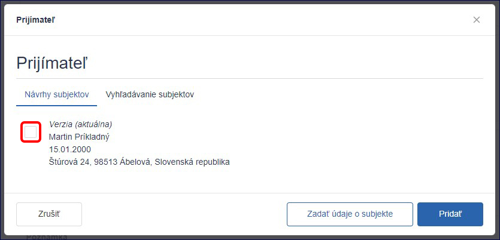

Ak nám navrhnutý subjekt nevyhovuje, alebo vytvárame evidenčný projekt
po kliknutí na tlačidlo pridať osobu/organizáciu a do poľa **Výber
osoby** / **Výber organizácie** uvedieme meno a priezvisko/názov alebo
IČO organizácie. Systém ISPO spárovaný s RFO/ RPO navrhne zoznam
osôb/organizácií, z ktorých si vyberieme požadovanú a potvrdíme
tlačidlom **Pridať**.

Takto pridaný prijímateľ sa zobrazí v základnom tvare, systém však na
pozadí dotiahne všetky údaje o prijímateľovi.

Rovnakým spôsobom môžeme pridať aj partnera.

V časti **Poznámka** môžeme uviesť doplňujúce údaje k projektu. Následne
klikneme na tlačidlo **Pridať**, čím potvrdíme vytvorenie projektu.

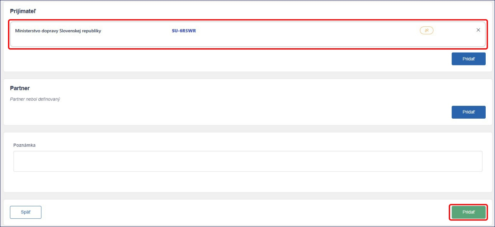

Takto založený projekt sa dostane do zoznamu **Vkladanie údajov -
Projekty** a kedykoľvek sa k nemu môžeme vrátiť a upraviť.

## 8.4) Pridanie ŽoP

Pre pridanie žop v menu **Vkladanie údajov** rozklikneme záložku
**ŽoP**. Zobrazí sa zoznam ŽoP, ktoré systém eviduje.

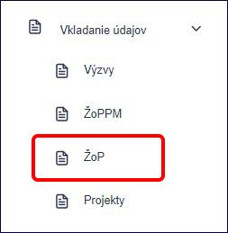

V zozname sa orientujeme pomocou stĺpcov ***Kód žiadosti***, ***Typ,
Dátum predloženia žiadosti, Dátum vyplatenia, Požadovaná suma*** a
***Mód Spracovania.*** Pre lepšiu orientáciu v zozname nám pomáha
**Filter**. Pre pridanie ŽoP klikneme na tlačidlo **Vytvoriť žiadosť**.

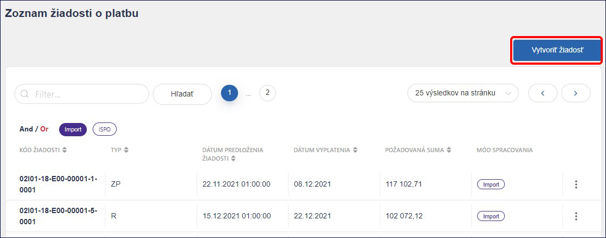

Najskôr zo zoznamu vyberieme **Kód projektu**. Následne vyberieme **Typ
žiadosti o platbu**. Systém automaticky vygeneruje ***Kód ŽoP*** na
základe kódu projektu a typu žiadosti. Ak kód ŽoP systém nevygeneruje
alebo nie je podľa nás správny, vieme ho upraviť.

**Upozornenie!** *Nie je možné pridať ŽoP, ak v systéme nie je evidovaný
Projekt, na ktorý chceme žiadosť o platbu zaevidovať.*

Každý typ ŽoP má svoje číselné označenie. Pre kontrolu ich uvádzame a to
nasledovne:

- 0 – Vrátenie (V)

- 1 – Poskytnutie zálohy (PZ)

- 2 – Zúčtovanie zálohy (ZZ)

- 3 – Poskytnutie predfinancovania (PP)

- 4 – Zúčtovanie predfinancovania (ZP)

- 5 – Priebežná platba / Refundácia (PRP)

Ďalej uvedieme ***Dátum predloženia žiadosti***, môžeme uviesť ***Dátum
vyplatenia žiadosti***. V prípade, že evidujeme zúčtovaciu ŽoP, uvedieme
aj ***Relevanciu k ŽoP*** (kód ŽoP, ktorú ideme zúčtovať).

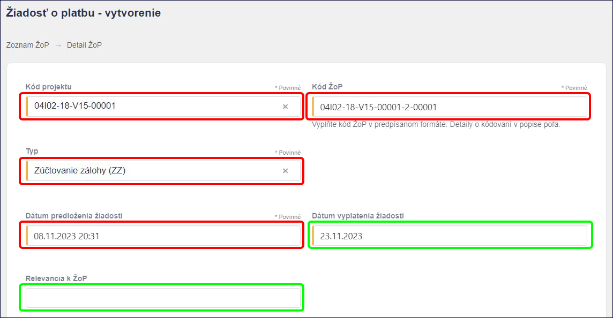

V poliach pre vykázané a vyplatené výdavky vyplníme relevantné sumy ako
***Sumu z plánu obnovy bez DPH, Čiastku DPH*** ***z*** ***Plánu obnovy*,
*Verejné zdroje mimo EÚ, Verejné zdroje EÚ*** a ***Vlastné zdroje**.*
Kliknutím na tlačidlo **Prepočítať** sa automaticky prepočíta suma
**Celkom**. Uviesť môžeme tiež **Neoprávnené výdavky**.

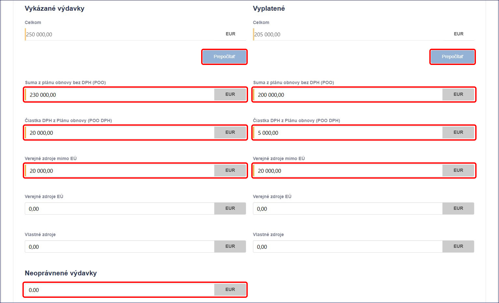

V časti prijímateľ klikneme na tlačidlo **Pridať**. Systém nám
automaticky navrhne subjekt, ktorý už bol pridaný v projekte.

Ak nám navrhnutý subjekt nevyhovuje alebo vytvárame evidenčný projekt,
po kliknutí na tlačidlo pridať osobu/organizáciu a do poľa **Výber
osoby** / **Výber organizácie** uvedieme meno a priezvisko/názov alebo
IČO organizácie. Systém ISPO spárovaný s RFO/ RPO navrhne zoznam
osôb/organizácií, z ktorých si vyberieme požadovanú a potvrdíme
tlačidlom **Pridať**.

Takto pridaný prijímateľ sa zobrazí v základnom tvare, systém však na
pozadí dotiahne všetky údaje o prijímateľovi. Rovnakým spôsobom môžeme
pridať **Dodávateľa** a následne aj **Subdodávateľov**.

V časti **Poznámka** môžeme uviesť doplňujúce údaje k ŽoP. Následne
klikneme na tlačidlo **Pridať**, čím potvrdíme vytvorenie ŽoP.

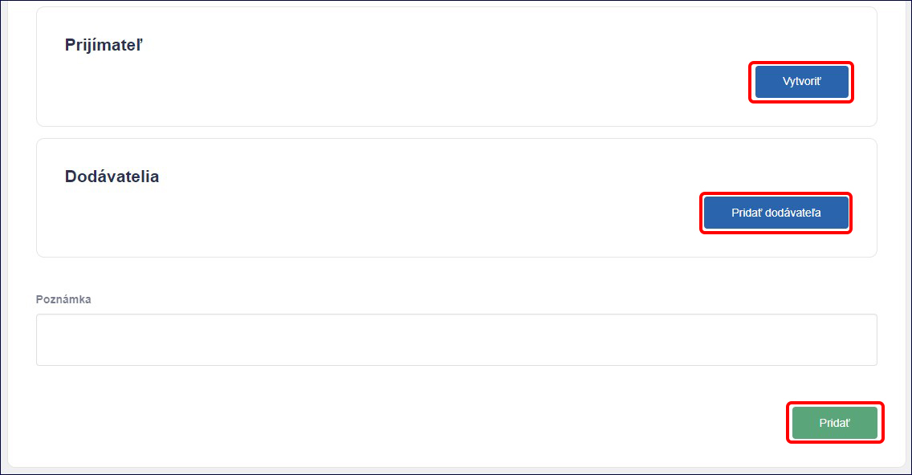

Takto založená ŽoP sa dostane do zoznamu **Vkladanie údajov - ŽoP**
a kedykoľvek sa ku nej môžeme vrátiť a upraviť.